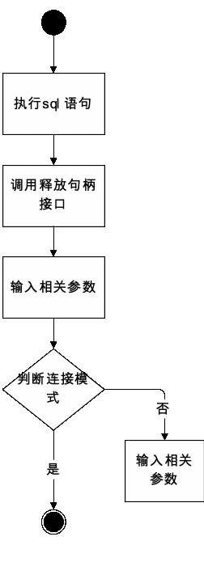
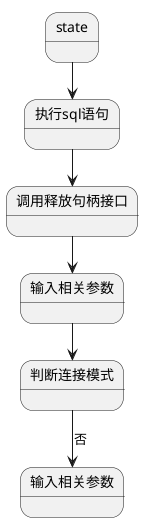
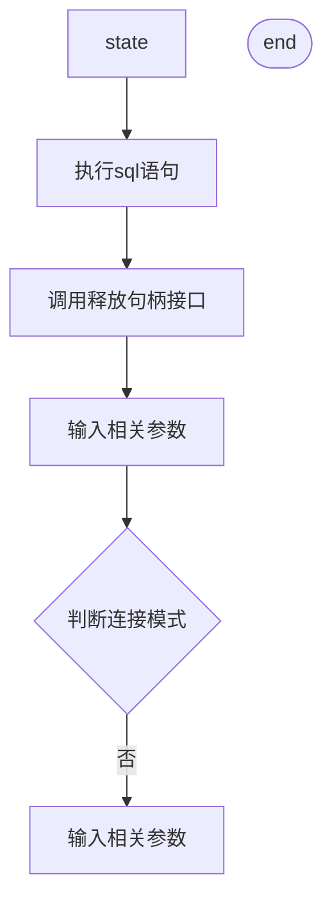

# 2_054 数据对档案

| 字段 | 值 |
|---|---|
| doc | 04数据统一访问服务软件需求规格说明-终稿 |
| section | 3.2.6.1 |
| image_caption | 图 45数据源接入流程图 |
| table_caption | 表46 数据源接入用例描述 |

## 原始图片


*图 45数据源接入流程图*

## 结构图

*来源: born-digital导出(flowchart, 5节点/5边)*
*类型经几何启发式精化(Master类型识别失败的图, 投影层推断, canonical锚点不变)*

*状态图以PlantUML渲染(UML母语): [*]=起止 | 圆角框=状态 | 箭头标签=迁移事件*



<details><summary>Mermaid兼容投影(通用md渲染器可显示)</summary>



</details>

<details><summary>DOT源码(完整语义, graphviz可渲染)</summary>

```dot
digraph G {
  rankdir=TB;
  node [fontname="Microsoft YaHei"];
  N1150 [shape=box, label="执行sql语句"];
  N1148 [shape=ellipse, label="state"];
  N1149 [shape=doublecircle, label="end"];
  N1152 [shape=box, label="输入相关参数"];
  N1151 [shape=box, label="调用释放句柄接口"];
  N1107 [shape=box, label="判断连接模式"];
  N1153 [shape=box, label="输入相关参数"];
  N1107 -> N1153, label="否";
  N1148 -> N1150;
  N1150 -> N1151;
  N1151 -> N1152;
  N1152 -> N1107;
}
```

</details>

### 锚点节点结构

| # | 文本 | 类型 |
|---|---|---|
| 1 | 执行sql语句 | process |
| 2 |   | state |
| 3 |   | end |
| 4 | 输入相关参数 | process |
| 5 | 调用释放句柄接口 | process |
| 6 | 判断连接模式 | gateway |
| 7 | 输入相关参数 | process |

## 表格内容

| Use Case 名称：数据源接入 | Actors：应用软件 |   |
|---|---|---|
| Use Case 名称：数据源接入 | Actors：应用软件 |   |
| 概述：本用例是数据源适配的扩展用例，描述 |   |   |
| 前置条件：数据库连接正常。 |   |   |
| 主事件流 |   |   |
| Actor的动作 | 系统的动作 | 动作约束 （性能、可靠性、容错等） |
| 1.数据库初始化时，应用软件调用数据源接 | 2．依据连接模式加载对应的数据库驱动，加 | 如果无法连接到服务端，提示连接错误。 |
| 异常流E1：系统提示初始化，用例结束。 |   |   |
| 后置条件：无。 |   |   |

## 正文

数据源接入用例场景，见表46所示。
