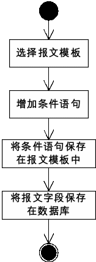
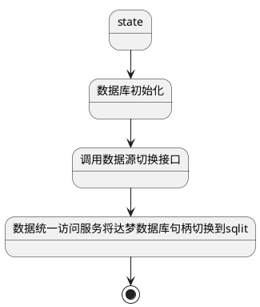
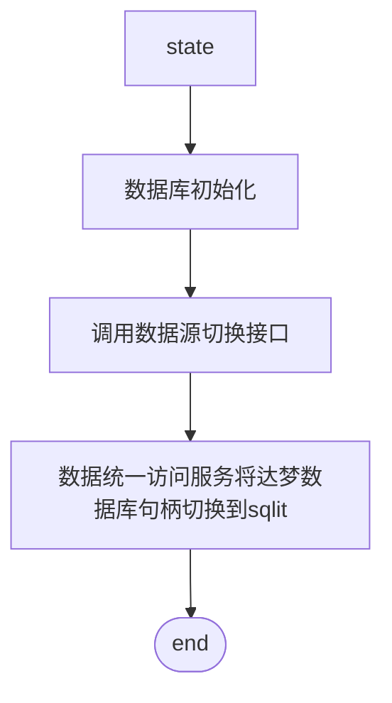
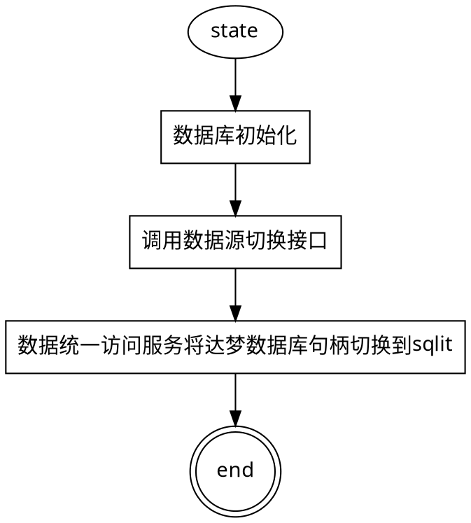

# 2_055 数据对档案

| 字段 | 值 |
|---|---|
| doc | 04数据统一访问服务软件需求规格说明-终稿 |
| section | 3.2.6.2 |
| image_caption | 图 46数据源切换流程图 |

## 原始图片

*图 46数据源切换流程图*

## 结构图

*来源: born-digital导出(flowchart, 3节点/4边)*
*类型经几何启发式精化(Master类型识别失败的图, 投影层推断, canonical锚点不变)*

*状态图以PlantUML渲染(UML母语): [*]=起止 | 圆角框=状态 | 箭头标签=迁移事件*

Mermaid兼容投影(通用md渲染器可显示)

DOT源码(完整语义, graphviz可渲染)

### 锚点节点结构

| # | 文本 | 类型 |
|---|---|---|
| 1 | 数据库初始化 | process |
| 2 |   | state |
| 3 |   | end |
| 4 | 数据统一访问服务将达梦数据库句柄切换到sqlit | process |
| 5 | 调用数据源切换接口 | process |

## 表格内容

| Use Case 名称：数据源切换 | Actors：应用软件 |   |
|---|---|---|
| Use Case 名称：数据源切换 | Actors：应用软件 |   |
| 概述：本用例是数据源适配的扩展用例，描述 |   |   |
| 前置条件：数据库连接正常。 |   |   |
| 主事件流 |   |   |
| Actor的动作 | 系统的动作 | 动作约束 （性能、可靠性、容错等） |
| 1.车上切换到车下时，应用软件调用数据源 | 2．数据统一访问服务将达梦数据库句柄切换 | 数据源切换时间不超过2s。如果无法连接到 |
| 异常流E1：系统提示初始化，用例结束。 |   |   |
| 后置条件：无。 |   |   |

## 正文

数据源切换流程图如图 46所示：
