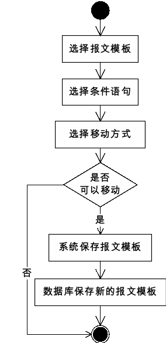
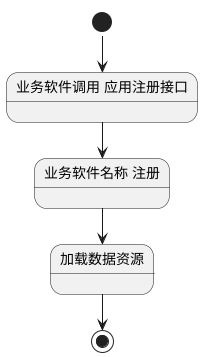
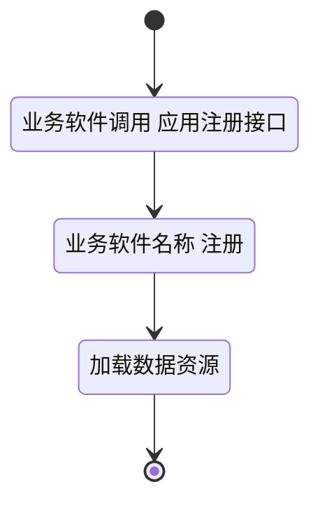
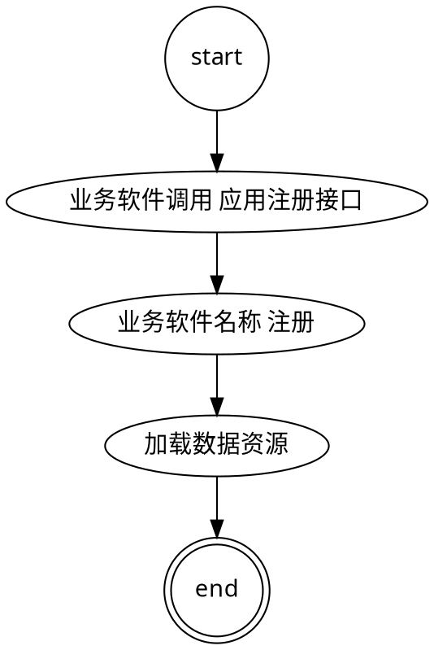

# 2_056 数据对档案

| 字段 | 值 |
|---|---|
| doc | 07报文处理服务软件需求规格说明-终稿 |
| section | 3.2.1.1 |
| image_caption | 图6 应用注册流程图 |
| table_caption | 表4 应用软件注册用例描述 |

## 原始图片

*图6 应用注册流程图*

## 结构图

*来源: born-digital导出(state, 3节点/4边)*
*类型经几何启发式精化(Master类型识别失败的图, 投影层推断, canonical锚点不变)*

*状态图以PlantUML渲染(UML母语): [*]=起止 | 圆角框=状态 | 箭头标签=迁移事件*

Mermaid兼容投影(通用md渲染器可显示)

DOT源码(完整语义, graphviz可渲染)

### 锚点节点结构

| # | 文本 | 类型 |
|---|---|---|
| 1 |   | start |
| 2 |   | end |
| 3 | 业务软件调用
应用注册接口 | state |
| 4 | 业务软件名称
注册 | state |
| 5 | 加载数据资源 | state |

## 表格内容

| Use Case 名称：应用软件注册 | Actors：应用软件、字典数据文件 |   |
|---|---|---|
| Use Case 名称：应用软件注册 | Actors：应用软件、字典数据文件 |   |
| 概述：本用例是应用注册的用例，描述应用软 |   |   |
| 前置条件：报文脚本文件、数据字典文件及报 |   |   |
| 主事件流 |   |   |
| Actor的动作 | 系统的动作 | 动作约束 （性能、可靠性、容错等） |
| 1.应用软件注册报文处理服务，提供注册标 | 2．系统将检测注册标识的合法性，如果软件 | 校验输入参数的合法性 |
| 异常流E1：系统提示注册失败，返回错误信 |   |   |
| 后置条件：无。 |   |   |

## 正文

报文编码为应用软件提供编码应用程序接口，能够将符合模板规则的用户数据结构进行编码，返回符合对应协议标准的比特数据或编码错误信息，满足不同业务数据协议标准要求的数据处理规则。
