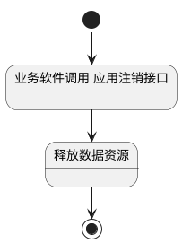
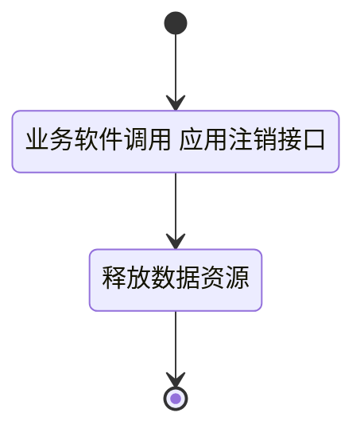
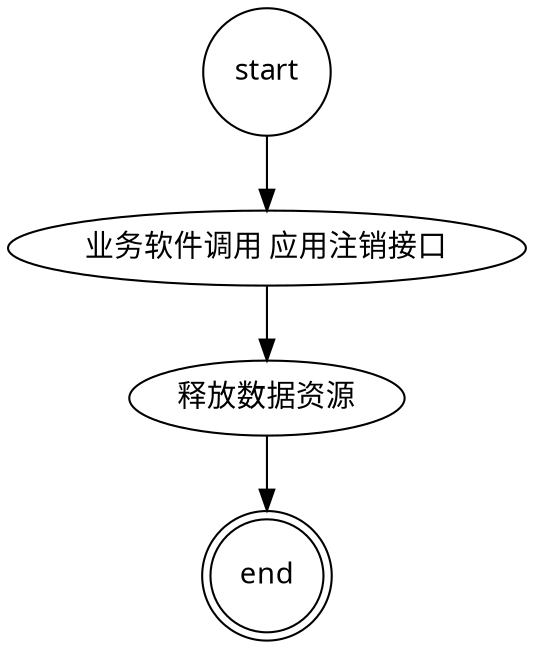

# 2_057 数据对档案

| 字段 | 值 |
|---|---|
| doc | 07报文处理服务软件需求规格说明-终稿 |
| section | 3.2.1.6 |
| image_caption | 图11 应用注销流程图 |
| table_caption | 表14 应用软件注销用例描述 |

## 原始图片

*图11 应用注销流程图*

## 结构图

*来源: born-digital导出(state, 2节点/3边)*

*状态图以PlantUML渲染(UML母语): [*]=起止 | 圆角框=状态 | 箭头标签=迁移事件*

Mermaid兼容投影(通用md渲染器可显示)

DOT源码(完整语义, graphviz可渲染)

### 锚点节点结构

| # | 文本 | 类型 |
|---|---|---|
| 1 |   | start |
| 2 |   | end |
| 3 | 业务软件调用
应用注销接口 | state |
| 4 | 释放数据资源 | state |

## 表格内容

| Use Case 名称：应用软件注销 | Actors：应用软件 |   |
|---|---|---|
| Use Case 名称：应用软件注销 | Actors：应用软件 |   |
| 概述：本用例描述应用软件显示调用注销接口 |   |   |
| 前置条件：报文编解码服务运行正常 |   |   |
| 主事件流 |   |   |
| Actor的动作 | 系统的动作 | 动作约束 （性能、可靠性、容错等） |
| 1.应用软件调用注销接口； | 2.系统释放共享内存、字典数据、模板数据 |   |
| 异常流E1：无。 |   |   |
| 后置条件：无。 |   |   |

## 正文

报文编码为应用软件提供编码应用程序接口，能够将符合模板规则的用户数据结构进行编码，返回符合对应协议标准的比特数据或编码错误信息，满足不同业务数据协议标准要求的数据处理规则。
