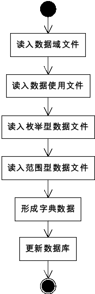
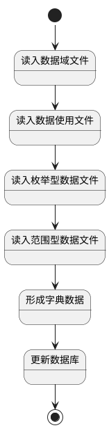
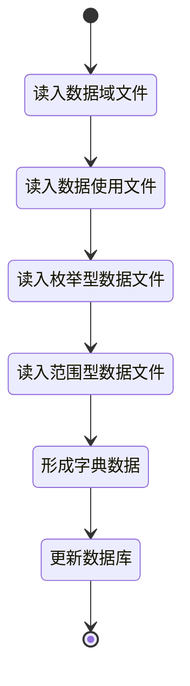
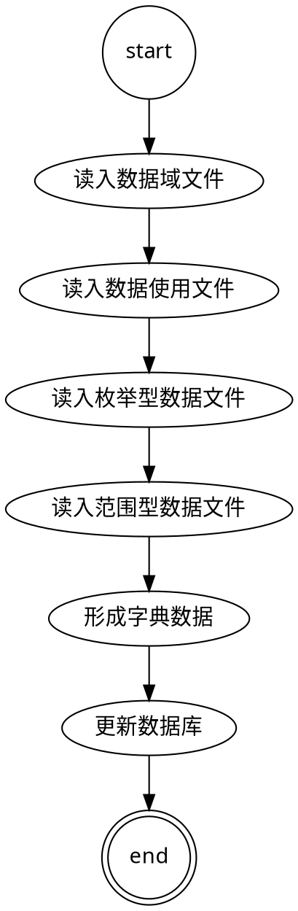

# 2_058 数据对档案

| 字段 | 值 |
|---|---|
| doc | 07报文处理服务软件需求规格说明-终稿 |
| section | 3.2.2.4 |
| image_caption | 图20 数据字典文件导入流程图 |
| table_caption | 表28 数据字典文件导入用例描述 |

## 原始图片

*图20 数据字典文件导入流程图*

## 结构图

*来源: born-digital导出(state, 6节点/7边)*
*类型经几何启发式精化(Master类型识别失败的图, 投影层推断, canonical锚点不变)*

*状态图以PlantUML渲染(UML母语): [*]=起止 | 圆角框=状态 | 箭头标签=迁移事件*

Mermaid兼容投影(通用md渲染器可显示)

DOT源码(完整语义, graphviz可渲染)

### 锚点节点结构

| # | 文本 | 类型 |
|---|---|---|
| 1 | 读入数据域文件 | state |
| 2 | 读入数据使用文件 | state |
| 3 | 读入枚举型数据文件 | state |
| 4 | 读入范围型数据文件 | state |
| 5 | 形成字典数据 | state |
| 6 | 更新数据库 | state |
| 7 |   | end |
| 8 |   | start |

## 表格内容

| Use Case 名称：数据字典文件导入 | Actors：用户、数据库、数据字典文件 |   |
|---|---|---|
| Use Case 名称：数据字典文件导入 | Actors：用户、数据库、数据字典文件 |   |
| 概述：本用例描述使用现有数据字典文件更新 |   |   |
| 前置条件：数据字典管理工具软件运行正常， |   |   |
| 主事件流 |   |   |
| Actor的动作 | 系统的动作 | 动作约束 （性能、可靠性、容错等） |
| 1.用户选择数据字典文件，启动数据字典文 | 2.系统确认导入操作，读取数据字典文件； | 校验输入参数的合法性 |
| 异常流E1：系统给出提示信息，用户根据提 |   |   |
| 后置条件：无。 |   |   |

## 正文

数据字典文件导入提供用户使用现有数据字典文件更新字典数据库的手段，用户选择已有的符合导出格式数据域标识文件、数据使用标识文件、枚举数据文件、范围数据文件执行导入过程，系统将读取文件数据转换为字典数据信息，更新字典数据库，导入流程，如图20所示。
