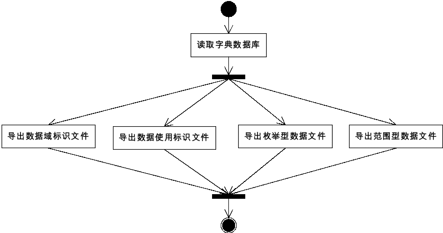
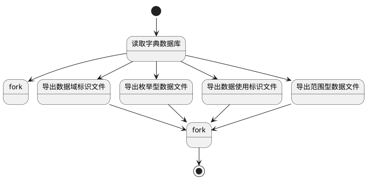
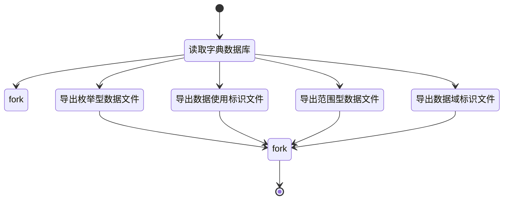
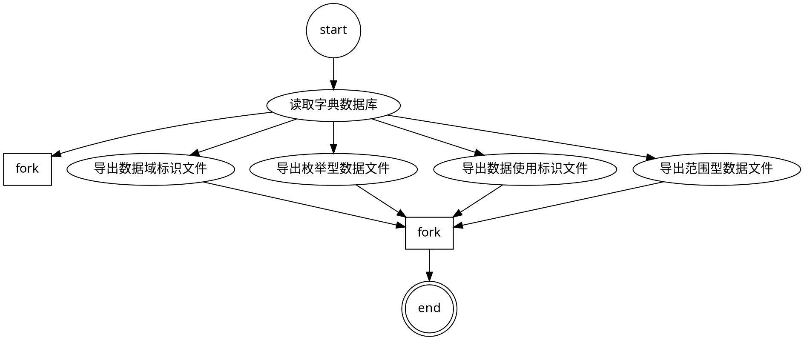

# 2_059 数据对档案

| 字段 | 值 |
|---|---|
| doc | 07报文处理服务软件需求规格说明-终稿 |
| section | 3.2.2.5 |
| image_caption | 图21 数据字典文件导出流程图 |
| table_caption | 表29 数据字典文件导出用例描述 |

## 原始图片

*图21 数据字典文件导出流程图*

## 结构图

*来源: born-digital导出(state, 5节点/11边)*
*类型经几何启发式精化(Master类型识别失败的图, 投影层推断, canonical锚点不变)*

*状态图以PlantUML渲染(UML母语): [*]=起止 | 圆角框=状态 | 箭头标签=迁移事件*

Mermaid兼容投影(通用md渲染器可显示)

DOT源码(完整语义, graphviz可渲染)

### 锚点节点结构

| # | 文本 | 类型 |
|---|---|---|
| 1 |   | fork |
| 2 |   | fork |
| 3 | 读取字典数据库 | state |
| 4 | 导出数据域标识文件 | state |
| 5 | 导出枚举型数据文件 | state |
| 6 | 导出数据使用标识文件 | state |
| 7 | 导出范围型数据文件 | state |
| 8 |   | end |
| 9 |   | start |

## 表格内容

| Use Case 名称：数据字典文件导出 | Actors：用户、数据库、数据字典文件 |   |
|---|---|---|
| Use Case 名称：数据字典文件导出 | Actors：用户、数据库、数据字典文件 |   |
| 概述：本用例描述用户使用数据字典管理工具 |   |   |
| 前置条件：数据字典管理工具软件运行正常， |   |   |
| 主事件流 |   |   |
| Actor的动作 | 系统的动作 | 动作约束 （性能、可靠性、容错等） |
| 1.用户启动数据字典文件导出过程； 4. | 2.系统确认导出操作，连接字典数据库，如 | 校验输入参数的合法性 |
| 异常流E1：系统给出提示信息，用户根据提 |   |   |
| 后置条件：无。 |   |   |

## 正文

报文编解码服务必须依赖数据字典文件才能运行，数据字典文件导出提供用户界面友好的数据字典文件导出操作。用户启动导出过程后，系统能够将当前字典数据导出为数据域标识文件、数据使用标识文件、枚举数据文件、范围数据文件四个数据字典文件，导出流程，如图21所示。
