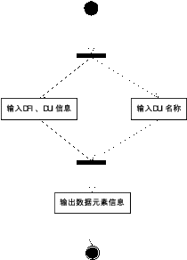
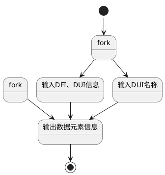
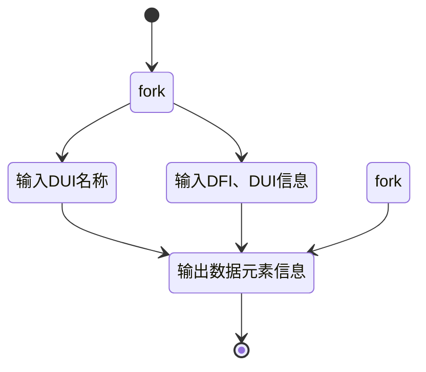
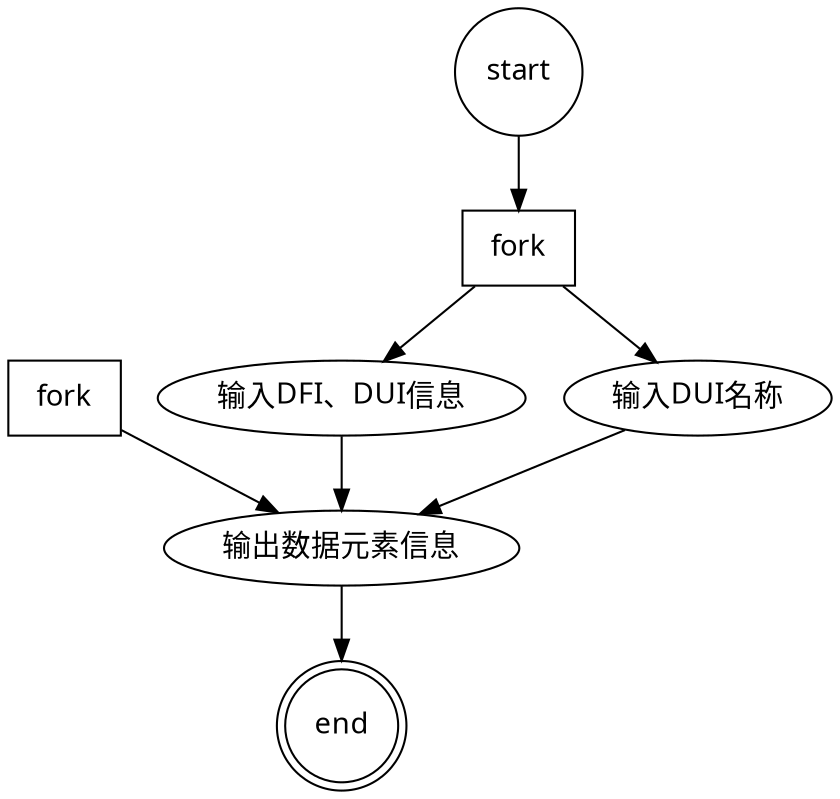

# 2_060 数据对档案

| 字段 | 值 |
|---|---|
| doc | 07报文处理服务软件需求规格说明-终稿 |
| section | 3.2.2.6 |
| image_caption | 图22 数据元素查询流程图 |
| table_caption | 表30 数据元素查询用例描述 |

## 原始图片

*图22 数据元素查询流程图*

## 结构图

*来源: born-digital导出(state, 3节点/7边)*
*类型经几何启发式精化(Master类型识别失败的图, 投影层推断, canonical锚点不变)*

*状态图以PlantUML渲染(UML母语): [*]=起止 | 圆角框=状态 | 箭头标签=迁移事件*

Mermaid兼容投影(通用md渲染器可显示)

DOT源码(完整语义, graphviz可渲染)

### 锚点节点结构

| # | 文本 | 类型 |
|---|---|---|
| 1 |   | fork |
| 2 |   | fork |
| 3 | 输入DFI、DUI信息 | state |
| 4 | 输入DUI名称 | state |
| 5 | 输出数据元素信息 | state |
| 6 |   | end |
| 7 |   | start |

## 表格内容

| Use Case 名称：数据字典文件导出 | Actors：用户、数据库、数据字典文件 |   |
|---|---|---|
| Use Case 名称：数据字典文件导出 | Actors：用户、数据库、数据字典文件 |   |
| 概述：本用例描述用户使用数据字典管理工具 |   |   |
| 前置条件：数据字典管理工具软件运行正常， |   |   |
| 主事件流 |   |   |
| Actor的动作 | 系统的动作 | 动作约束 （性能、可靠性、容错等） |
| 1.用户输入DFI、DUI信息，启动查询 | 2.系统确认查询操作，读取数据库，如果读 | 校验输入参数的合法性 |
| 异常流E1：系统给出提示信息，用户根据提 |   |   |
| 后置条件：无。 |   |   |

## 正文

数据元素新增提供用户向数据字典中添加数据元素的手段，主要包括新增数据域标识和数据使用标识功能，其功能用例如图14所示。
