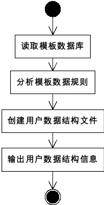
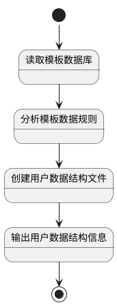
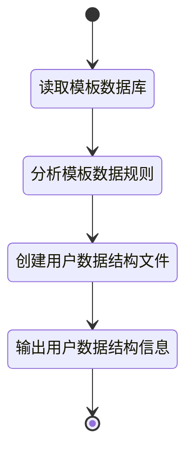
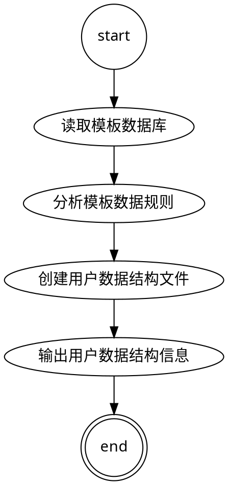

# 2_061 数据对档案

| 字段 | 值 |
|---|---|
| doc | 07报文处理服务软件需求规格说明-终稿 |
| section | 3.2.3.1 |
| image_caption | 图24 用户数据结构导出流程图 |
| table_caption | 表32 用户数据结构导出用例描述 |

## 原始图片

*图24 用户数据结构导出流程图*

## 结构图

*来源: born-digital导出(state, 4节点/5边)*
*类型经几何启发式精化(Master类型识别失败的图, 投影层推断, canonical锚点不变)*

*状态图以PlantUML渲染(UML母语): [*]=起止 | 圆角框=状态 | 箭头标签=迁移事件*

Mermaid兼容投影(通用md渲染器可显示)

DOT源码(完整语义, graphviz可渲染)

### 锚点节点结构

| # | 文本 | 类型 |
|---|---|---|
| 1 |   | end |
| 2 |   | start |
| 3 | 读取模板数据库 | state |
| 4 | 分析模板数据规则 | state |
| 5 | 创建用户数据结构文件 | state |
| 6 | 输出用户数据结构信息 | state |

## 表格内容

| Use Case 名称：用户数据结构导出 | Actors：用户、数据库、报文头文件 |   |
|---|---|---|
| Use Case 名称：用户数据结构导出 | Actors：用户、数据库、报文头文件 |   |
| 概述：本用例是描述用户使用模板管理工具导 |   |   |
| 前置条件：报文模板管理工具软件运行正常， |   |   |
| 主事件流 |   |   |
| Actor的动作 | 系统的动作 | 动作约束 （性能、可靠性、容错等） |
| 1.用户启动文件导出过程； 4.数据库提 | 2.系统确认导出操作，连接模板数据库，如 | 文件导出顺序固定，头文件须在脚本文件存在 |
| 异常流E1：系统给出提示信息，用户根据提 |   |   |
| 后置条件：无。 |   |   |

## 正文

模板脚本文件导出支持用户通过模板管理工具导出模板脚本文件，为报文编解码服务提供业务支持，其流程如图25所示。
