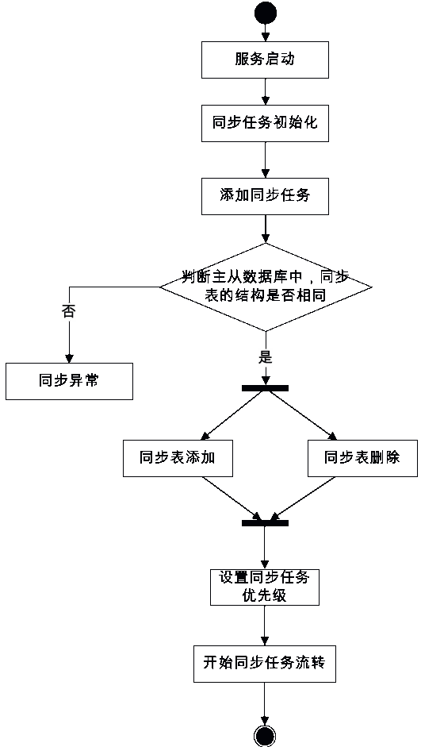
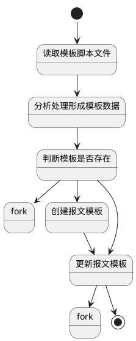
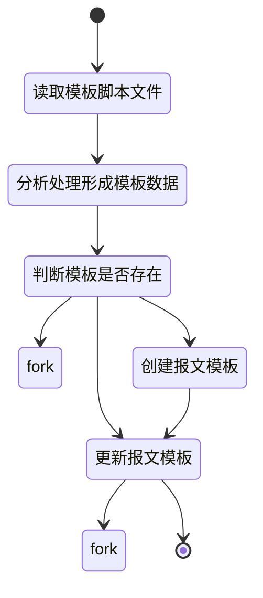
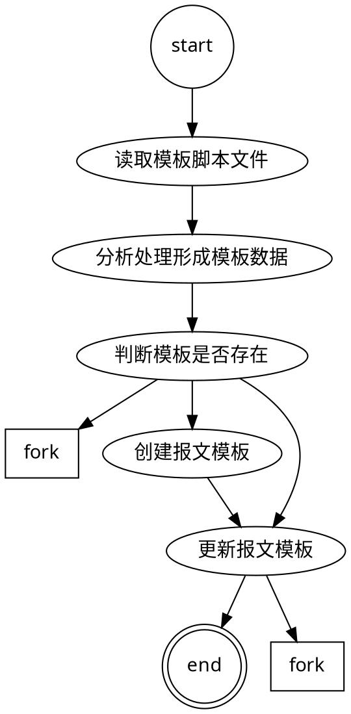

# 2_063 数据对档案

| 字段 | 值 |
|---|---|
| doc | 07报文处理服务软件需求规格说明-终稿 |
| section | 3.2.3.3 |
| image_caption | 图26 报文脚本文件导入流程图 |
| table_caption | 表34 报文脚本文件导入用例描述 |

## 原始图片

*图26 报文脚本文件导入流程图*

## 结构图

*来源: born-digital导出(state, 5节点/9边)*
*类型经几何启发式精化(Master类型识别失败的图, 投影层推断, canonical锚点不变)*

*状态图以PlantUML渲染(UML母语): [*]=起止 | 圆角框=状态 | 箭头标签=迁移事件*

Mermaid兼容投影(通用md渲染器可显示)

DOT源码(完整语义, graphviz可渲染)

### 锚点节点结构

| # | 文本 | 类型 |
|---|---|---|
| 1 |   | end |
| 2 |   | start |
| 3 | 读取模板脚本文件 | state |
| 4 | 分析处理形成模板数据 | state |
| 5 | 判断模板是否存在 | state |
| 6 |   | fork |
| 7 | 创建报文模板 | state |
| 8 | 更新报文模板 | state |
| 9 |   | fork |

## 表格内容

| Use Case 名称：模板脚本文件导入 | Actors：用户、数据库、报文头文件 |   |
|---|---|---|
| Use Case 名称：模板脚本文件导入 | Actors：用户、数据库、报文头文件 |   |
| 概述：本用例是描述导入模板脚本文件更新或 |   |   |
| 前置条件：报文模板管理工具软件运行正常， |   |   |
| 主事件流 |   |   |
| Actor的动作 | 系统的动作 | 动作约束 （性能、可靠性、容错等） |
| 1.用户选择模板脚本文件，启动文件导入过 | 2.系统读取模板脚本文件，如果读取文件失 | 文件导出顺序固定，头文件须在脚本文件存在 |
| 异常流E1：系统给出提示信息，用户根据提 |   |   |
| 后置条件：无。 |   |   |

## 正文

用户数据结构导出支持用户通过模板管理工具导出业务应用程序使用的结构文件，为软件开发提供支持，其业务流程如图24所示。
