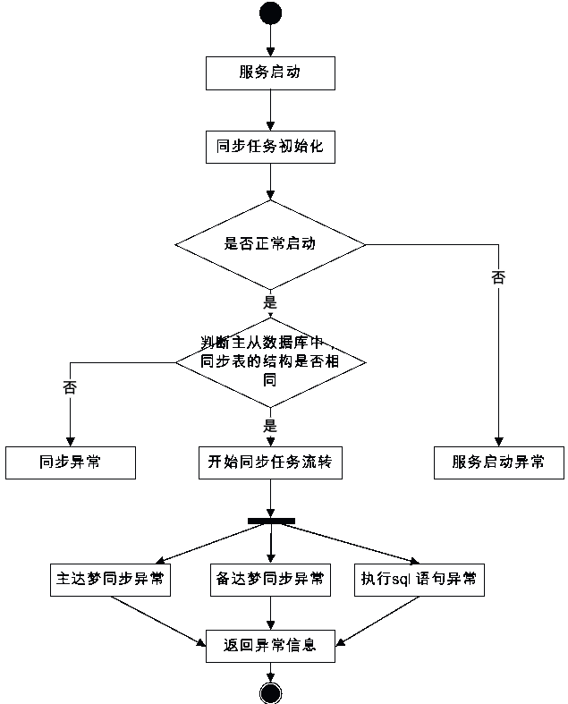
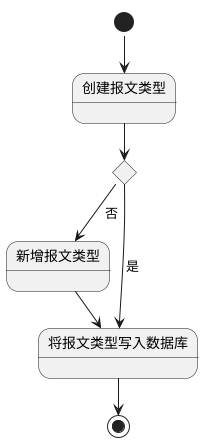
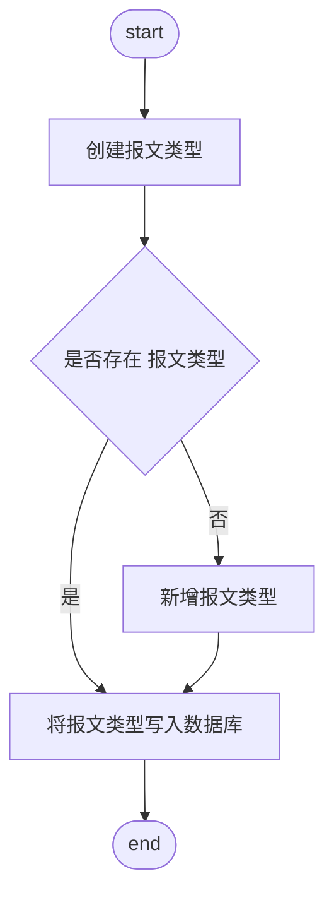

# 2_064 数据对档案

| 字段 | 值 |
|---|---|
| doc | 07报文处理服务软件需求规格说明-终稿 |
| section | 3.2.3.4 |
| image_caption | 图28 报文类型新增流程图 |
| table_caption | 表36 报文类型新增用例描述 |

## 原始图片


*图28 报文类型新增流程图*

## 结构图

*来源: born-digital导出(flowchart, 4节点/6边)*
*类型经几何启发式精化(Master类型识别失败的图, 投影层推断, canonical锚点不变)*

*状态图以PlantUML渲染(UML母语): [*]=起止 | 圆角框=状态 | 箭头标签=迁移事件*



<details><summary>Mermaid兼容投影(通用md渲染器可显示)</summary>



</details>

<details><summary>DOT源码(完整语义, graphviz可渲染)</summary>

```dot
digraph G {
  rankdir=TB;
  node [fontname="Microsoft YaHei"];
  N1079 [shape=circle, label="start"];
  N1080 [shape=box, label="新增报文类型"];
  N1081 [shape=ellipse, label="创建报文类型"];
  N1089 [shape=doublecircle, label="end"];
  N1096 [shape=box, label="将报文类型写入数据库"];
  N1099 [shape=diamond, label="是否存在 报文类型"];
  N1099 -> N1080, label="否";
  N1099 -> N1096, label="是";
  N1079 -> N1081;
  N1081 -> N1099;
  N1080 -> N1096;
  N1096 -> N1089;
}
```

</details>

### 锚点节点结构

| # | 文本 | 类型 |
|---|---|---|
| 1 |   | start |
| 2 | 新增报文类型 | process |
| 3 | 创建报文类型 | state |
| 4 |   | end |
| 5 | 将报文类型写入数据库 | process |
| 6 | 是否存在
报文类型 | decision |

## 表格内容

| Use Case 名称：报文类型新增 | Actors：用户、数据库 |   |
|---|---|---|
| Use Case 名称：报文类型新增 | Actors：用户、数据库 |   |
| 概述：本用例描述用户通过报文模板管理工具 |   |   |
| 前置条件：报文模板管理工具软件运行正常， |   |   |
| 主事件流 |   |   |
| Actor的动作 | 系统的动作 | 动作约束 （性能、可靠性、容错等） |
| 1.用户新建报文类型； 4.数据库保存数 | 2.系统判断报文类型合法性，如果输入类型 |   |
| 异常流E1：系统给出提示信息，用户根据提 |   |   |
| 后置条件：无。 |   |   |

## 正文

报文模板新增支持用户使用报文模板管理工具创建新的报文模板，报文模板是用户结构文件和模板脚本文件的依据，是比特数据和用户数据的连接，报文模板编辑功能的用例图见图27。
