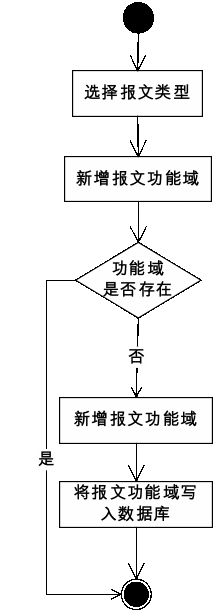
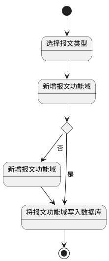
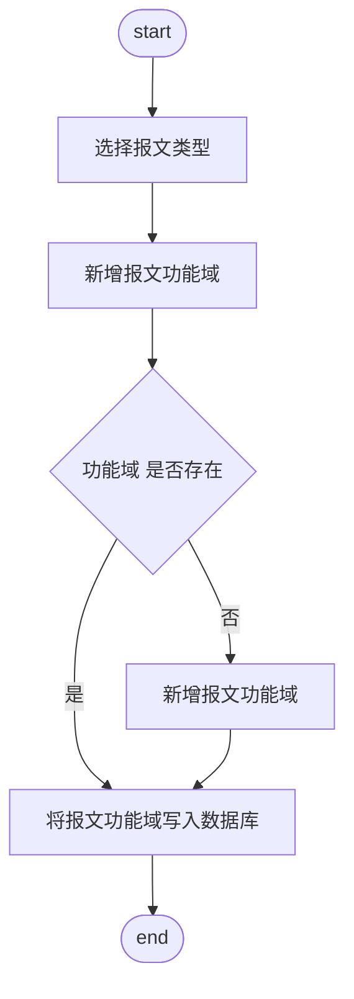

# 2_065 数据对档案

| 字段 | 值 |
|---|---|
| doc | 07报文处理服务软件需求规格说明-终稿 |
| section | 3.2.3.4 |
| image_caption | 图29 报文功能域新增流程图 |
| table_caption | 表37 报文功能域新增用例描述 |

## 原始图片


*图29 报文功能域新增流程图*

## 结构图

*来源: born-digital导出(flowchart, 5节点/7边)*
*类型经几何启发式精化(Master类型识别失败的图, 投影层推断, canonical锚点不变)*

*状态图以PlantUML渲染(UML母语): [*]=起止 | 圆角框=状态 | 箭头标签=迁移事件*



<details><summary>Mermaid兼容投影(通用md渲染器可显示)</summary>



</details>

<details><summary>DOT源码(完整语义, graphviz可渲染)</summary>

```dot
digraph G {
  rankdir=TB;
  node [fontname="Microsoft YaHei"];
  N1102 [shape=circle, label="start"];
  N1103 [shape=box, label="新增报文功能域"];
  N1104 [shape=ellipse, label="选择报文类型"];
  N1112 [shape=doublecircle, label="end"];
  N1118 [shape=box, label="将报文功能域写入数据库"];
  N1121 [shape=ellipse, label="新增报文功能域"];
  N1127 [shape=diamond, label="功能域 是否存在"];
  N1127 -> N1118, label="是";
  N1127 -> N1103, label="否";
  N1121 -> N1127;
  N1102 -> N1104;
  N1103 -> N1118;
  N1118 -> N1112;
  N1104 -> N1121;
}
```

</details>

### 锚点节点结构

| # | 文本 | 类型 |
|---|---|---|
| 1 |   | start |
| 2 | 新增报文功能域 | process |
| 3 | 选择报文类型 | state |
| 4 |   | end |
| 5 | 将报文功能域写入数据库 | process |
| 6 | 新增报文功能域 | state |
| 7 | 功能域
是否存在 | decision |

## 表格内容

| Use Case 名称：报文功能域新增 | Actors：用户、数据库 |   |
|---|---|---|
| Use Case 名称：报文功能域新增 | Actors：用户、数据库 |   |
| 概述：本用例描述用户通过报文模板管理工具 |   |   |
| 前置条件：报文模板管理工具软件运行正常， |   |   |
| 主事件流 |   |   |
| Actor的动作 | 系统的动作 | 动作约束 （性能、可靠性、容错等） |
| 1.用户选择报文类型，并添加功能域编号； | 2.系统判断报文功能域编号合法性，如果输 |   |
| 异常流E1：系统给出提示信息，用户根据提 |   |   |
| 后置条件：无。 |   |   |

## 正文

报文模板新增支持用户使用报文模板管理工具创建新的报文模板，报文模板是用户结构文件和模板脚本文件的依据，是比特数据和用户数据的连接，报文模板编辑功能的用例图见图27。
