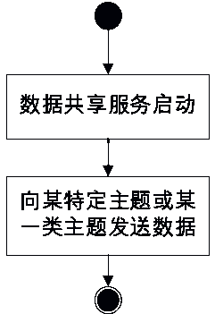
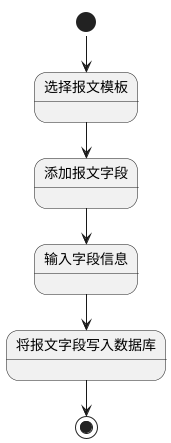
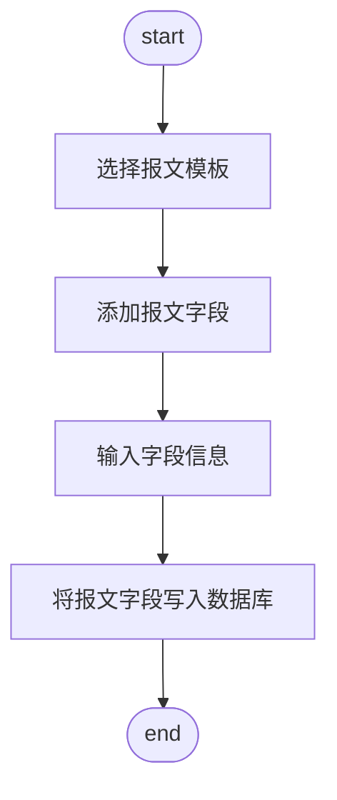
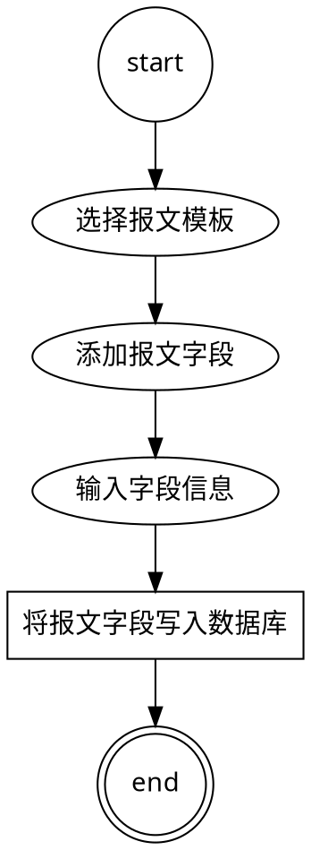

# 2_068 数据对档案

| 字段 | 值 |
|---|---|
| doc | 07报文处理服务软件需求规格说明-终稿 |
| section | 3.2.3.5 |
| image_caption | 图33增加数据项流程图 |
| table_caption | 表41 增加数据项用例描述 |

## 原始图片

*图33增加数据项流程图*

## 结构图

*来源: born-digital导出(flowchart, 4节点/5边)*
*类型经几何启发式精化(Master类型识别失败的图, 投影层推断, canonical锚点不变)*

*状态图以PlantUML渲染(UML母语): [*]=起止 | 圆角框=状态 | 箭头标签=迁移事件*

Mermaid兼容投影(通用md渲染器可显示)

DOT源码(完整语义, graphviz可渲染)

### 锚点节点结构

| # | 文本 | 类型 |
|---|---|---|
| 1 |   | start |
| 2 | 选择报文模板 | state |
| 3 |   | end |
| 4 | 将报文字段写入数据库 | process |
| 5 | 添加报文字段 | state |
| 6 | 输入字段信息 | state |

## 表格内容

| Use Case 名称：增加数据项 | Actors：用户、数据库 |   |
|---|---|---|
| Use Case 名称：增加数据项 | Actors：用户、数据库 |   |
| 概述：本用例描述用户通过管理工具为报文模 |   |   |
| 前置条件：报文模板管理工具软件运行正常， |   |   |
| 主事件流 |   |   |
| Actor的动作 | 系统的动作 | 动作约束 （性能、可靠性、容错等） |
| 1.用户选择报文模板，并选择字段信息；  | 2.系统判断填写信息合法性，如果输入类型 | 校验输入参数的合法性 |
| 异常流E1：系统给出提示信息，用户根据提 |   |   |
| 后置条件：无。 |   |   |

## 正文

用户数据结构导出支持用户通过模板管理工具导出业务应用程序使用的结构文件，为软件开发提供支持，其业务流程如图24所示。
