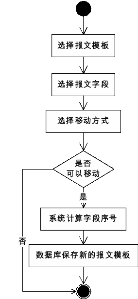
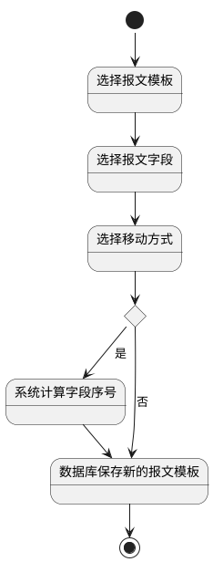
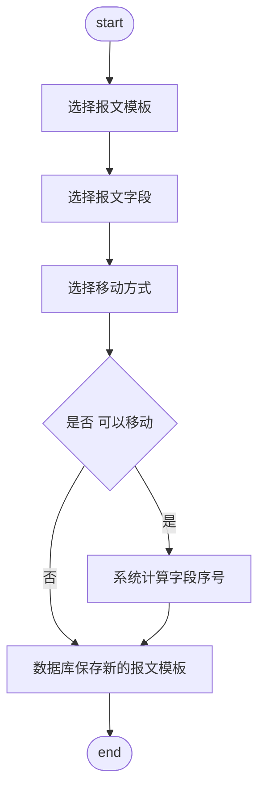

# 2_070 数据对档案

| 字段 | 值 |
|---|---|
| doc | 07报文处理服务软件需求规格说明-终稿 |
| section | 3.2.3.5 |
| image_caption | 图35调整数据项顺序流程图 |
| table_caption | 表43 调整数据项顺序用例描述 |

## 原始图片


*图35调整数据项顺序流程图*

## 结构图

*来源: born-digital导出(flowchart, 6节点/8边)*
*类型经几何启发式精化(Master类型识别失败的图, 投影层推断, canonical锚点不变)*

*状态图以PlantUML渲染(UML母语): [*]=起止 | 圆角框=状态 | 箭头标签=迁移事件*



<details><summary>Mermaid兼容投影(通用md渲染器可显示)</summary>



</details>

<details><summary>DOT源码(完整语义, graphviz可渲染)</summary>

```dot
digraph G {
  rankdir=TB;
  node [fontname="Microsoft YaHei"];
  N1329 [shape=circle, label="start"];
  N1330 [shape=ellipse, label="选择报文模板"];
  N1334 [shape=doublecircle, label="end"];
  N1336 [shape=box, label="系统计算字段序号"];
  N1337 [shape=ellipse, label="选择报文字段"];
  N1342 [shape=box, label="选择移动方式"];
  N1348 [shape=box, label="数据库保存新的报文模板"];
  N1353 [shape=diamond, label="是否 可以移动"];
  N1353 -> N1348, label="否";
  N1353 -> N1336, label="是";
  N1348 -> N1334;
  N1336 -> N1348;
  N1329 -> N1330;
  N1330 -> N1337;
  N1337 -> N1342;
  N1342 -> N1353;
}
```

</details>

### 锚点节点结构

| # | 文本 | 类型 |
|---|---|---|
| 1 |   | start |
| 2 | 选择报文模板 | state |
| 3 |   | end |
| 4 | 系统计算字段序号 | process |
| 5 | 选择报文字段 | state |
| 6 | 选择移动方式 | process |
| 7 | 数据库保存新的报文模板 | process |
| 8 | 是否
可以移动 | decision |

## 表格内容

| Use Case 名称：调整数据项顺序 | Actors：用户、数据库 |   |
|---|---|---|
| Use Case 名称：调整数据项顺序 | Actors：用户、数据库 |   |
| 概述：本用例描述用户通过报文模板管理工具 |   |   |
| 前置条件：报文模板管理工具软件运行正常， |   |   |
| 主事件流 |   |   |
| Actor的动作 | 系统的动作 | 动作约束 （性能、可靠性、容错等） |
| 1.用户选择报文模板； 3.用户选择报文 | 2.系统显示报文信息； 4.系统判断是否 | 校验输入参数的合法性 |
| 异常流E1：系统给出提示信息，用户根据提 |   |   |
| 后置条件：无。 |   |   |

## 正文

用户数据结构导出支持用户通过模板管理工具导出业务应用程序使用的结构文件，为软件开发提供支持，其业务流程如图24所示。
