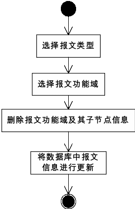
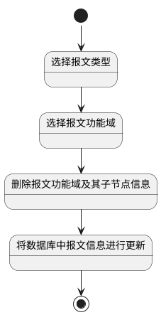
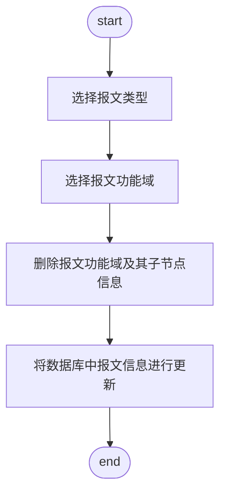
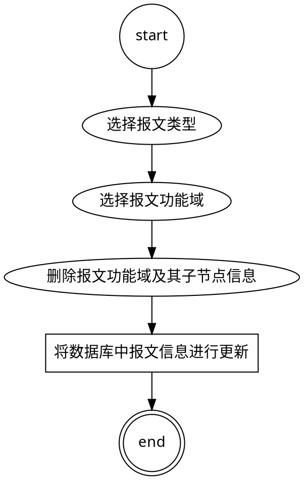

# 2_077 数据对档案

| 字段 | 值 |
|---|---|
| doc | 07报文处理服务软件需求规格说明-终稿 |
| section | 3.2.3.6 |
| image_caption | 图43 删除指定报文流程图 |
| table_caption | 表51 删除指定报文用例描述 |

## 原始图片

*图43 删除指定报文流程图*

## 结构图

*来源: born-digital导出(flowchart, 4节点/5边)*
*类型经几何启发式精化(Master类型识别失败的图, 投影层推断, canonical锚点不变)*

*状态图以PlantUML渲染(UML母语): [*]=起止 | 圆角框=状态 | 箭头标签=迁移事件*

Mermaid兼容投影(通用md渲染器可显示)

DOT源码(完整语义, graphviz可渲染)

### 锚点节点结构

| # | 文本 | 类型 |
|---|---|---|
| 1 |   | start |
| 2 | 选择报文类型 | state |
| 3 |   | end |
| 4 | 删除报文功能域及其子节点信息 | state |
| 5 | 将数据库中报文信息进行更新 | process |
| 6 | 选择报文功能域 | state |

## 表格内容

| Use Case 名称：删除指定报文 | Actors：用户、数据库 |   |
|---|---|---|
| Use Case 名称：删除指定报文 | Actors：用户、数据库 |   |
| 概述：本用例描述用户通过报文模板管理工具 |   |   |
| 前置条件：报文模板管理工具软件运行正常， |   |   |
| 主事件流 |   |   |
| Actor的动作 | 系统的动作 | 动作约束 （性能、可靠性、容错等） |
| 1.用户选择要删除的报文编号； 4.数据 | 2.系统删除指定报文； 3.系统更新的报 |   |
| 异常流E1：无。 |   |   |
| 后置条件：无。 |   |   |

## 正文

用户数据结构导出支持用户通过模板管理工具导出业务应用程序使用的结构文件，为软件开发提供支持，其业务流程如图24所示。
