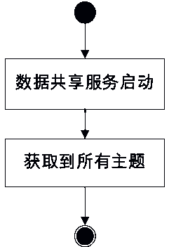
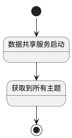
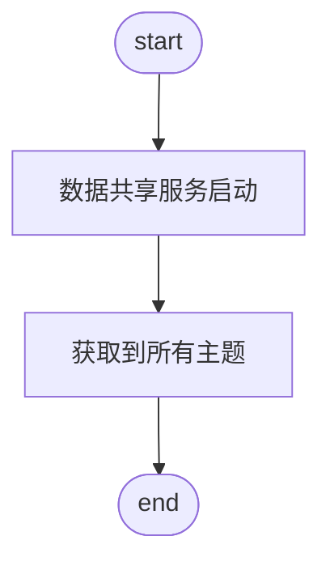
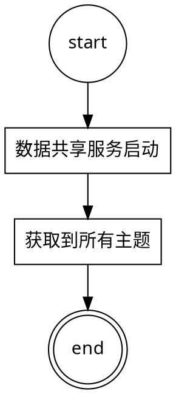

# 2_078 数据对档案

| 字段 | 值 |
|---|---|
| doc | 09数据同步共享服务软件需求规格说明-终稿 |
| section | 3.2.2.1 |
| image_caption | 图 24 获取主题流程图 |
| table_caption | 表 35获取主题用例描述 |

## 原始图片

*图 24 获取主题流程图*

## 结构图

*来源: born-digital导出(flowchart, 2节点/3边)*

*状态图以PlantUML渲染(UML母语): [*]=起止 | 圆角框=状态 | 箭头标签=迁移事件*

Mermaid兼容投影(通用md渲染器可显示)

DOT源码(完整语义, graphviz可渲染)

### 锚点节点结构

| # | 文本 | 类型 |
|---|---|---|
| 1 | 数据共享服务启动 | process |
| 2 | 获取到所有主题 | process |
| 3 |   | start |
| 4 |   | end |

## 表格内容

| Use Case 名称：获取主题 | Actors：应用软件 |   |
|---|---|---|
| Use Case 名称：获取主题 | Actors：应用软件 |   |
| 概述：本用例主要实现获取资源池中所有资源 |   |   |
| 前置条件：数据共享服务正常启动。 |   |   |
| 主事件流 |   |   |
| Actor的动作 | 系统的动作 | 动作约束 （性能、可靠性、容错等） |
| 1. 初始化数据共享服务，并保证初始化成 | 3.系统会获取消息队列中订阅的所有主题， |   |
| 异常流E1：系统提示失败，用例结束。 |   |   |
| 后置条件：无。 |   |   |

## 正文

数据共享中的获取主题功能为上层应用提供获取资源池中所有资源主题的功能。获取主题流程图如图 24所示。
