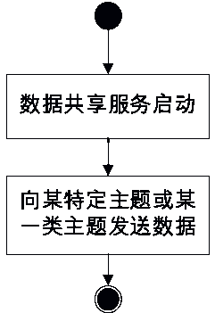
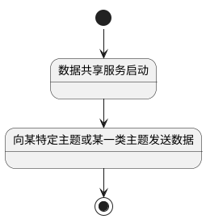
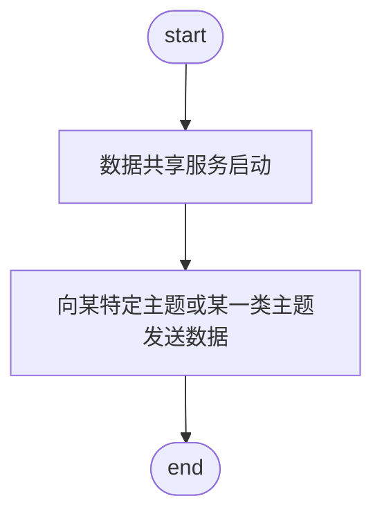
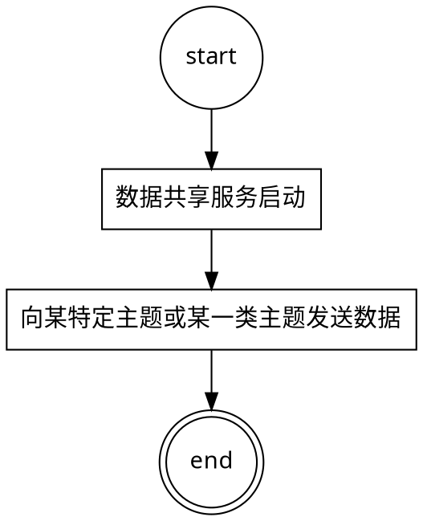

# 2_079 数据对档案

| 字段 | 值 |
|---|---|
| doc | 09数据同步共享服务软件需求规格说明-终稿 |
| section | 3.2.2.2 |
| image_caption | 图 25 数据发送流程图 |
| table_caption | 表 36数据发布用例描述 |

## 原始图片

*图 25 数据发送流程图*

## 结构图

*来源: born-digital导出(flowchart, 2节点/3边)*

*状态图以PlantUML渲染(UML母语): [*]=起止 | 圆角框=状态 | 箭头标签=迁移事件*

Mermaid兼容投影(通用md渲染器可显示)

DOT源码(完整语义, graphviz可渲染)

### 锚点节点结构

| # | 文本 | 类型 |
|---|---|---|
| 1 | 数据共享服务启动 | process |
| 2 | 向某特定主题或某一类主题发送数据 | process |
| 3 |   | start |
| 4 |   | end |

## 表格内容

| Use Case 名称：数据发布 | Actors：应用软件、统一传输服务 |   |
|---|---|---|
| Use Case 名称：数据发布 | Actors：应用软件、统一传输服务 |   |
| 概述：本用例主要实现数据共享下的数据发布 |   |   |
| 前置条件：数据共享服务正常启动。 |   |   |
| 主事件流 |   |   |
| Actor的动作 | 系统的动作 | 动作约束 （性能、可靠性、容错等） |
| 1.初始化数据共享服务，并保证初始化成功 | 3．系统会通过后台消息队列传输接口，以覆 |   |
| 异常流E1：系统提示失败，用例结束。 |   |   |
| 后置条件：无。 |   |   |

## 正文

数据共享中的数据发送功能为上层应用提供基于主题的数据发送接口。数据发送流程图如图 25所示。
