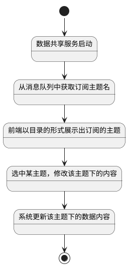
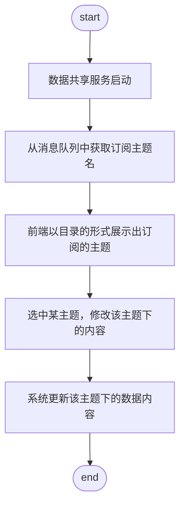
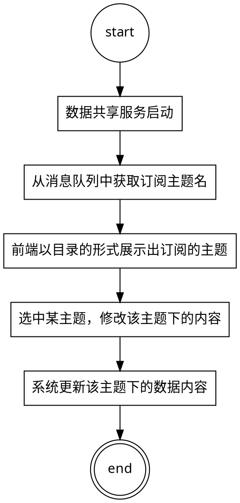

# 2_082 数据对档案

| 字段 | 值 |
|---|---|
| doc | 09数据同步共享服务软件需求规格说明-终稿 |
| section | 3.2.3.2 |
| image_caption | 图 29 数据资源目录修改功能流程图 |
| table_caption | 表 40数据资源修改用例描述 |

## 原始图片

*图 29 数据资源目录修改功能流程图*

## 结构图

*来源: born-digital导出(flowchart, 5节点/6边)*
*类型经几何启发式精化(Master类型识别失败的图, 投影层推断, canonical锚点不变)*

*状态图以PlantUML渲染(UML母语): [*]=起止 | 圆角框=状态 | 箭头标签=迁移事件*

Mermaid兼容投影(通用md渲染器可显示)

DOT源码(完整语义, graphviz可渲染)

### 锚点节点结构

| # | 文本 | 类型 |
|---|---|---|
| 1 | 从消息队列中获取订阅主题名 | process |
| 2 | 前端以目录的形式展示出订阅的主题 | process |
| 3 | 数据共享服务启动 | process |
| 4 |   | start |
| 5 |   | end |
| 6 | 选中某主题，修改该主题下的内容 | process |
| 7 | 系统更新该主题下的数据内容 | process |

## 表格内容

| Use Case 名称：数据资源修改 | Actors：用户、统一传输服务 |   |
|---|---|---|
| Use Case 名称：数据资源修改 | Actors：用户、统一传输服务 |   |
| 概述：本用例主要实现数据资源的修改功能 |   |   |
| 前置条件：数据共享服务正常启动。 |   |   |
| 主事件流 |   |   |
| Actor的动作 | 系统的动作 | 动作约束 （性能、可靠性、容错等） |
| 1.初始化数据共享服务，并保证初始化成功 | 2．选中某主题，修改该主题下的内容； 3 |   |
| 异常流E1：系统提示失败，用例结束。 |   |   |
| 后置条件：无。 |   |   |

## 正文

数据资源目录展现功能为用户提供数据资源的呈现展示功能，用户可以查看所有注册成功的主题名称，并支持模糊查找。
