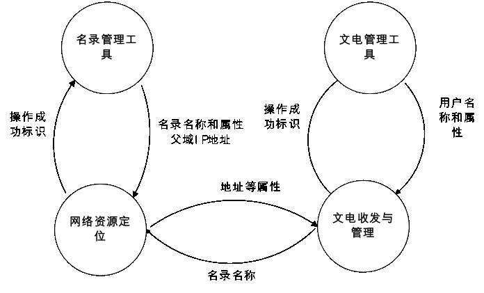
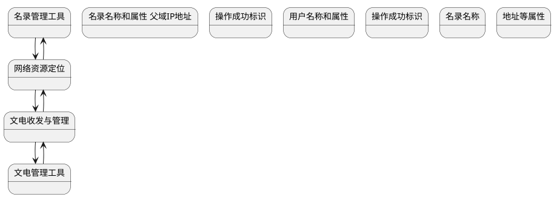
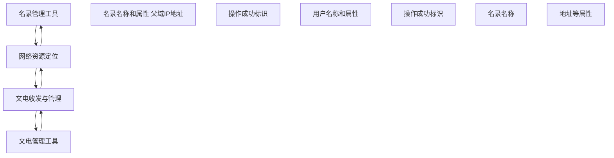
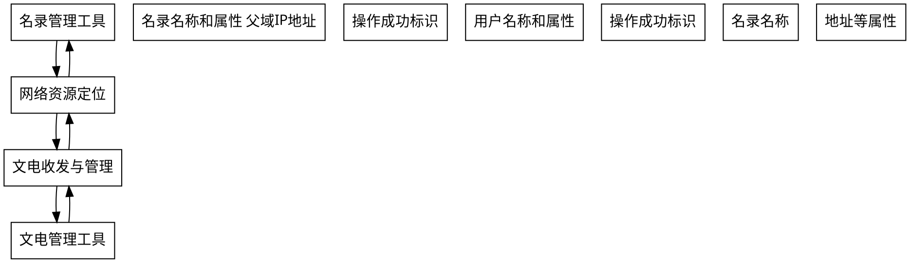

# 2_084 数据对档案

| 字段 | 值 |
|---|---|
| doc | 12文电处理需求规格说明-终端 |
| section | 3.2.2.1 |
| image_caption | 图 7 用户登录的流程图 |
| table_caption | 表 8 用户登录和退出用例描述 |

## 原始图片

*图 7 用户登录的流程图*

## 结构图

*⚠ 结构经VLM文本匹配重对齐: 旧锚点(oleObject2.bin:page1.xml)与图片不符, 已切换到与image.png内容一致的锚点(oleObject7.bin:page1.xml, align_score=1.0)*

*来源: born-digital导出(flowchart, 10节点/6边)*
*类型经几何启发式精化(Master类型识别失败的图, 投影层推断, canonical锚点不变)*

*状态图以PlantUML渲染(UML母语): [*]=起止 | 圆角框=状态 | 箭头标签=迁移事件*

Mermaid兼容投影(通用md渲染器可显示)

DOT源码(完整语义, graphviz可渲染)

### 锚点节点结构

| # | 文本 | 类型 |
|---|---|---|
| 1 | 名录管理工具 | process |
| 2 | 文电收发与管理 | process |
| 3 | 名录名称和属性
父域IP地址 | other |
| 4 | 文电管理工具 | process |
| 5 | 操作成功标识 | other |
| 6 | 用户名称和属性 | other |
| 7 | 操作成功标识 | other |
| 8 | 名录名称 | other |
| 9 | 地址等属性 | other |
| 10 | 网络资源定位 | process |

## 表格内容

| Use Case 名称：用户登录和退出 | Actors：用户 |   |
|---|---|---|
| Use Case 名称：用户登录和退出 | Actors：用户 |   |
| 概述：支持用户登录和退出 |   |   |
| 前置条件：文电处理正常启动，文电客户端页 |   |   |
| 主事件流 |   |   |
| Actor的动作 | 系统的动作 | 动作约束 （性能、可靠性、容错等） |
| 1.用户通过文电客户端页面输入用户名或密 | 2.根据用户收到的用户账号和密码，以及机 | 校验用户名和密码的合法性，并在错误发生时 |
| 异常流E1：能够处理用户填写信息时发生的 |   |   |
| 后置条件：无。 |   |   |

## 正文

用户登录和退出的流程图如图 7、图 8所示。
