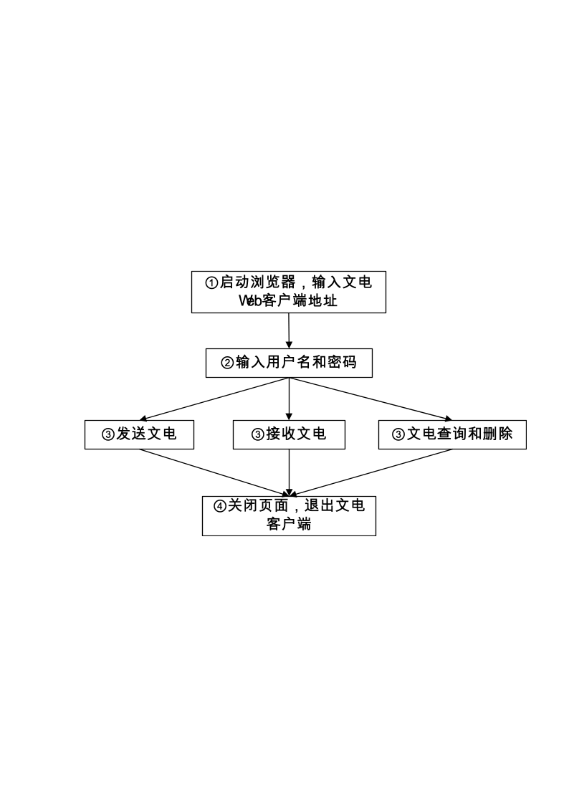
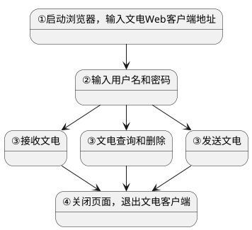
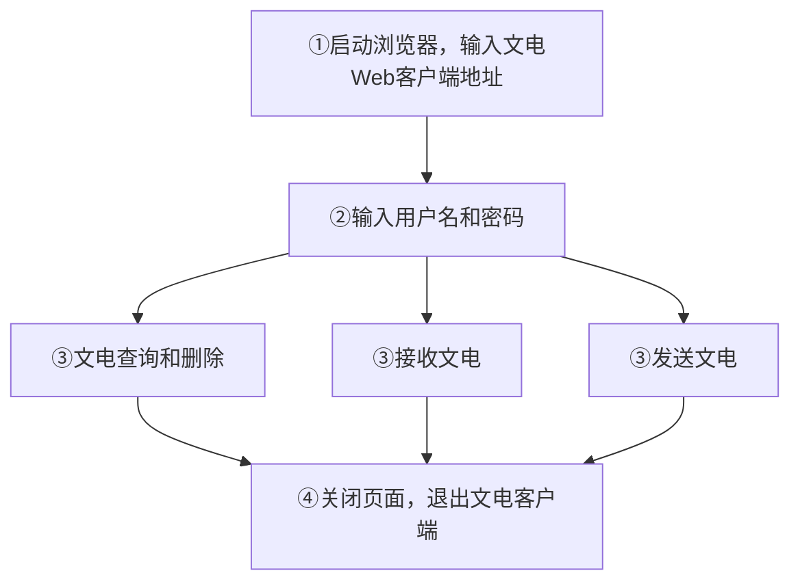
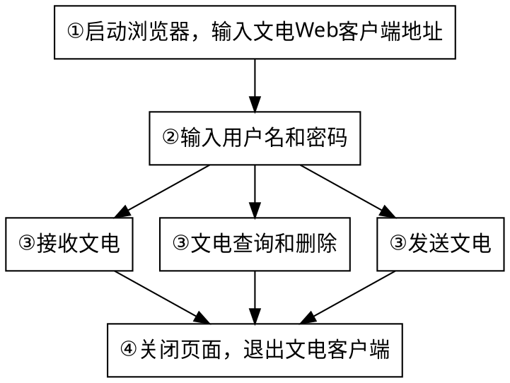

# 2_085 数据对档案

| 字段 | 值 |
|---|---|
| doc | 12文电处理需求规格说明-终端 |
| section | 3.2.2.1 |
| image_caption | 图 8  用户退出的流程图 |
| table_caption | 表 8 用户登录和退出用例描述 |

## 原始图片

*图 8  用户退出的流程图*

## 结构图

*来源: born-digital导出(flowchart, 6节点/7边)*
*类型经几何启发式精化(Master类型识别失败的图, 投影层推断, canonical锚点不变)*

*状态图以PlantUML渲染(UML母语): [*]=起止 | 圆角框=状态 | 箭头标签=迁移事件*

Mermaid兼容投影(通用md渲染器可显示)

DOT源码(完整语义, graphviz可渲染)

*⚠ 锚点Connect重建存在6个悬空连线端点(线端粘在无文本形状上被语义过滤跳过), 图示边数可能少于原图——渲染只呈现锚点事实, 不编造边; 独立证据可对照VLM通道提取(scene_vlm_extractions.json)*

### 锚点节点结构

| # | 文本 | 类型 |
|---|---|---|
| 1 | ①启动浏览器，输入文电Web客户端地址 | process |
| 2 | ②输入用户名和密码 | process |
| 3 | ④关闭页面，退出文电客户端 | process |
| 4 | ③接收文电 | process |
| 5 | ③文电查询和删除 | process |
| 6 | ③发送文电 | process |

## 表格内容

| Use Case 名称：用户登录和退出 | Actors：用户 |   |
|---|---|---|
| Use Case 名称：用户登录和退出 | Actors：用户 |   |
| 概述：支持用户登录和退出 |   |   |
| 前置条件：文电处理正常启动，文电客户端页 |   |   |
| 主事件流 |   |   |
| Actor的动作 | 系统的动作 | 动作约束 （性能、可靠性、容错等） |
| 1.用户通过文电客户端页面输入用户名或密 | 2.根据用户收到的用户账号和密码，以及机 | 校验用户名和密码的合法性，并在错误发生时 |
| 异常流E1：能够处理用户填写信息时发生的 |   |   |
| 后置条件：无。 |   |   |

## 正文

用户登录和退出的流程图如图 7、图 8所示。
