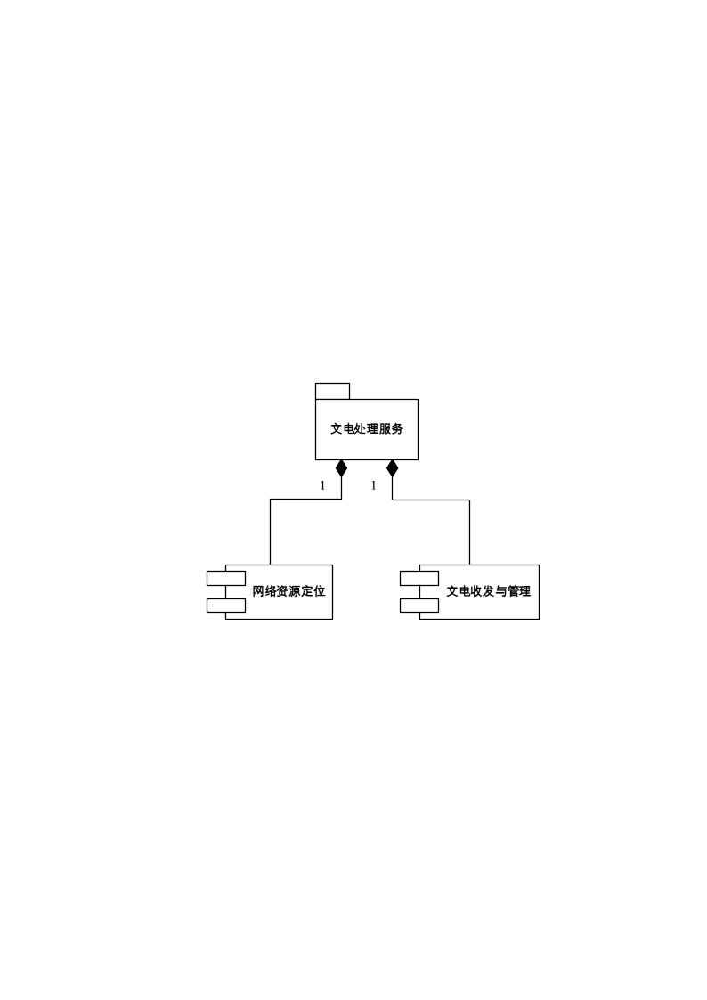
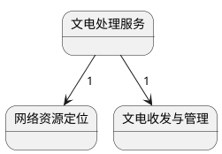
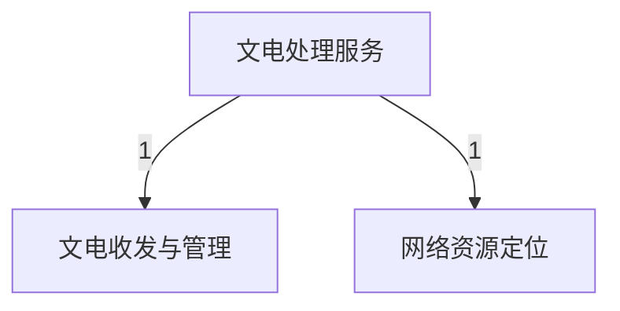

# 2_086 数据对档案

| 字段 | 值 |
|---|---|
| doc | 12文电处理需求规格说明-终端 |
| section | 3.2.2.2 |
| image_caption | 图 9  文电发送的流程图 |
| table_caption | 表 9 文电发送用例描述 |

## 原始图片


*图 9  文电发送的流程图*

## 结构图

*来源: born-digital导出(flowchart, 3节点/2边)*
*类型经几何启发式精化(Master类型识别失败的图, 投影层推断, canonical锚点不变)*

*状态图以PlantUML渲染(UML母语): [*]=起止 | 圆角框=状态 | 箭头标签=迁移事件*



<details><summary>Mermaid兼容投影(通用md渲染器可显示)</summary>



</details>

<details><summary>DOT源码(完整语义, graphviz可渲染)</summary>

```dot
digraph G {
  rankdir=TB;
  node [fontname="Microsoft YaHei"];
  N625 [shape=box, label="文电处理服务"];
  N628 [shape=box, label="网络资源定位"];
  N663 [shape=box, label="文电收发与管理"];
  N625 -> N663, label="1";
  N625 -> N628, label="1";
}
```

</details>

### 锚点节点结构

| # | 文本 | 类型 |
|---|---|---|
| 1 | 文电处理服务 | process |
| 2 | 网络资源定位 | process |
| 3 | 文电收发与管理 | process |

## 表格内容

| Use Case 名称：文电发送 | Actors：用户 |   |
|---|---|---|
| Use Case 名称：文电发送 | Actors：用户 |   |
| 概述：将文电投递到接收方用户的收件箱。 |   |   |
| 前置条件：文电处理正常启动，发送方和接收 |   |   |
| 主事件流 |   |   |
| Actor的动作 | 系统的动作 | 动作约束 （性能、可靠性、容错等） |
| 1.用户进入文电客户端页面，撰写文电。支 | 3.调用网络资源定位接口解析接收用户，文 |   |
| 异常流E1：报文投递失败时有相应的失败原 |   |   |
| 后置条件：无。 |   |   |

## 正文

文电发送的流程图如图 9所示。
