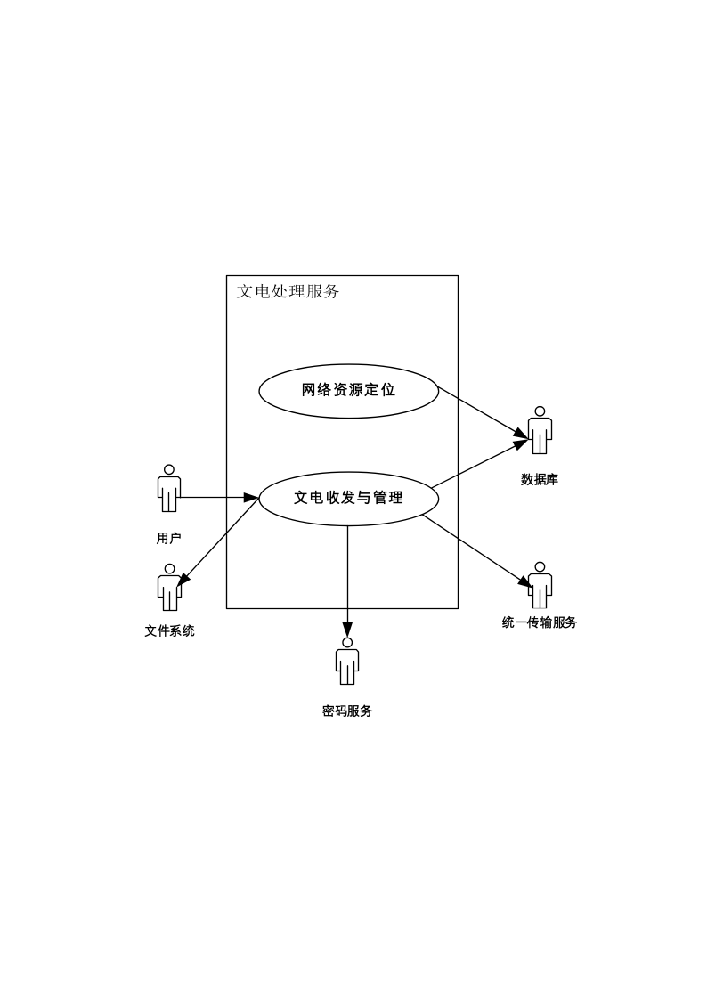
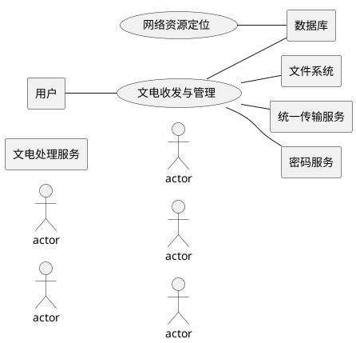
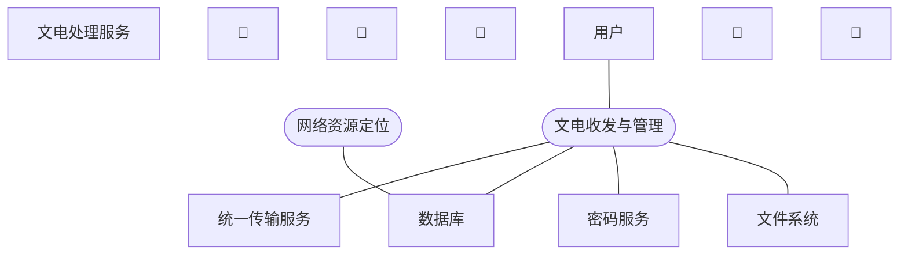
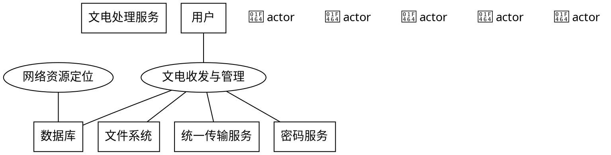

# 2_087 数据对档案

| 字段 | 值 |
|---|---|
| doc | 12文电处理需求规格说明-终端 |
| section | 3.2.2.3 |
| image_caption | 图 10 文电接收的流程图 |
| table_caption | 表 10 文电接收用例描述 |

## 原始图片

*图 10 文电接收的流程图*

## 结构图

*来源: born-digital导出(usecase, 8节点/6边)*
*类型经几何启发式精化(Master类型识别失败的图, 投影层推断, canonical锚点不变)*

*用例图以PlantUML渲染(UML母语): 小人=参与者 | 椭圆=用例 | 矩形框=系统边界 | 实线=关联 | 虚线=include/extend*

Mermaid兼容投影(通用md渲染器可显示)

DOT源码(完整语义, graphviz可渲染)

### 锚点节点结构

| # | 文本 | 类型 |
|---|---|---|
| 1 | 文电处理服务 | process |
| 2 | 网络资源定位 | usecase |
| 3 | 文电收发与管理 | usecase |
| 4 |   | actor |
| 5 | 文件系统 | process |
| 6 |   | actor |
| 7 | 统一传输服务 | process |
| 8 |   | actor |
| 9 | 用户 | process |
| 10 |   | actor |
| 11 | 数据库 | process |
| 12 |   | actor |
| 13 | 密码服务 | process |

## 表格内容

| Use Case 名称：文电接收 | Actors：用户 |   |
|---|---|---|
| Use Case 名称：文电接收 | Actors：用户 |   |
| 概述：用户接收文电信息。 |   |   |
| 前置条件：文电处理正常启动，发送方和接收 |   |   |
| 主事件流 |   |   |
| Actor的动作 | 系统的动作 | 动作约束 （性能、可靠性、容错等） |
| 4.用户收件箱收到来报通知。 5.接收方 | 1.文电处理收到从数据传输模块发送过来的 |   |
| 异常流E1：数据传输模块将报文拷贝到接收 |   |   |
| 后置条件：无。 |   |   |

## 正文

文电接收的流程图如图 10所示。
