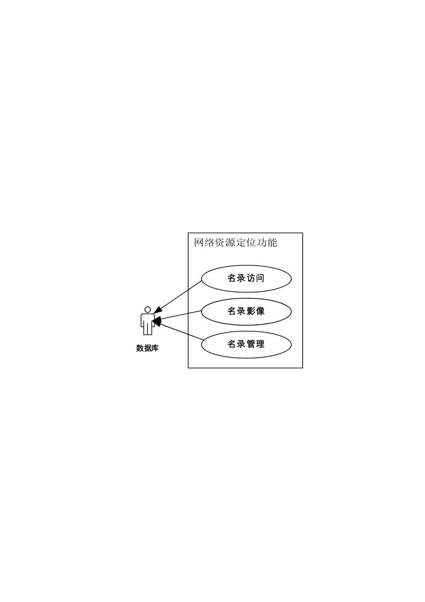
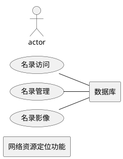
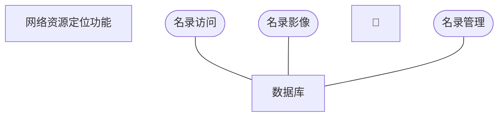

# 2_088 数据对档案

| 字段 | 值 |
|---|---|
| doc | 12文电处理需求规格说明-终端 |
| section | 3.2.2.4 |
| image_caption | 图 11  用户管理的流程图 |
| table_caption | 表 11 用户管理用例描述 |

## 原始图片

*图 11  用户管理的流程图*

## 结构图

*来源: born-digital导出(usecase, 5节点/3边)*
*类型经几何启发式精化(Master类型识别失败的图, 投影层推断, canonical锚点不变)*

*用例图以PlantUML渲染(UML母语): 小人=参与者 | 椭圆=用例 | 矩形框=系统边界 | 实线=关联 | 虚线=include/extend*

Mermaid兼容投影(通用md渲染器可显示)

DOT源码(完整语义, graphviz可渲染)

### 锚点节点结构

| # | 文本 | 类型 |
|---|---|---|
| 1 | 网络资源定位功能 | process |
| 2 | 名录访问 | usecase |
| 3 | 名录管理 | usecase |
| 4 |   | actor |
| 5 | 名录影像 | usecase |
| 6 | 数据库 | process |

## 表格内容

| Use Case 名称：用户管理 | Actors：用户 |   |
|---|---|---|
| Use Case 名称：用户管理 | Actors：用户 |   |
| 概述：获取用户的中文名等信息，获取用户的 |   |   |
| 前置条件：文电处理正常启动。 |   |   |
| 主事件流 |   |   |
| Actor的动作 | 系统的动作 | 动作约束 （性能、可靠性、容错等） |
| 1.用户打开文电管理工具，点击增加用户按 | 2.系统对比用户信息状态，如果用户已存在 |   |
| 异常流E1：提示已经存在的用户不能增加。 |   |   |
| 异常流E2：提示不存在的用户不能修改和删 |   |   |
| 后置条件：无。 |   |   |

## 正文

用户管理的流程图如图 11所示。
