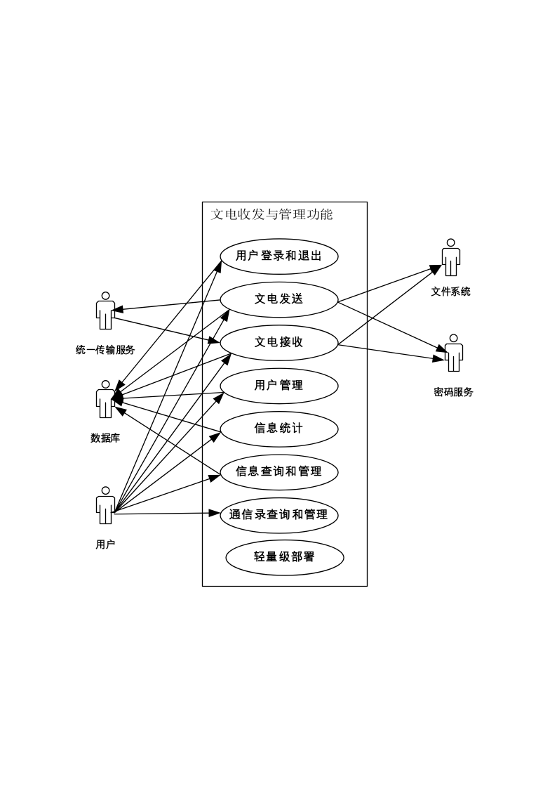
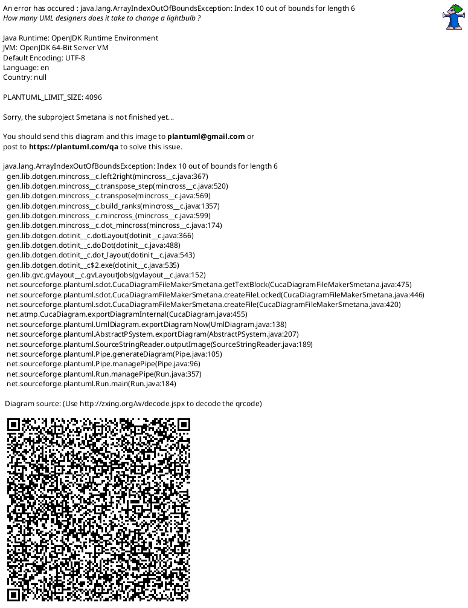
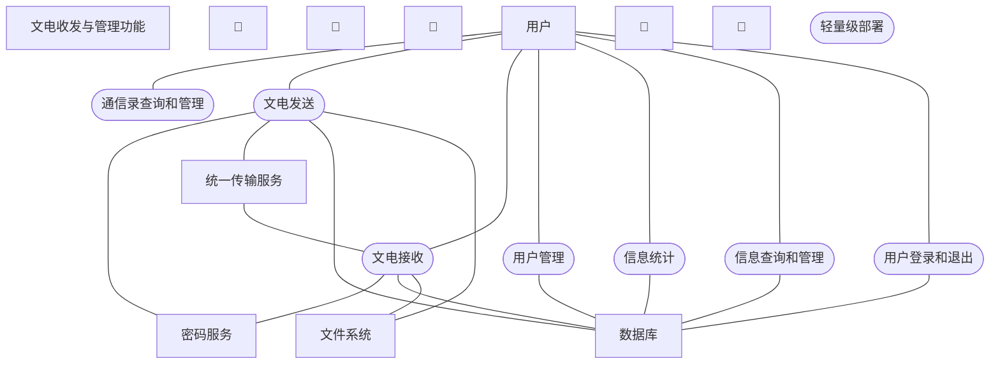
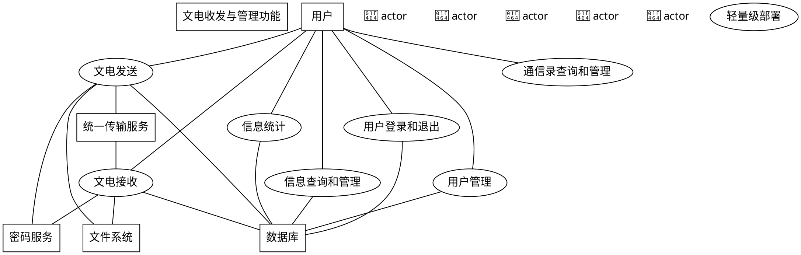

# 2_089 数据对档案

| 字段 | 值 |
|---|---|
| doc | 12文电处理需求规格说明-终端 |
| section | 3.2.2.5 |
| image_caption | 图 12  信息统计的流程图 |
| table_caption | 表 12 信息统计用例描述 |

## 原始图片

*图 12  信息统计的流程图*

## 结构图

*来源: born-digital导出(usecase, 14节点/19边)*
*类型经几何启发式精化(Master类型识别失败的图, 投影层推断, canonical锚点不变)*

*用例图以PlantUML渲染(UML母语): 小人=参与者 | 椭圆=用例 | 矩形框=系统边界 | 实线=关联 | 虚线=include/extend*

Mermaid兼容投影(通用md渲染器可显示)

DOT源码(完整语义, graphviz可渲染)

### 锚点节点结构

| # | 文本 | 类型 |
|---|---|---|
| 1 | 文电收发与管理功能 | process |
| 2 | 用户登录和退出 | usecase |
| 3 | 文电接收 | usecase |
| 4 | 文电发送 | usecase |
| 5 | 用户管理 | usecase |
| 6 | 信息统计 | usecase |
| 7 | 信息查询和管理 | usecase |
| 8 | 通信录查询和管理 | usecase |
| 9 |   | actor |
| 10 | 密码服务 | process |
| 11 |   | actor |
| 12 | 统一传输服务 | process |
| 13 |   | actor |
| 14 | 用户 | process |
| 15 |   | actor |
| … | 共19个节点 | |

## 表格内容

| Use Case 名称：信息统计 | Actors：用户 |   |
|---|---|---|
| Use Case 名称：信息统计 | Actors：用户 |   |
| 概述：根据用户输入的条件统计出某用户或某 |   |   |
| 前置条件：文电处理正常启动。 |   |   |
| 主事件流 |   |   |
| Actor的动作 | 系统的动作 | 动作约束 （性能、可靠性、容错等） |
| 1.用户打开名录应用，填写查询条件，点击 | 2.系统根据用户提供的条件在发件箱数据表 | 校验访问条件的合法性，并在错误发生时，提 |
| 异常流E1：提示用户检索条件错误，并进行 |   |   |
| 后置条件：无。 |   |   |

## 正文

信息统计的流程图如图 12所示。
