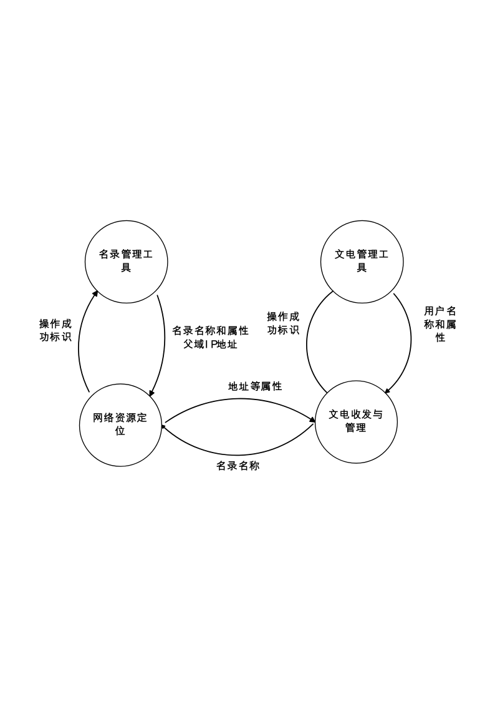

# 2_090 数据对档案

| 字段 | 值 |
|---|---|
| doc | 12文电处理需求规格说明-终端 |
| section | 3.2.2.6 |
| image_caption | 图 13  信息查询和管理的流程图 |
| table_caption | 表 13 信息查询和管理用例描述 |

## 原始图片

*图 13  信息查询和管理的流程图*

## 结构图

*该对无Visio锚点(非Visio图, 无born-digital导出)*

## 表格内容

| Use Case 名称：信息查询和管理 | Actors：用户 |   |
|---|---|---|
| Use Case 名称：信息查询和管理 | Actors：用户 |   |
| 概述：根据条件查询发件箱、收件箱、草稿箱 |   |   |
| 前置条件：文电处理正常启动。 |   |   |
| 主事件流 |   |   |
| Actor的动作 | 系统的动作 | 动作约束 （性能、可靠性、容错等） |
| 1.用户打开文电客户端页面，填写查询条件 | 2.系统根据用户提供的条件在已处理收件箱 | 校验访问条件的合法性，并在错误发生时，提 |
| 异常流E1：提示用户检索条件错误，并进行 |   |   |
| 后置条件：无。 |   |   |

## 正文

信息查询和管理的流程图如图 13所示。
