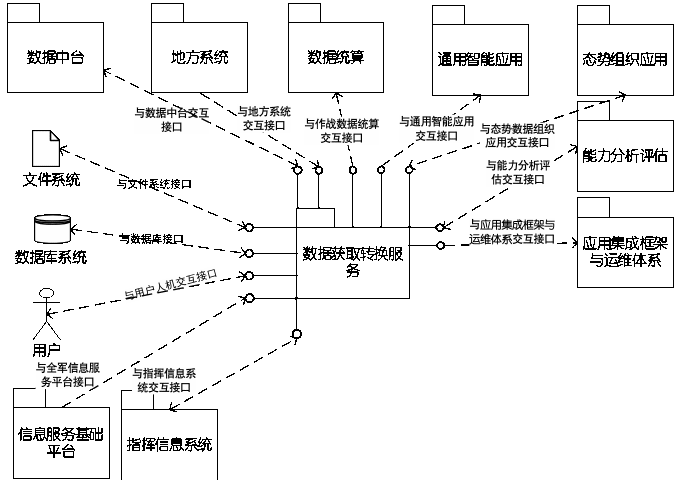

```mermaid
flowchart TD
    N1["数据获取转换服务"]
    N6["数据中台"]
    N9["与数据中台交互接口"]
    N10["与用户人机交互接口"]
    N11["信息服务基础平台"]
    N15["与全军信息服务平台接口"]
    N16["指挥信息系统"]
    N20["与指挥信息系统交互接口"]
    N29["与文件系统接口"]
    N30["与数据库接口"]
    N44["地方系统"]
    N50["与地方系统 交互接口"]
    N51["文件系统"]
    N52["数据库系统"]
    N53["用户"]
    N55["数据统算"]
    N60["与作战数据统算 交互接口"]
    N61["通用智能应用"]
    N65["与通用智能应用 交互接口"]
    N67["态势组织应用"]
    N73["能力分析评估"]
    N78["与态势数据组织应用交互接口"]
    N79["与能力分析评估交互接口"]
    N80["应用集成框架与运维体系"]
    N88["与应用集成框架与运维体系交互接口"]
    N10 --> N1
    N88 --> N1
    N60 --> N1
```

# 3_001 数据对档案

| 字段 | 值 |
|---|---|
| doc | 01数据获取转换分系统需求规格说明-终稿 |
| section | 3.3.1 |
| image_caption | 图 14 某服务系统外部接口设计 |
| table_caption | 表34 外部接口标识 |

## 原始图片

*图 14 某服务系统外部接口设计*

## 结构图

*来源: born-digital导出(flowchart, 25节点/3边)*
*类型经几何启发式精化(Master类型识别失败的图, 投影层推断, canonical锚点不变)*

*状态图以PlantUML渲染(UML母语): [*]=起止 | 圆角框=状态 | 箭头标签=迁移事件*

```plantuml
@startuml
!pragma layout smetana
state "数据获取转换服务" as S1
state "数据中台" as S6
state "与数据中台交互接口" as S9
state "与用户人机交互接口" as S10
state "信息服务基础平台" as S11
state "与全军信息服务平台接口" as S15
state "指挥信息系统" as S16
state "与指挥信息系统交互接口" as S20
state "与文件系统接口" as S29
state "与数据库接口" as S30
state "地方系统" as S44
state "与地方系统 交互接口" as S50
state "文件系统" as S51
state "数据库系统" as S52
state "用户" as S53
state "数据统算" as S55
state "与作战数据统算 交互接口" as S60
state "通用智能应用" as S61
state "与通用智能应用 交互接口" as S65
state "态势组织应用" as S67
state "能力分析评估" as S73
state "与态势数据组织应用交互接口" as S78
state "与能力分析评估交互接口" as S79
state "应用集成框架与运维体系" as S80
state "与应用集成框架与运维体系交互接口" as S88
S10 --> S1
S88 --> S1
S60 --> S1
@enduml
```

Mermaid兼容投影(通用md渲染器可显示)

DOT源码(完整语义, graphviz可渲染)

```dot
digraph G {
  rankdir=TB;
  node [fontname="Microsoft YaHei"];
  N1 [shape=box, label="数据获取转换服务"];
  N6 [shape=box, label="数据中台"];
  N9 [shape=box, label="与数据中台交互接口"];
  N10 [shape=box, label="与用户人机交互接口"];
  N11 [shape=box, label="信息服务基础平台"];
  N15 [shape=box, label="与全军信息服务平台接口"];
  N16 [shape=box, label="指挥信息系统"];
  N20 [shape=box, label="与指挥信息系统交互接口"];
  N29 [shape=box, label="与文件系统接口"];
  N30 [shape=box, label="与数据库接口"];
  N44 [shape=box, label="地方系统"];
  N50 [shape=box, label="与地方系统 交互接口"];
  N51 [shape=box, label="文件系统"];
  N52 [shape=box, label="数据库系统"];
  N53 [shape=box, label="用户"];
  N55 [shape=box, label="数据统算"];
  N60 [shape=box, label="与作战数据统算 交互接口"];
  N61 [shape=box, label="通用智能应用"];
  N65 [shape=box, label="与通用智能应用 交互接口"];
  N67 [shape=box, label="态势组织应用"];
  N73 [shape=box, label="能力分析评估"];
  N78 [shape=box, label="与态势数据组织应用交互接口"];
  N79 [shape=box, label="与能力分析评估交互接口"];
  N80 [shape=box, label="应用集成框架与运维体系"];
  N88 [shape=box, label="与应用集成框架与运维体系交互接口"];
  N10 -> N1;
  N88 -> N1;
  N60 -> N1;
}
```

*锚点Connect重建存在12个悬空连线端点, 已几何恢复3条边(连线自由端吸附最近语义节点, 每条带距离证据, via=dangling_snap; canonical锚点不变)*

### 锚点节点结构

| # | 文本 | 类型 |
|---|---|---|
| 1 | 数据获取转换服务 | process |
| 2 | 数据中台 | process |
| 3 | 与数据中台交互接口 | other |
| 4 | 与用户人机交互接口 | other |
| 5 | 信息服务基础平台 | process |
| 6 | 与全军信息服务平台接口 | other |
| 7 | 指挥信息系统 | process |
| 8 | 与指挥信息系统交互接口 | other |
| 9 | 与文件系统接口 | other |
| 10 | 与数据库接口 | other |
| 11 | 地方系统 | process |
| 12 | 与地方系统
交互接口 | other |
| 13 | 文件系统 | other |
| 14 | 数据库系统 | other |
| 15 | 用户 | other |
| … | 共25个节点 | |

## 表格内容

| 序号 | 接口名称/标识 | 接口描述 | 发送方 | 接收方 | 接口类型 | 优先级 | 备注 |
|---|---|---|---|---|---|---|---|
| 1 | 与数据统算交互接口/ZZSJHQZHFW | 数据统算调用本系统获取通算分析所需的数据 | 本系统 | 数据统算 | API接口 | 高 | — |
| 2 | 与通用智能应用交互接口/ZZSJHQZH | 通用智能应用调用本系统获取应用运行所需数 | 本系统 | 通用智能应用 | API接口 | 高 | — |
| 3 | 与态势数据组织应用交互接口/ZZSJHQ | 本系统与态势数据组织应用之间进行态势数据 | 本系统 | 态势数据组织应用 | API接口 | 高 | — |
| 4 | 态势数据组织应用 | 本系统 | API接口 | 高 | — |
| 5 | 与能力分析评估交互接口/ZZSJHQZH | 能力分析评估应用调用本系统获取评估所需数 | 本系统 | 能力分析评估应用 | API接口 | 高 | — |
| 6 | 能力分析评估应用 | 本系统 | API接口 | 高 | — |
| 7 | 与应用集成框架与运维体系交互接口/ ZZ | 本系统将系统监控、日志等信息推送至应用集 | 本系统 | 应用集成框架与运维体系 | API接口、DLL接口 | 低 | — |
| 8 | 与指挥信息系统交互接口/ ZZSJHQZ | 本系统与指挥信息系统之间进行态势数据等数 | 本系统 | 指挥信息系统 | API接口 | 高 | — |
| 9 | 指挥信息系统 | 本系统 | API接口 | 高 | — |
| 10 | 与某信息服务平台交互接口/ ZZSJHQ | 本系统调用某信息服务平台用户管理、统一时 | 某信息服务基础平台 | 本系统 | API接口 | 中 | — |
| 11 | 与某数据中台交互接口/ZZSJHQZHF | 本系统与数据中台之间进行基础数据、动态数 | 某数据中台 | 本系统 | API接口、消息队列接口 | 高 | — |
| 12 | 本系统 | 某数据中台 | API接口 | 高 | — |
| 13 | 与上下级典型应用交互接口/ ZZSJHQ | 本系统基于下发的通用组件与某典型应用系统 | 某典型应用系统 | 本系统 | API接口 | 中 | — |
| 14 | 本系统 | 某某典型应用系统 | API接口 | 中 | — |
| 15 | 与地方系统交互接口/ ZZSJHQZHF | 本系统需要从外部地方系统引接其他领域数据 | 地方系统 | 本系统 | 文件接口 | 中 | — |
| 16 | 与用户人机交互接口/ZZSJHQZHFW | 本系统提供人机交互接口，实现用户操作使用 | 本系统 | 用户 | API接口 | 高 | — |
| 17 | 用户 | 本系统 | API接口 | 高 | — |
| 18 | 与数据库接口/ ZZSJHQZHFW - | 本系统与数据库系统进行数据库信息、数据库 | 本系统 | 数据库系统 | 数据库访问接口 | 高 | — |
| 19 | 数据库系统 | 本系统 | 数据库访问接口 | 高 | — |
| 20 | 与文件系统接口/ ZZSJHQZHFW  | 本系统与文件系统进行文本文件、图片文件、 | 本系统 | 文件系统 | 文件接口 | 高 | — |

## 正文

本系统的外部接口标识见表34所示。
