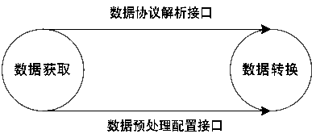
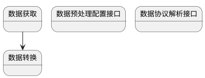
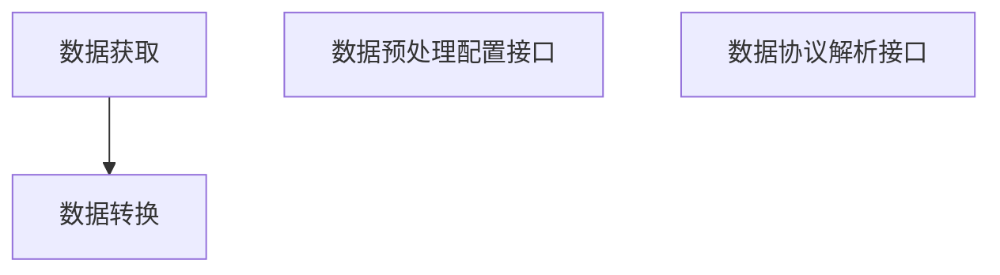
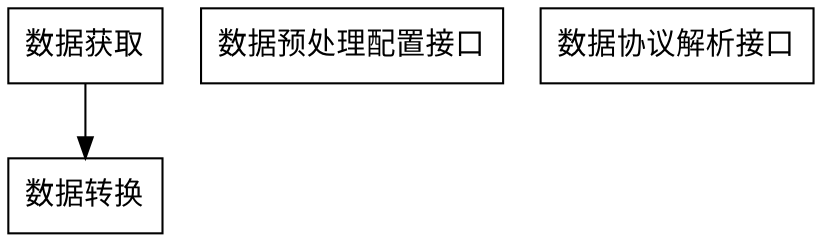

# 3_002 数据对档案

| 字段 | 值 |
|---|---|
| doc | 01数据获取转换分系统需求规格说明-终稿 |
| section | 3.4 |
| image_caption | 图 15 某服务内部接口设计 |
| table_caption | 表56 某服务内部接口详细设计表 |

## 原始图片

*图 15 某服务内部接口设计*

## 结构图

*来源: born-digital导出(flowchart, 4节点/1边)*
*类型经几何启发式精化(Master类型识别失败的图, 投影层推断, canonical锚点不变)*

*状态图以PlantUML渲染(UML母语): [*]=起止 | 圆角框=状态 | 箭头标签=迁移事件*

Mermaid兼容投影(通用md渲染器可显示)

DOT源码(完整语义, graphviz可渲染)

### 锚点节点结构

| # | 文本 | 类型 |
|---|---|---|
| 1 | 数据转换 | process |
| 2 | 数据获取 | process |
| 3 | 数据预处理配置接口 | other |
| 4 | 数据协议解析接口 | other |

## 表格内容

| 序号 | 接口名称/标识 | 接口需求描述 | 接口类型 | 发送方 | 接收方 | 优先级 |
|---|---|---|---|---|---|---|
| 1 | 数据协议解析接口/ZZSJHQZHFW- | 对引接获取的数据进行自定义协议配置和解析 | API接口 | 数据获取 | 数据转换 | 中 |
| 2 | 数据预处理配置接口/ZZSJHQZHFW | 对引接获取的数据进行结构转换配置 | API接口 | 数据获取 | 数据转换 | 中 |

## 正文

某服务系统内部接口包括数据协议解析接口、数据预处理配置接口。某服务系统内部接口如图 15所示。
