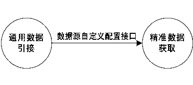
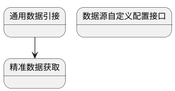
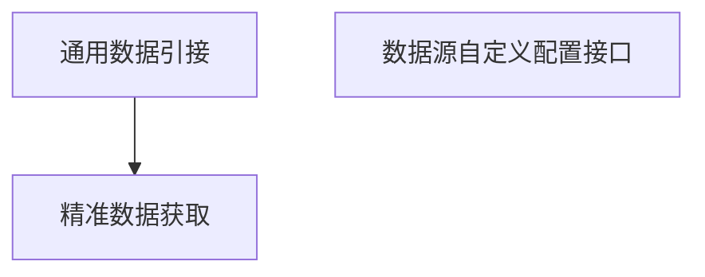
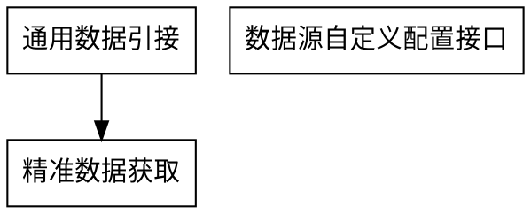

# 3_003 数据对档案

| 字段 | 值 |
|---|---|
| doc | 01数据获取转换分系统需求规格说明-终稿 |
| section | 3.4.1 |
| image_caption | 图 16 数据获取内部接口图 |
| table_caption | 表57 数据获取内部接口表 |

## 原始图片

*图 16 数据获取内部接口图*

## 结构图

*来源: born-digital导出(flowchart, 3节点/1边)*
*类型经几何启发式精化(Master类型识别失败的图, 投影层推断, canonical锚点不变)*

*状态图以PlantUML渲染(UML母语): [*]=起止 | 圆角框=状态 | 箭头标签=迁移事件*

Mermaid兼容投影(通用md渲染器可显示)

DOT源码(完整语义, graphviz可渲染)

### 锚点节点结构

| # | 文本 | 类型 |
|---|---|---|
| 1 | 精准数据获取 | process |
| 2 | 通用数据引接 | process |
| 3 | 数据源自定义配置接口 | other |

## 表格内容

| 序号 | 接口名称/标识 | 接口需求描述 | 接口类型 | 发送方 | 接收方 |
|---|---|---|---|---|---|
| 1 | 数据源自定义/配置接口/ZZSJHQZH | 对特定信源数据进行自定义配置 | API接口 | 通用数据引接 | 精准数据获取 |

## 正文

数据获取包括数据源自定义配置接口，其内部接口图见图 16所示。
