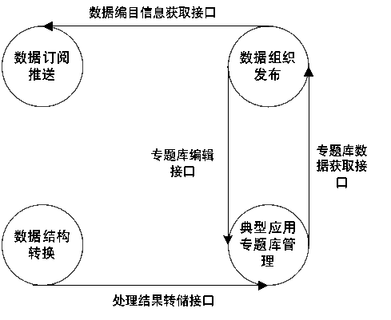
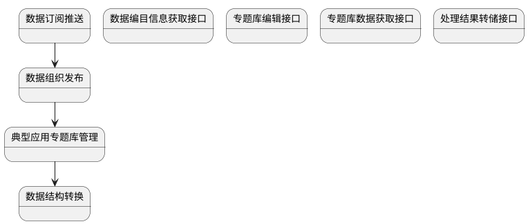
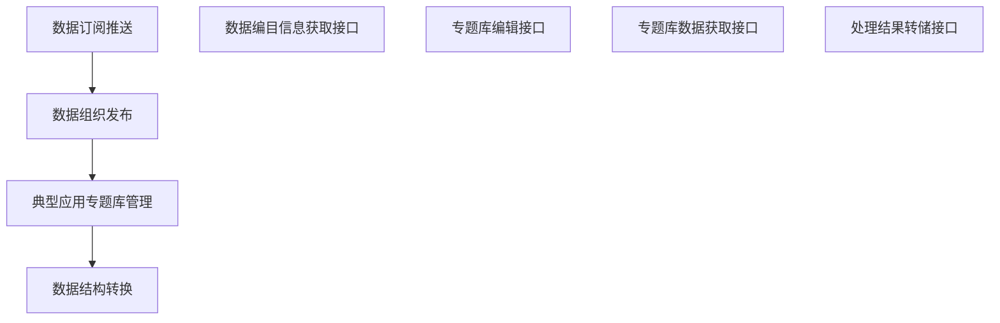
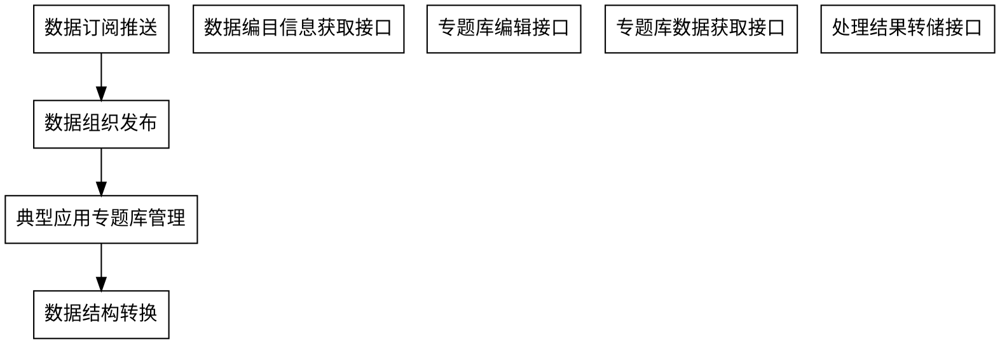

# 3_004 数据对档案

| 字段 | 值 |
|---|---|
| doc | 01数据获取转换分系统需求规格说明-终稿 |
| section | 3.4.2 |
| image_caption | 图 17 数据转换内部接口图 |
| table_caption | 表58 数据转换内部接口表 |

## 原始图片

*图 17 数据转换内部接口图*

## 结构图

*来源: born-digital导出(flowchart, 8节点/3边)*
*类型经几何启发式精化(Master类型识别失败的图, 投影层推断, canonical锚点不变)*

*状态图以PlantUML渲染(UML母语): [*]=起止 | 圆角框=状态 | 箭头标签=迁移事件*

Mermaid兼容投影(通用md渲染器可显示)

DOT源码(完整语义, graphviz可渲染)

*锚点Connect重建存在1个悬空连线端点, 已几何恢复1条边(连线自由端吸附最近语义节点, 每条带距离证据, via=dangling_snap; canonical锚点不变)*

### 锚点节点结构

| # | 文本 | 类型 |
|---|---|---|
| 1 | 数据组织发布 | process |
| 2 | 数据订阅推送 | process |
| 3 | 数据结构转换 | process |
| 4 | 典型应用专题库管理 | process |
| 5 | 数据编目信息获取接口 | other |
| 6 | 专题库编辑接口 | other |
| 7 | 专题库数据获取接口 | other |
| 8 | 处理结果转储接口 | other |

## 表格内容

| 序号 | 接口名称 | 接口需求描述 | 接口类型 | 发送方 | 接收方 |
|---|---|---|---|---|---|
| 1 | 处理结果转储接口/ZZSJHQZHFW- | 将预处理结果转储到相应典型应用专题库 | API接口 | 数据结构转换 | 典型应用专题库管理 |
| 2 | 专题库数据获取接口/ZZSJHQZHFW | 专题库数据查询获取 | API接口 | 典型应用专题库管理 | 数据组织发布 |
| 3 | 专题库编辑接口/ZZSJHQZHFW-J | 专题库目录信息编辑、更新 | API接口 | 数据组织发布 | 典型应用专题库管理 |
| 4 | 数据编目信息获取接口/ZZSJHQZHF | 获取数据服务封装发布信息 | API接口 | 数据组织发布 | 数据订阅推送 |

## 正文

数据转换包括处理结果转储接口、专题库数据获取接口、专题库编辑接口和数据编目信息获取接口，其内部接口图见图 17所示。
