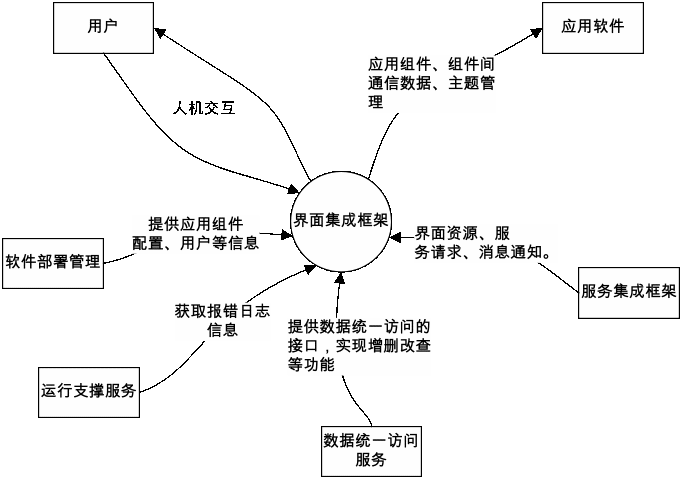
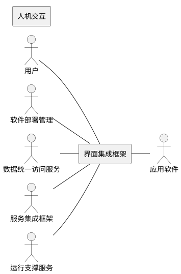
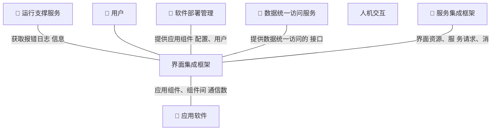
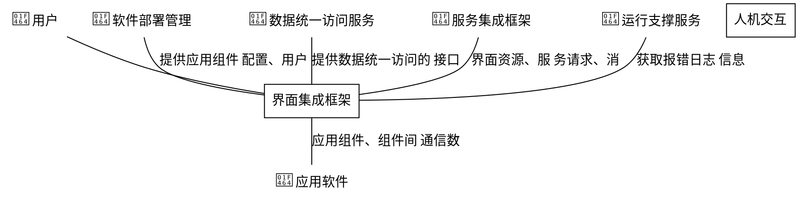

# 3_005 数据对档案

| 字段 | 值 |
|---|---|
| doc | 02界面集成框架软件需求规格说明-终稿 |
| section | 1.9.1 |
| image_caption | 图 42界面集成框架接口需求图 |
| table_caption | 表49 界面集成框架外部接口需求 |

## 原始图片

*图 42界面集成框架接口需求图*

## 结构图

*来源: born-digital导出(usecase, 8节点/6边)*
*类型经几何启发式精化(Master类型识别失败的图, 投影层推断, canonical锚点不变)*

*用例图以PlantUML渲染(UML母语): 小人=参与者 | 椭圆=用例 | 矩形框=系统边界 | 实线=关联 | 虚线=include/extend*

Mermaid兼容投影(通用md渲染器可显示)

DOT源码(完整语义, graphviz可渲染)

### 锚点节点结构

| # | 文本 | 类型 |
|---|---|---|
| 1 | 界面集成框架 | process |
| 2 | 用户 | actor |
| 3 | 软件部署管理 | actor |
| 4 | 数据统一访问服务 | actor |
| 5 | 服务集成框架 | actor |
| 6 | 应用软件 | actor |
| 7 | 人机交互 | other |
| 8 | 运行支撑服务 | actor |

## 表格内容

| 序号 | 接口需求名称 | 接口需求标识 | 接口类型 | 发送方 | 接收方 | 接口内容 | 接口优先级 |
|---|---|---|---|---|---|---|---|
| 1 | 与用户的接口 | PZXQ-WBJK-YH | 人机接口 | 用户 | 本软件 | 提供用户菜单响应、数据编辑、图上操作等功 | 高 |
| 本软件 | 用户 |
| 2 | 与应用软件的接口 | PZXQ-WBJK-YYRJ | API接口 | 本软件 | 应用 | 提供应用组件管理、组件间通信、主题管理、 | 高 |
| 3 | 与软件部署管理的接口 | PZXQ-WBJK-YXZCFW | Restful接口 | 软件部署管理 | 本软件 | 调用软件部署管理接口，实现用户身份认证， | 高 |
| 4 | 与服务集成框架的接口 | PZXQ-WBJK-FWJCKJ | 网络接口 | 服务集成框架 | 本软件 | 调用服务集成框架接口，实现界面资源获取、 | 高 |
| 5 | 与数据统一访问服务的接口 | PZXQ-WBJK-SJTYFW | API接口 | 数据统一访问服务 | 本软件 | 调用数据统一访问服务的接口，实现依据用户 | 高 |

## 正文

界面集成框架对外接口包括与用户的接口、与应用软件的接口、与软件部署管理的接口、与服务集成框架的接口、与数据统一访问服务的接口。外部接口关系如图 42所示。
