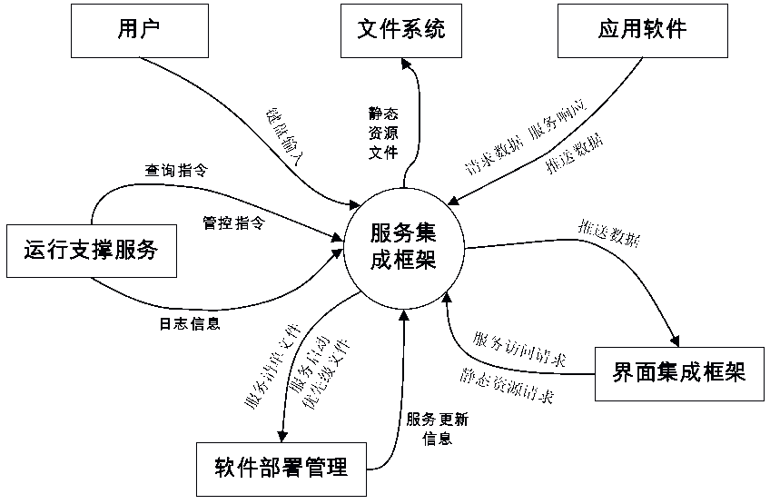
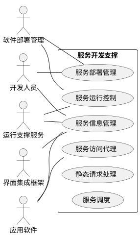
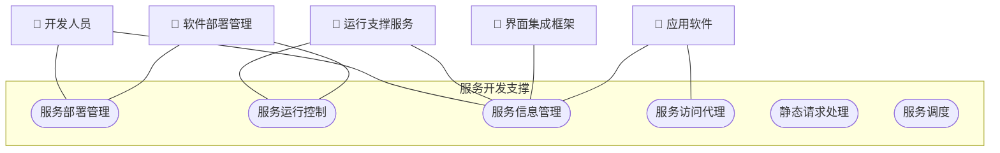
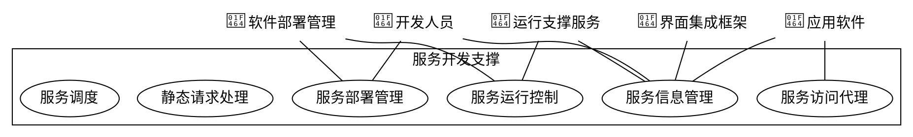

# 3_007 数据对档案

| 字段 | 值 |
|---|---|
| doc | 03服务集成框架软件需求规格说明-终稿 |
| section | 3.3.1 |
| image_caption | 图20 服务集成框架外部接口需求 |
| table_caption | 表59 服务集成框架外部接口需求 |

## 原始图片

*图20 服务集成框架外部接口需求*

## 结构图

*来源: born-digital导出(usecase, 12节点/9边)*
*类型经几何启发式精化(Master类型识别失败的图, 投影层推断, canonical锚点不变)*

*用例图以PlantUML渲染(UML母语): 小人=参与者 | 椭圆=用例 | 矩形框=系统边界 | 实线=关联 | 虚线=include/extend*

Mermaid兼容投影(通用md渲染器可显示)

DOT源码(完整语义, graphviz可渲染)

### 锚点节点结构

| # | 文本 | 类型 |
|---|---|---|
| 1 |   | other |
| 2 |   | other |
| 3 | 开发人员 | other |
| 4 |   | other |
| 5 |   | other |
| 6 |   | other |
| 7 |   | other |
| 8 | 服务开发支撑 | other |
| 9 |   | other |
| 10 |   | other |
| 11 | 服务部署管理 | other |
| 12 |   | other |
| 13 |   | other |
| 14 | 服务运行控制 | other |
| 15 |   | other |
| … | 共38个节点 | |

## 表格内容

| 序号 | 接口需求名称 | 接口需求标识 | 接口类型 | 发送方 | 接收方 | 接口内容 | 接口优先级 |
|---|---|---|---|---|---|---|---|
| 1 | 与运行支撑服务的接口 | PZXQ-WBJK-FWJCKJ-YXZ | 网络接口 | 运行支撑服务 | 本系统 | 查询指令 | 高 |
| 网络接口 | 运行支撑服务 | 本系统 | 管控指令 | 高 |
| API接口 | 本系统 | 运行支撑服务 | 日志信息 | 高 |
| 2 | 与界面集成框架的接口 | PZXQ-WBJK-FWJCKJ-JMJ | 网络接口 | 界面集成框架 | 本系统 | 服务访问请求 | 高 |
| 网络接口 | 界面集成框架 | 本系统 | 静态资源请求 | 高 |
| 网络接口 | 本系统 | 界面集成框架 | 推送数据 | 高 |
| 3 | 与软件部署管理的接口 | PZXQ-WBJK-FWJCKJ-BSG | 文件接口 | 本系统 | 软件部署管理 | 服务清单信息 | 高 |
| 文件接口 | 本系统 | 软件部署管理 | 服务启动优先级信息 | 高 |
| 网络接口 | 软件部署管理 | 本系统 | 服务更新信息 | 高 |
| 4 | 与用户之间接口 | PZXQ-WBJK-FWJCKJ-RJJ | 人机接口 | 用户 | 本系统 | 键盘输入信息 | 中 |
| 5 | 与应用软件接口 | PZXQ-WBJK-FWJCKJ-YYR | API接口 | 应用软件 | 本系统 | 请求数据 | 中 |
| API接口 | 应用软件 | 本系统 | 响应数据 | 中 |
| API接口 | 本系统 | 应用软件 | 推送数据 | 中 |
| 6 | 与文件系统接口 | PZXQ-WBJK-FWJCKJ-JTW | 文件接口 | 本系统 | 文件系统 | 静态资源文件 | 中 |

## 正文

服务集成框架外部接口需求见图20所示，包括：与运行支撑服务软件接口、与软件部署管理软件接口、与界面集成框架软件接口、与应用软件的接口、人机接口、文件系统接口。
