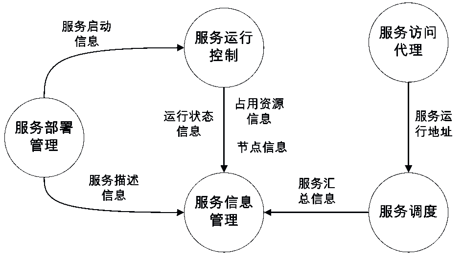
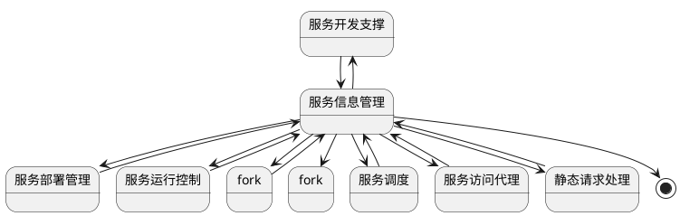
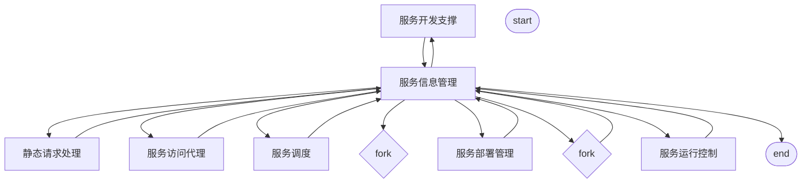
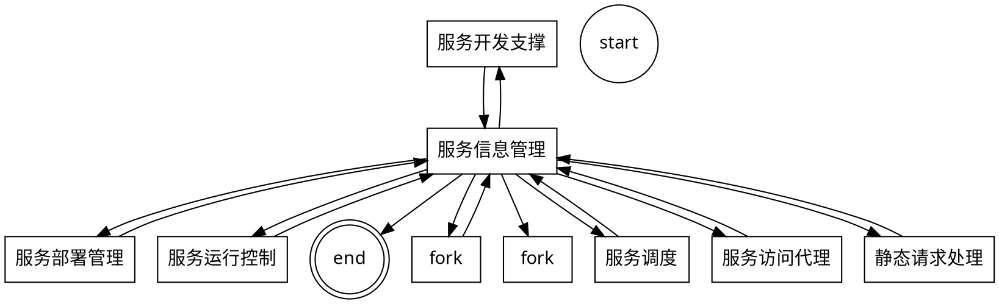

# 3_008 数据对档案

| 字段 | 值 |
|---|---|
| doc | 03服务集成框架软件需求规格说明-终稿 |
| section | 3.4.1 |
| image_caption | 图21服务集成框架内部接口需求 |
| table_caption | 表66 服务集成框架内部接口需求 |

## 原始图片

*图21服务集成框架内部接口需求*

## 结构图

*⚠ 结构经census重对齐: 旧锚点(oleObject21.bin:page1.xml)与图片不符, 已切换到与image.png内容一致的锚点(oleObject2.bin:page1.xml, align_score=0.714)*

*来源: born-digital导出(flowchart, 7节点/16边)*
*类型经几何启发式精化(Master类型识别失败的图, 投影层推断, canonical锚点不变)*

*状态图以PlantUML渲染(UML母语): [*]=起止 | 圆角框=状态 | 箭头标签=迁移事件*

Mermaid兼容投影(通用md渲染器可显示)

DOT源码(完整语义, graphviz可渲染)

### 锚点节点结构

| # | 文本 | 类型 |
|---|---|---|
| 1 | 服务开发支撑 | process |
| 2 | 服务部署管理 | process |
| 3 | 服务信息管理 | process |
| 4 | 服务运行控制 | process |
| 5 |   | start |
| 6 |   | end |
| 7 |   | fork |
| 8 |   | fork |
| 9 | 服务调度 | process |
| 10 | 服务访问代理 | process |
| 11 | 静态请求处理 | process |

## 表格内容

| 序号 | 接口需求名称 | 接口需求标识 | 接口类型 | 发送方 | 接收方 | 接口内容 | 接口优先级 |
|---|---|---|---|---|---|---|---|
| 1 | 服务部署管理与服务运行控制接口 | PZXQ-NBJK-FWJCKJ-FWQ | API接口 | 服务部署管理 | 服务运行控制 | 服务启动信息 | 低 |
| 2 | 服务部署管理与服务信息管理接口 | PZXQ-NBJK-FWJCKJ-FWZ | 网络接口 | 服务部署管理 | 服务运行控制 | 服务描述信息 | 低 |
| 3 | 服务运行控制与服务信息管理接口 | PZXQ-NBJK-FWJCKJ-ZTJ | 网络接口 | 服务运行控制 | 服务状态监视 | 运行状态信息 | 低 |
| 网络接口 | 服务运行控制 | 服务状态监视 | 资源占用信息 | 低 |
| 4 | 服务信息管理与服务调度的关系 | PZXQ-NBJK-FWJCKJ-FWD | API接口 | 服务状态监视 | 服务调度 | 服务汇总信息 | 低 |
| 5 | 服务访问代理与服务调度的关系 | PZXQ-NBJK-FWJCKJ-FWD | 网络接口 | 服务访问代理 | 服务调度 | 服务运行地址 | 低 |

## 正文

服务集成框架内部接口需求表见表66。
