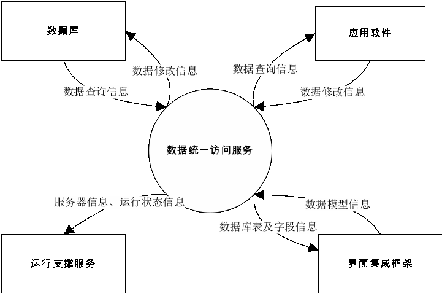
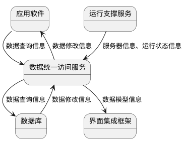
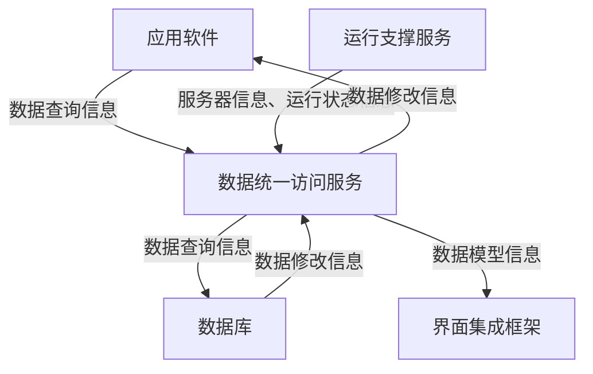

# 3_009 数据对档案

| 字段 | 值 |
|---|---|
| doc | 04数据统一访问服务软件需求规格说明-终稿 |
| section | 3.3.1 |
| image_caption | 图47 数据统一访问服务软件外部接口需求 |
| table_caption | 表48 数据统一访问服务软件外部接口需求 |

## 原始图片


*图47 数据统一访问服务软件外部接口需求*

## 结构图

*⚠ 结构经census重对齐: 旧锚点(oleObject4.bin:page1.xml)与图片不符, 已切换到与image.png内容一致的锚点(oleObject47.bin:page1.xml, align_score=1.0)*

*来源: born-digital导出(flowchart, 5节点/6边)*
*类型经几何启发式精化(Master类型识别失败的图, 投影层推断, canonical锚点不变)*

*状态图以PlantUML渲染(UML母语): [*]=起止 | 圆角框=状态 | 箭头标签=迁移事件*



<details><summary>Mermaid兼容投影(通用md渲染器可显示)</summary>



</details>

<details><summary>DOT源码(完整语义, graphviz可渲染)</summary>

```dot
digraph G {
  rankdir=TB;
  node [fontname="Microsoft YaHei"];
  N1 [shape=box, label="应用软件"];
  N4 [shape=box, label="数据库"];
  N6 [shape=box, label="运行支撑服务"];
  N7 [shape=box, label="界面集成框架"];
  N9 [shape=box, label="数据统一访问服务"];
  N9 -> N4, label="数据查询信息";
  N4 -> N9, label="数据修改信息";
  N1 -> N9, label="数据查询信息";
  N9 -> N7, label="数据模型信息";
  N6 -> N9, label="服务器信息、运行状态信息";
  N9 -> N1, label="数据修改信息";
}
```

</details>

### 锚点节点结构

| # | 文本 | 类型 |
|---|---|---|
| 1 | 应用软件 | process |
| 2 | 数据库 | process |
| 3 | 运行支撑服务 | process |
| 4 | 界面集成框架 | process |
| 5 | 数据统一访问服务 | process |

## 表格内容

| 序号 | 接口需求名称 | 接口需求标识 | 接口类型 | 发送方 | 接收方 | 接口内容 | 接口优先级 |
|---|---|---|---|---|---|---|---|
| 1 | 数据统一访问服务与应用软件接口 | PZXQ-JK-SJTYFW-YYRJ | API接口 | 本系统 | 应用软件 | 数据查询信息 | 中 |
| 应用软件 | 本系统 | 删除数据记录信息 |
| 2 | 数据统一访问服务与运行支撑服务接口 | PZXQ-JK-SJTBGX-YXZCF | API接口 | 运行支撑服务 | 本系统 | 服务器信息、 运行状态信息 | 中 |
| 3 | 数据统一访问服务与界面集成框架接口 | PZXQ-JK-SJTBGX-JMJCK | 人机接口 | 本系统 | 界面集成框架 | 数据库表及字段信息 | 中 |
| 界面集成框架 | 本系统 | 数据模型信息 |
| 4 | 数据统一访问服务与数据库接口 | PZXQ-JK-SJTBGX-SJK | 数据库接口 | 本系统 | 数据库 | 删除数据记录信息 | 中 |
| 数据库 | 本系统 | 数据查询信息 |

## 正文

数据统一访问服务软件外部接口包括：与数据库接口、与应用软件接口、与运行支撑服务接口、与界面集成框架接口。数据统一访问服务软件外部接口需求表见表48所示。
