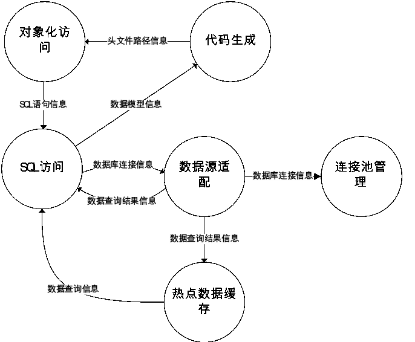
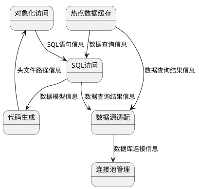
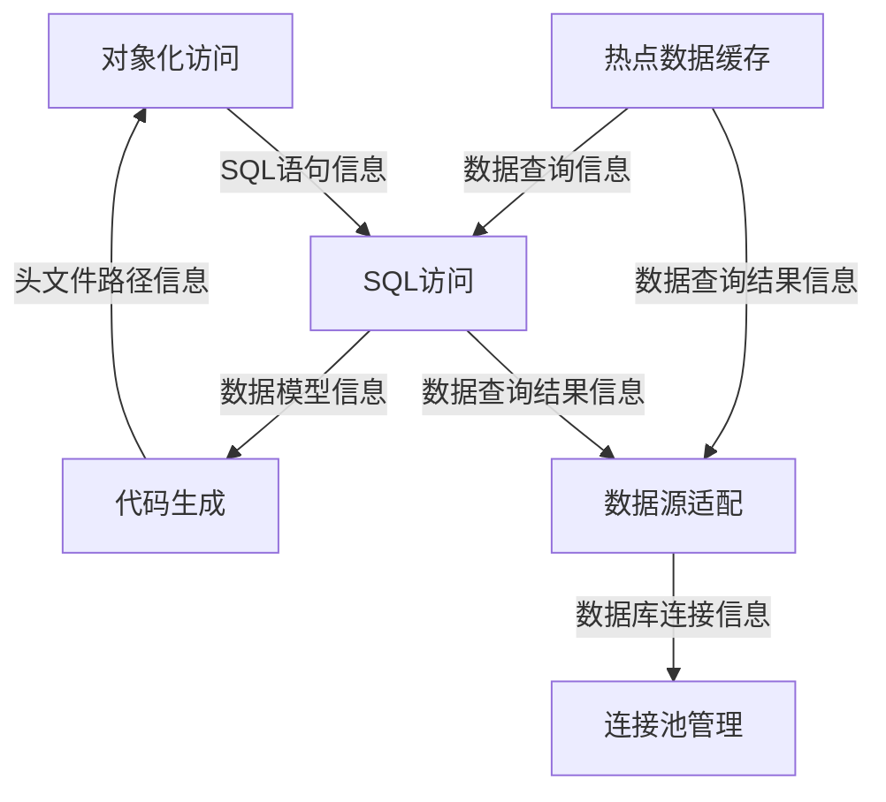

# 3_010 数据对档案

| 字段 | 值 |
|---|---|
| doc | 04数据统一访问服务软件需求规格说明-终稿 |
| section | 3.4.1 |
| image_caption | 图 48数据统一访问服务软件内部接口需求 |
| table_caption | 表53 数据统一访问服务软件内部接口需求 |

## 原始图片


*图 48数据统一访问服务软件内部接口需求*

## 结构图

*⚠ 结构经census重对齐: 旧锚点(oleObject1.bin:page1.xml)与图片不符, 已切换到与image.png内容一致的锚点(oleObject48.bin:page1.xml, align_score=1.0)*

*来源: born-digital导出(other, 6节点/7边)*
*类型经几何启发式精化(Master类型识别失败的图, 投影层推断, canonical锚点不变)*

*状态图以PlantUML渲染(UML母语): [*]=起止 | 圆角框=状态 | 箭头标签=迁移事件*



<details><summary>Mermaid兼容投影(通用md渲染器可显示)</summary>



</details>

<details><summary>DOT源码(完整语义, graphviz可渲染)</summary>

```dot
digraph G {
  rankdir=TB;
  node [fontname="Microsoft YaHei"];
  N2 [shape=box, label="对象化访问"];
  N4 [shape=box, label="SQL访问"];
  N6 [shape=box, label="代码生成"];
  N8 [shape=box, label="数据源适配"];
  N10 [shape=box, label="连接池管理"];
  N25 [shape=box, label="热点数据缓存"];
  N25 -> N8, label="数据查询结果信息";
  N4 -> N8, label="数据查询结果信息";
  N4 -> N6, label="数据模型信息";
  N2 -> N4, label="SQL语句信息";
  N6 -> N2, label="头文件路径信息";
  N8 -> N10, label="数据库连接信息";
  N25 -> N4, label="数据查询信息";
}
```

</details>

### 锚点节点结构

| # | 文本 | 类型 |
|---|---|---|
| 1 |   | other |
| 2 | 对象化访问 | other |
| 3 |   | other |
| 4 | SQL访问 | other |
| 5 |   | other |
| 6 | 代码生成 | other |
| 7 |   | other |
| 8 | 数据源适配 | other |
| 9 |   | other |
| 10 | 连接池管理 | other |
| 11 | 热点数据缓存 | other |

## 表格内容

| 序号 | 接口需求名称 | 接口需求标识 | 接口类型 | 发送方 | 接收方 | 接口内容 | 接口优先级 |
|---|---|---|---|---|---|---|---|
| 1 | 代码生成与对象化访问接口 | PZXQ-NBJK-DMSC-DXHFW | API | 代码生成 | 对象化访问 | 头文件路径信息 | 中 |
| 2 | 对象化访问与SQL访问接口 | PZXQ-NBJK-DXHFW-SQLF | API | 对象化访问 | SQL访问 | SQL语句信息 | 中 |
| 3 | SQL访问与代码生成接口 | PZXQ-NBJK-SQLFW-DMSC | API | SQL访问 | 代码生成 | 数据模型信息 | 中 |
| 4 | SQL访问与数据源适配接口 | PZXQ-NBJK-SQLFW-SJYS | API | SQL访问 | 数据源适配 | 数据库连接信息 | 中 |
| 5 | 数据源适配与SQL访问接口 | PZXQ-NBJK-SJYSP-SQLF | API | 数据源适配 | SQL访问 | 数据查询结果信息 | 中 |
| 6 | 数据源适配与连接池管理 | PZXQ-NBJK-SJYSP-LJCG | API | 数据源适配 | 连接池管理 | 数据库连接信息 | 中 |
| 7 | 数据源适配与热点数据缓存接口 | PZXQ-NBJK-SJYSP-RDSJ | API | 数据源适配 | 热点数据缓存 | 数据查询结果信息 | 中 |
| 8 | 热点数据缓存与SQL访问接口 | PZXQ-NBJK-RDSJHC-SQL | API | 热点数据缓存 | SQL访问 | 数据查询结果信息 | 中 |

## 正文

数据统一访问服务软件内部接口需求如图 48所示。
