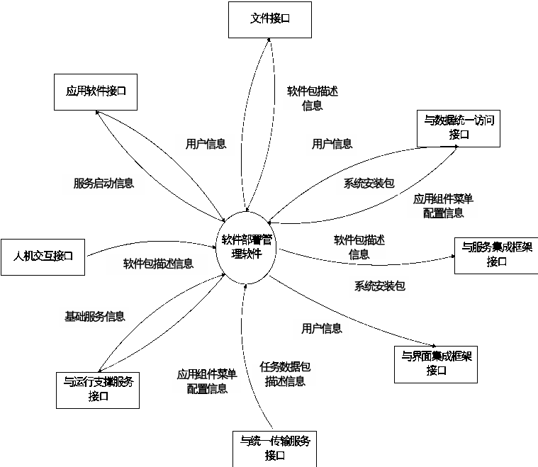
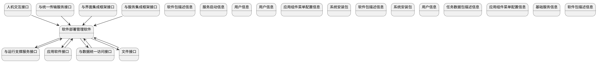
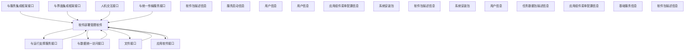

# 3_011 数据对档案

| 字段 | 值 |
|---|---|
| doc | 05软件部署管理软件需求规格说明-终稿 |
| section | 3.3.1 |
| image_caption | 图23 软件部署管理软件外部接口需求 |
| table_caption | 表52 软件部署管理软件外部接口需求 |

## 原始图片

*图23 软件部署管理软件外部接口需求*

## 结构图

*来源: born-digital导出(flowchart, 22节点/12边)*
*类型经几何启发式精化(Master类型识别失败的图, 投影层推断, canonical锚点不变)*

*状态图以PlantUML渲染(UML母语): [*]=起止 | 圆角框=状态 | 箭头标签=迁移事件*

Mermaid兼容投影(通用md渲染器可显示)

DOT源码(完整语义, graphviz可渲染)

```dot
digraph G {
  rankdir=TB;
  node [fontname="Microsoft YaHei"];
  N146 [shape=box, label="软件部署管理软件"];
  N147 [shape=box, label="人机交互接口"];
  N148 [shape=box, label="与运行支撑服务接口"];
  N149 [shape=box, label="与统一传输服务接口"];
  N150 [shape=box, label="与界面集成框架接口"];
  N151 [shape=box, label="与服务集成框架接口"];
  N152 [shape=box, label="应用软件接口"];
  N153 [shape=box, label="与数据统一访问接口"];
  N154 [shape=box, label="文件接口"];
  N171 [shape=box, label="软件包描述信息"];
  N172 [shape=box, label="服务启动信息"];
  N173 [shape=box, label="用户信息"];
  N174 [shape=box, label="用户信息"];
  N175 [shape=box, label="应用组件菜单配置信息"];
  N176 [shape=box, label="系统安装包"];
  N177 [shape=box, label="软件包描述信息"];
  N178 [shape=box, label="系统安装包"];
  N179 [shape=box, label="用户信息"];
  N180 [shape=box, label="任务数据包描述信息"];
  N181 [shape=box, label="应用组件菜单配置信息"];
  N182 [shape=box, label="基础服务信息"];
  N183 [shape=box, label="软件包描述信息"];
  N146 -> N148;
  N146 -> N153;
  N146 -> N154;
  N146 -> N152;
  N151 -> N146;
  N148 -> N146;
  N150 -> N146;
  N153 -> N146;
  N147 -> N146;
  N152 -> N146;
  N149 -> N146;
  N154 -> N146;
}
```

### 锚点节点结构

| # | 文本 | 类型 |
|---|---|---|
| 1 | 软件部署管理软件 | process |
| 2 | 人机交互接口 | process |
| 3 | 与运行支撑服务接口 | process |
| 4 | 与统一传输服务接口 | process |
| 5 | 与界面集成框架接口 | process |
| 6 | 与服务集成框架接口 | process |
| 7 | 应用软件接口 | process |
| 8 | 与数据统一访问接口 | process |
| 9 | 文件接口 | process |
| 10 | 软件包描述信息 | other |
| 11 | 服务启动信息 | other |
| 12 | 用户信息 | other |
| 13 | 用户信息 | other |
| 14 | 应用组件菜单配置信息 | other |
| 15 | 系统安装包 | other |
| … | 共22个节点 | |

## 表格内容

| 序号 | 接口需求名称 | 接口需求标识 | 接口类型 | 发送方 | 接收方 | 接口内容 | 接口优先级 |
|---|---|---|---|---|---|---|---|
|   | 人机交互接口 | PZXQ-WBJK-RJJH | 人机接口 | 用户 | 软件部署管理 | 实现用户对软件部署管理软件的操作 | 低 |
|   | 应用软件接口 | PZXQ-WBJK-YYRJ | HTTP接口 | 软件部署管理 | 应用软件 | 实现预案制作开通软件与其他应用软件进行相 | 低 |
|   | 应用软件 | 软件部署管理 | 低 |
|   | 与数据统一访问接口 | PZXQ-WBJK-SJFW | API接口 | 软件部署管理 | 数据统一访问服务 | 通过数据统一访问服务，实现与数据库的交互 | 低 |
|   | 数据统一访问服务 | 软件部署管理 | 低 |
|   | 与服务集成框架接口 | PZXQ-WBJK-FWKJ | 文件接口 | 软件部署管理 | 服务支撑环境 | 实现软件部署管理软件向服务集成框架配置服 | 中 |
|   | 与界面集成框架接口 | PZXQ-WBJK-JMKJ | 文件接口 | 软件部署管理 | 界面集成框架 | 实现为界面集成框架配置人机界面功能菜单 | 中 |
|   | 与统一传输服务接口 | PZXQ-WBJK-TYCS | API接口 | 软件部署管理 | 统一传输服务 | 实现软件产品、数据产品车际的交互 | 低 |
|   | 与运行支撑服务接口 | PZXQ-WBJK-YXZC | API接口 | 运行支撑服务 | 软件部署管理 | 实现软件日志的记录、基础信息的获取 | 低 |
|   | 软件部署管理 | 运行支撑服务 | 低 |
|   | 文件接口 | PZXQ-WBJK-WJ | 文件接口 | 软件部署管理 | 文件 | 实现软件部署管理软件运行过程中文件的存取 | 低 |
|   | 文件 | 软件部署管理 | 低 |

## 正文

软件部署管理软件外部接口需求表见表52所示。
