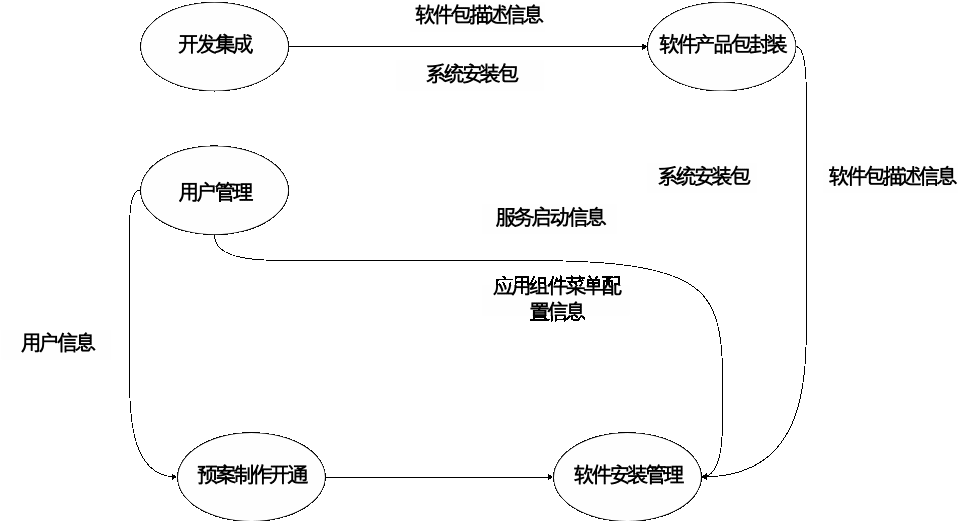
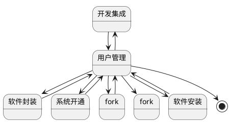
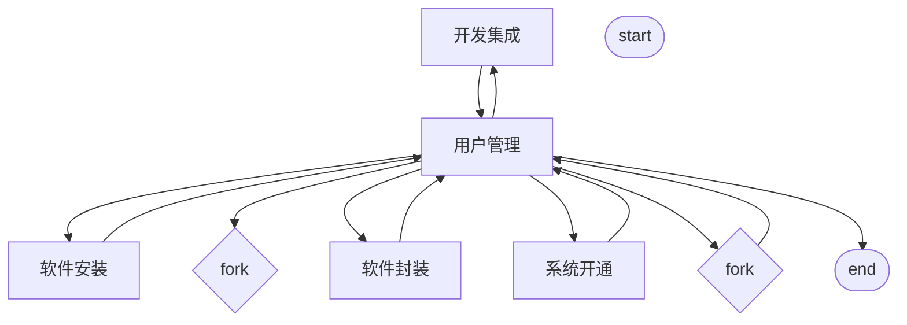
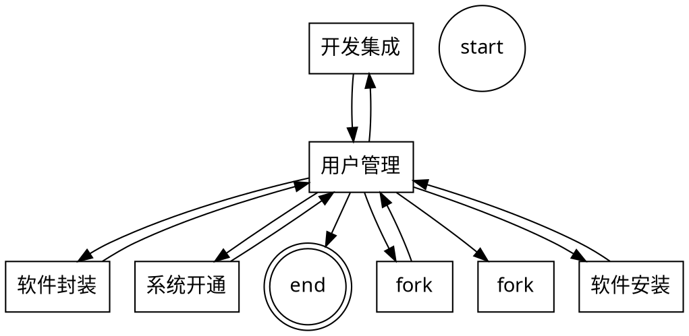

# 3_012 数据对档案

| 字段 | 值 |
|---|---|
| doc | 05软件部署管理软件需求规格说明-终稿 |
| section | 3.4.1 |
| image_caption | 图24 软件部署管理软件内部接口需求 |
| table_caption | 表61 软件部署管理软件内部接口需求 |

## 原始图片

*图24 软件部署管理软件内部接口需求*

## 结构图

*来源: born-digital导出(flowchart, 5节点/12边)*
*类型经几何启发式精化(Master类型识别失败的图, 投影层推断, canonical锚点不变)*

*状态图以PlantUML渲染(UML母语): [*]=起止 | 圆角框=状态 | 箭头标签=迁移事件*

Mermaid兼容投影(通用md渲染器可显示)

DOT源码(完整语义, graphviz可渲染)

### 锚点节点结构

| # | 文本 | 类型 |
|---|---|---|
| 1 | 开发集成 | process |
| 2 | 软件封装 | process |
| 3 | 系统开通 | process |
| 4 | 用户管理 | process |
| 5 |   | start |
| 6 |   | end |
| 7 |   | fork |
| 8 |   | fork |
| 9 | 软件安装 | process |

## 表格内容

| 序号 | 接口需求名称 | 接口需求标识 | 接口类型 | 发送方 | 接收方 | 接口内容 | 接口优先级 |
|---|---|---|---|---|---|---|---|
| 1 | 用户管理与软件安装管理接口 | PZXQ-NBJK-YHGL-RJAZG | API | 用户 管理 | 软件安装管理 | 服务启动信息 应用组件菜单配置信息 | 低 |
| 2 | 用户管理与预案制作开通接口 | PZXQ-NBJK-YHGL-YAZZK | API | 用户 管理 | 预案制作开通 | 用户信息 | 低 |
| 3 | 软件产品包封装与软件安装管理接口 | PZXQ-NBJK-RJANBFZ-RJ | API | 软件产品包封装 | 软件安装管理 | 软件包描述信息 系统安装包 | 低 |
| 4 | 开发集成与软件产品包封装接口 | PZXQ-NBJK-KFJC-RJCPB | 网络 | 开发集成 | 软件产品包封装 | 软件包描述信息 系统安装包 | 低 |

## 正文

软件部署管理软件内部接口需求表见表61。
