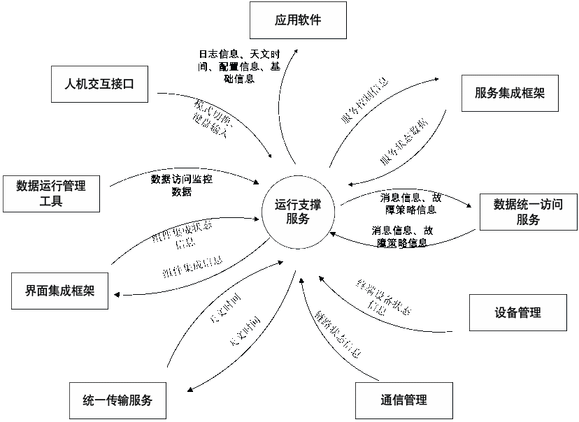

# 3_013 数据对档案

| 字段 | 值 |
|---|---|
| doc | 06运行支撑服务软件需求规格说明-终稿 |
| section | 3.3.1 |
| image_caption | 图32 运行支撑服务软件外部接口需求 |
| table_caption | 表77 运行支撑服务软件外部接口需求 |

## 原始图片

*图32 运行支撑服务软件外部接口需求*

## 结构图

*来源: born-digital导出(flowchart, 23节点/0边)*
*类型经几何启发式精化(Master类型识别失败的图, 投影层推断, canonical锚点不变)*

*状态图以PlantUML渲染(UML母语): [*]=起止 | 圆角框=状态 | 箭头标签=迁移事件*

Mermaid兼容投影(通用md渲染器可显示)

DOT源码(完整语义, graphviz可渲染)

### 锚点节点结构

| # | 文本 | 类型 |
|---|---|---|
| 1 | 运行支撑
服务 | process |
| 2 | 服务集成框架 | process |
| 3 | 数据统一访问
服务 | process |
| 4 | 应用软件 | process |
| 5 | 人机交互接口 | process |
| 6 | 数据运行管理
工具 | process |
| 7 | 界面集成框架 | process |
| 8 | 统一传输服务 | process |
| 9 | 设备管理 | process |
| 10 | 通信管理 | process |
| 11 | 模式切换、键盘输入 | other |
| 12 | 日志信息、天文时间、配置信息、基础信息 | other |
| 13 | 数据访问监控数据 | other |
| 14 | 服务控制信息 | other |
| 15 | 服务状态数据 | other |
| … | 共23个节点 | |

## 表格内容

| 序号 | 接口需求名称 | 接口需求标识 | 接口类型 | 发送方 | 接收方 | 接口内容 | 接口优先级 |
|---|---|---|---|---|---|---|---|
| 1 | 人机交互接口 | PZXQ-WBJK-YXZCFW-RJJ | 人机接口 | 用户 | 本软件 | 模式切换、键盘输入 | 低 |
| 2 | 与数据运行管理工具 接口 | PZXQ-WBJK-YXZCFW-SJY | API接口 | 数据运行管理工具 | 本软件 | 数据访问监控信息 | 高 |
| 3 | 与界面集成框架接口 | PZXQ-WBJK-YXZCFW-JMJ | API接口 | 界面集成 框架 | 本软件 | 组件集成状态信息 | 中 |
| 本软件 | 界面集成框架 | 组件集成信息 |
| 4 | 与统一传输服务接口 | PZXQ-WBJK-YXZCFW-TYC | API接口 | 统一传输服务 | 本软件 | 天文时间 | 高 |
| 本软件 | 统一传输服务 | 天文时间 |
| 5 | 与通信管理接口 | PZXQ-WBJK-YXZCFW-TXG | API接口 | 通信管理 | 本软件 | 链路状态信息 | 低 |
| 6 | 与设备管理接口 | PZXQ-WBJK-YXZCFW-SBG | API接口 | 设备管理 | 本软件 | 终端设备状态信息 | 低 |
| 7 | 与数据统一访问服务接口 | PZXQ-WBJK-YXZCFW-SJT | API接口 | 数据统一访问服务 | 本软件 | 消息信息、故障策略信息 | 高 |
| 本软件 | 数据统一访问服务 | 消息信息、故障策略信息 |
| 8 | 与服务集成框架接口 | PZXQ-WBJK-YXZCFW-FWJ | API接口 | 服务集成框架 | 本软件 | 服务状态数据信息 | 高 |
| 本软件 | 服务集成框架 | 服务控制信息 |
| 9 | 与应用软件接口 | PZXQ-WBJK-YXZCFW-YYR | API接口 | 本软件 | 应用软件 | 日志信息、天文时间、配置信息、基础信息 | 中 |

## 正文

运行支撑服务软件外部接口需求图，见图32所示。
