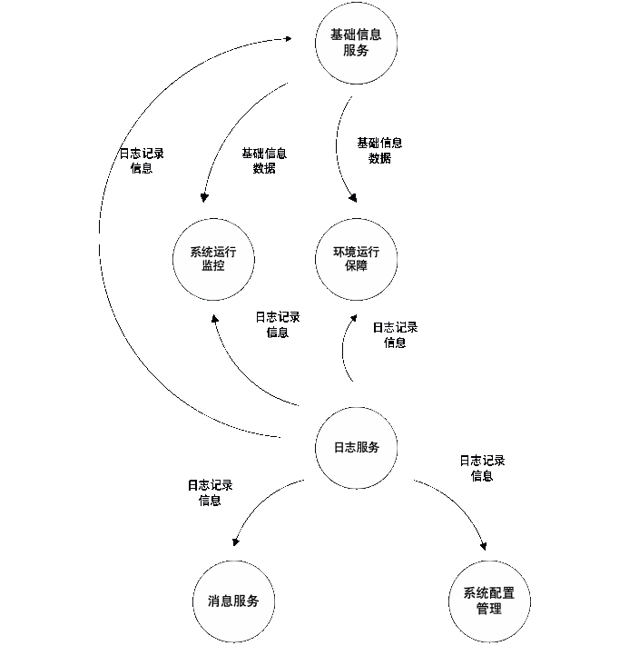

# 3_014 数据对档案

| 字段 | 值 |
|---|---|
| doc | 06运行支撑服务软件需求规格说明-终稿 |
| section | 3.4.1 |
| image_caption | 图 33 运行支撑服务软件内部接口需求 |
| table_caption | 表86 运行支撑服务软件内部接口需求 |

## 原始图片

*图 33 运行支撑服务软件内部接口需求*

## 结构图

*来源: born-digital导出(flowchart, 13节点/0边)*
*类型经几何启发式精化(Master类型识别失败的图, 投影层推断, canonical锚点不变)*

*状态图以PlantUML渲染(UML母语): [*]=起止 | 圆角框=状态 | 箭头标签=迁移事件*

Mermaid兼容投影(通用md渲染器可显示)

DOT源码(完整语义, graphviz可渲染)

### 锚点节点结构

| # | 文本 | 类型 |
|---|---|---|
| 1 | 基础信息
服务 | process |
| 2 | 系统运行
监控 | process |
| 3 | 日志服务 | process |
| 4 | 消息服务 | process |
| 5 | 环境运行
保障 | process |
| 6 | 系统配置
管理 | process |
| 7 | 日志记录
信息 | other |
| 8 | 基础信息
数据 | other |
| 9 | 基础信息
数据 | other |
| 10 | 日志记录
信息 | other |
| 11 | 日志记录
信息 | other |
| 12 | 日志记录
信息 | other |
| 13 | 日志记录
信息 | other |

## 表格内容

| 序号 | 接口需求名称 | 接口需求标识 | 接口类型 | 发送方 | 接收方 | 接口内容 | 接口优先级 |
|---|---|---|---|---|---|---|---|
| 1 | 基础信息服务与日志服务接口 | PZXQ-NBJK-YXZCFW- JC | API接口 | 日志服务 | 基础信息服务 | 记录的日志信息 | 中 |
| 2 | 基础信息服务与系统运行监控接口 | PZXQ-NBJK-YXZCFW- JC | API接口 | 基础信息服务 | 系统运行监控 | 本机IP地址、服务器IP地址、备份服务器 | 中 |
| 3 | 基础信息服务与环境运行保障接口 | PZXQ-NBJK-YXZCFW- JC | API接口 | 基础信息服务 | 环境运行保障 | 本机IP地址、服务器IP地址、备份服务器 | 中 |
| 4 | 系统运行监控与日志服务接口 | PZXQ-NBJK-YXZCFW- XT | API接口 | 日志服务 | 系统运行监控 | 日志记录信息 | 低 |
| 5 | 环境运行保障与日志服务接口 | PZXQ-NBJK-YXZCFW- HJ | API接口 | 日志服务 | 环境运行保障 | 日志记录信息 | 低 |
| 6 | 消息服务与日志服务接口 | PZXQ-NBJK-YXZCFW- XX | API接口 | 日志服务 | 消息服务 | 日志记录信息 | 低 |
| 7 | 系统配置管理与日志服务接口 | PZXQ-NBJK-YXZCFW- XT | API接口 | 日志服务 | 系统配置管理 | 日志记录信息 | 低 |

## 正文

运行支撑服务软件内部接口需求图，见图 33所示。
