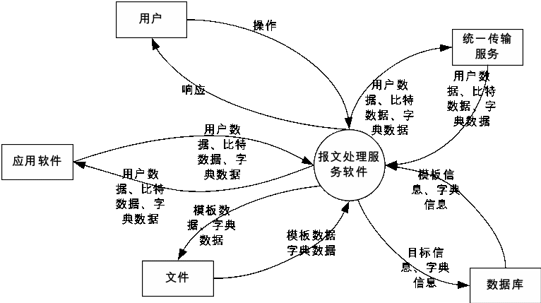

# 3_015 数据对档案

| 字段 | 值 |
|---|---|
| doc | 07报文处理服务软件需求规格说明-终稿 |
| section | 3.3.1 |
| image_caption | 图44 报文处理服务软件接口需求 |
| table_caption | 表52 报文处理服务软件外部接口需求 |

## 原始图片

*图44 报文处理服务软件接口需求*

## 结构图

*该对无Visio锚点(非Visio图, 无born-digital导出)*

## 表格内容

| 序号 | 接口需求名称 | 接口需求标识 | 接口类型 | 发送方 | 接收方 | 接口内容 | 接口优先级 |
|---|---|---|---|---|---|---|---|
|   | 人机交互接口 | PZXQ-JK-RJJH | 人机接口 | 用户 | 本软件 | 事件操作及响应 | 中 |
| 本软件 | 用户 |
|   | 报文处理接口 | PZXQ-JK-BWCL | API接口 | 应用软件 | 本软件 | 格式化报文信息 | 高 |
| 本软件 | 应用软件 |
|   | 报文传输接口 | PZXQ-JK-BWCS | API接口 | 应用软件 | 本软件 | 格式化报文信息、报文描述信息 | 高 |
| 本软件 | 应用软件 |
|   | 文件接口 | PZXQ-JK-BWCS | API接口 | 业务文件 | 本软件 | 字典文件、模板脚本文件、配置文件 | 高 |
| 本软件 | 业务文件 |
|   | 数据库接口 | PZXQ-JK-BWCS | API接口 | 数据库 | 本软件 | 字典数据、报文模板数据 | 中 |
| 本软件 | 数据库 |

## 正文

报文处理服务软件外部接口包括：人机交互接口、报文处理接口、报文传输接口、文件接口、数据库接口，报文处理服务软件外部接口需求表见表52所示。
