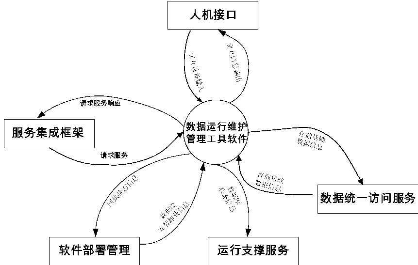
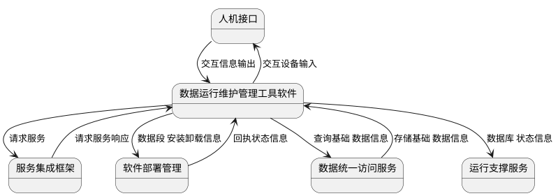
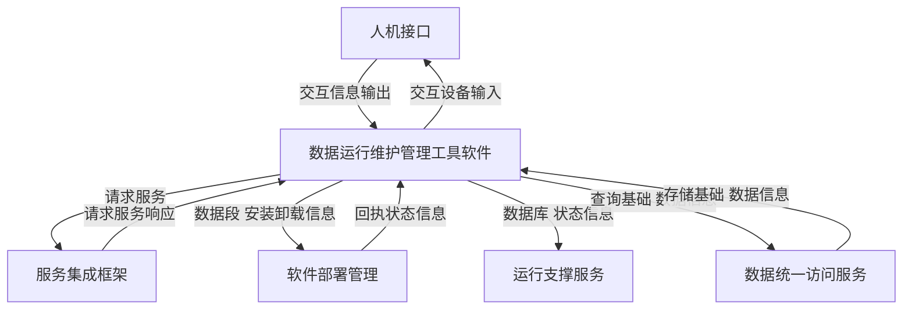

# 3_016 数据对档案

| 字段 | 值 |
|---|---|
| doc | 08数据运行维护管理工具软件需求规格说明-终稿 |
| section | 3.3.1 |
| image_caption | 图18数据运行维护管理工具外部接口需求 |
| table_caption | 表80 数据运行维护管理工具外部接口需求 |

## 原始图片


*图18数据运行维护管理工具外部接口需求*

## 结构图

*⚠ 结构经census重对齐: 旧锚点(oleObject5.bin:page1.xml)与图片不符, 已切换到与image.png内容一致的锚点(oleObject17.bin:page1.xml, align_score=0.4)*

*来源: born-digital导出(other, 15节点/9边)*
*类型经几何启发式精化(Master类型识别失败的图, 投影层推断, canonical锚点不变)*

*状态图以PlantUML渲染(UML母语): [*]=起止 | 圆角框=状态 | 箭头标签=迁移事件*



<details><summary>Mermaid兼容投影(通用md渲染器可显示)</summary>



</details>

<details><summary>DOT源码(完整语义, graphviz可渲染)</summary>

```dot
digraph G {
  rankdir=TB;
  node [fontname="Microsoft YaHei"];
  N16 [shape=box, label="人机接口"];
  N22 [shape=box, label="服务集成框架"];
  N28 [shape=box, label="软件部署管理"];
  N40 [shape=box, label="数据统一访问服务"];
  N72 [shape=box, label="数据运行维护管理工具软件"];
  N89 [shape=box, label="运行支撑服务"];
  N72 -> N22, label="请求服务";
  N72 -> N28, label="数据段 安装卸载信息";
  N28 -> N72, label="回执状态信息";
  N72 -> N89, label="数据库 状态信息";
  N72 -> N16, label="交互设备输入";
  N16 -> N72, label="交互信息输出";
  N22 -> N72, label="请求服务响应";
  N72 -> N40, label="查询基础 数据信息";
  N40 -> N72, label="存储基础 数据信息";
}
```

</details>

### 锚点节点结构

| # | 文本 | 类型 |
|---|---|---|
| 1 |   | other |
| 2 | 人机接口 | other |
| 3 |   | other |
| 4 | 服务集成框架 | other |
| 5 |   | other |
| 6 | 软件部署管理 | other |
| 7 |   | other |
| 8 | 数据统一访问服务 | other |
| 9 |   | other |
| 10 |   | other |
| 11 |   | other |
| 12 |   | other |
| 13 |   | other |
| 14 |   | other |
| 15 |   | other |
| … | 共28个节点 | |

## 表格内容

| 序号 | 接口需求名称 | 接口需求标识 | 接口类型 | 发送方 | 接收方 | 接口内容 | 接口优先级 |
|---|---|---|---|---|---|---|---|
| 1 | 人机交互接口 | PZXQ-WBJK-SJYXWHGL-R | 人机 | 本系统 | 用户 | 交互信息输出 | 低 |
| 用户 | 本系统 | 交互设备输入 | 低 |
| 2 | 数据运行维护管理工具与服务集成框架接口 | PZXQ-WBJK-SJYXWHGL-F | API | 本系统 | 服务集成框架 | 数据服务响应 | 低 |
| 服务集成框架 | 本系统 | 数据服务请求 | 低 |
| 3 | 数据运行维护管理工具与软件部署管理接口 | PZXQ-WBJK-SJYXWHGL-B | API | 本系统 | 软件部署管理 | 状态信息 | 低 |
| 软件部署管理 | 本系统 | 数据段安装卸载信息 | 低 |
| 4 | 数据运行维护管理工具与运行支撑服务接口 | PZXQ-WBJK-SJYXWHGL-Y | API | 本系统 | 运行支撑服务 | 数据库监控信息 | 低 |
| 5 | 数据运行维护管理工具与数据统一访问服务接 | PZXQ-WBJK-SJYXWHGL-T | 网络 | 本系统 | 数据统一访问服务 | 存储数据 | 低 |
| 数据统一访问服务 | 本系统 | 读取数据 | 低 |

## 正文

数据运行维护管理工具外部接口包括：人机交互接口、与服务集成框架接口、与软件部署管理接口、与运行支撑服务接口、与数据统一访问服务接口。
