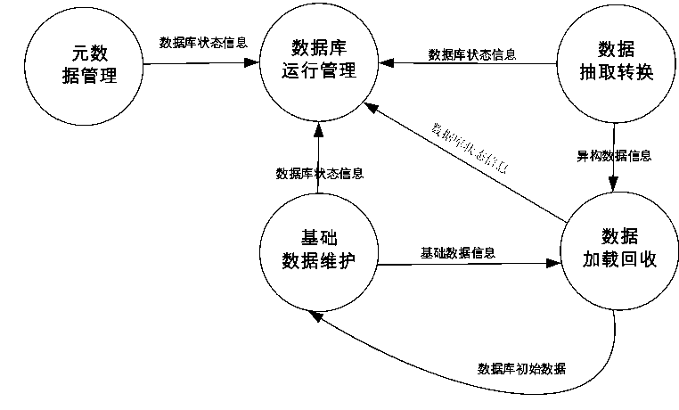
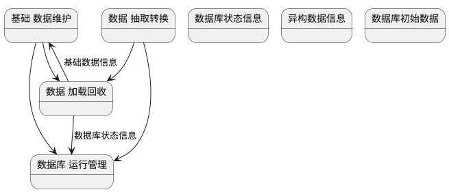
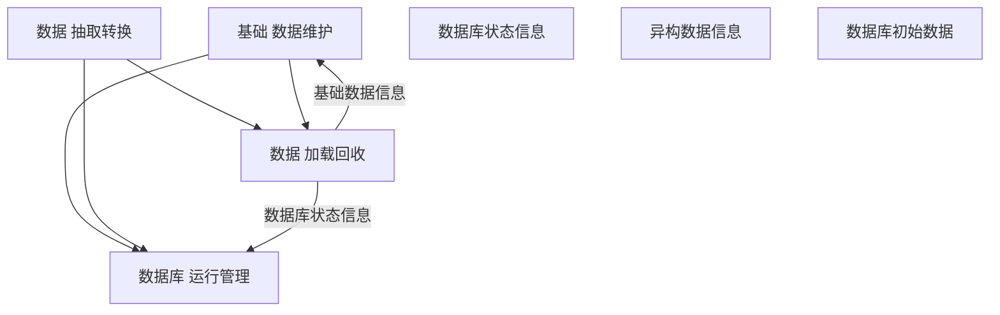

# 3_017 数据对档案

| 字段 | 值 |
|---|---|
| doc | 08数据运行维护管理工具软件需求规格说明-终稿 |
| section | 3.4.1 |
| image_caption | 图19数据运行维护管理工具内部接口需求 |
| table_caption | 表86 数据运行维护管理工具内部接口需求 |

## 原始图片


*图19数据运行维护管理工具内部接口需求*

## 结构图

*⚠ 结构经census重对齐: 旧锚点(oleObject2.bin:page1.xml)与图片不符, 已切换到与image.png内容一致的锚点(oleObject18.bin:page1.xml, align_score=0.417)*

*来源: born-digital导出(other, 12节点/6边)*
*类型经几何启发式精化(Master类型识别失败的图, 投影层推断, canonical锚点不变)*

*状态图以PlantUML渲染(UML母语): [*]=起止 | 圆角框=状态 | 箭头标签=迁移事件*



<details><summary>Mermaid兼容投影(通用md渲染器可显示)</summary>



</details>

<details><summary>DOT源码(完整语义, graphviz可渲染)</summary>

```dot
digraph G {
  rankdir=TB;
  node [fontname="Microsoft YaHei"];
  N4 [shape=box, label="数据库 运行管理"];
  N6 [shape=box, label="基础 数据维护"];
  N8 [shape=box, label="数据 加载回收"];
  N10 [shape=box, label="数据 抽取转换"];
  N28 [shape=box, label="数据库状态信息"];
  N37 [shape=box, label="异构数据信息"];
  N38 [shape=box, label="数据库初始数据"];
  N10 -> N8;
  N6 -> N4;
  N10 -> N4;
  N8 -> N4, label="数据库状态信息";
  N6 -> N8;
  N8 -> N6, label="基础数据信息";
}
```

</details>

### 锚点节点结构

| # | 文本 | 类型 |
|---|---|---|
| 1 |   | other |
| 2 | 元数
据管理 | other |
| 3 |   | other |
| 4 | 数据库
运行管理 | other |
| 5 |   | other |
| 6 | 基础
数据维护 | other |
| 7 |   | other |
| 8 | 数据
加载回收 | other |
| 9 |   | other |
| 10 | 数据
抽取转换 | other |
| 11 | 数据库状态信息 | other |
| 12 | 数据库状态信息 | other |
| 13 | 数据库状态信息 | other |
| 14 | 数据库状态信息 | other |
| 15 | 基础数据信息 | other |
| … | 共17个节点 | |

## 表格内容

| 序号 | 接口需求名称 | 接口需求标识 | 接口类型 | 发送方 | 接收方 | 接口内容 | 接口优先级 |
|---|---|---|---|---|---|---|---|
| 1 | 元数据管理与数据库运行管理接口 | PZXQ-NBJK-YSJGL-YXGL | API | 元数据管理 | 数据库运行管理 | 数据库状态信息 | 低 |
| 2 | 基础数据维护与数据库运行管理接口 | PZXQ-NBJK-JCSJWH-YXG | API | 基础数据维护 | 数据库运行管理 | 数据库状态信息 | 低 |
| 3 | 数据加载回收与数据库运行管理接口 | PZXQ-NBJK-SJJZHS-YXG | API | 数据加载回收 | 数据库运行管理 | 数据库状态信息 | 低 |
| 4 | 数据抽取转换与数据库运行管理接口 | PZXQ-NBJK-SJCQZH-YXG | API | 数据抽取转换 | 数据库运行管理 | 数据库状态信息 | 低 |
| 5 | 数据抽取转换与数据加载回收接口 | PZXQ-NBJK-SJCQZH-SJJ | API | 数据抽取转换 | 数据加载回收 | 异构数据 | 低 |
| 6 | 数据加载回收与基础数据维护接口 | PZXQ-NBJK-SJJZHS-JCS | API | 数据加载回收 | 基础数据维护 | 初始化系统数据 | 低 |
| 7 | 基础数据维护与数据加载回收接口 | PZXQ-NBJK-JCSJWH-SJJ | API | 基础数据维护 | 数据加载回收 | 基础数据 | 低 |

## 正文

数据运行维护管理工具内部接口需求表见表86所示。
