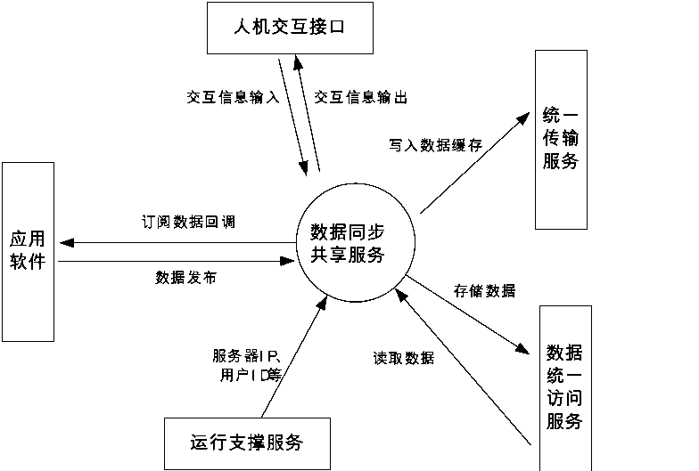
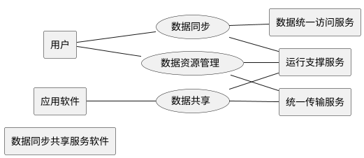
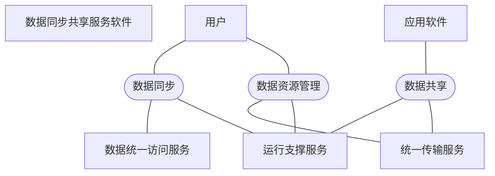
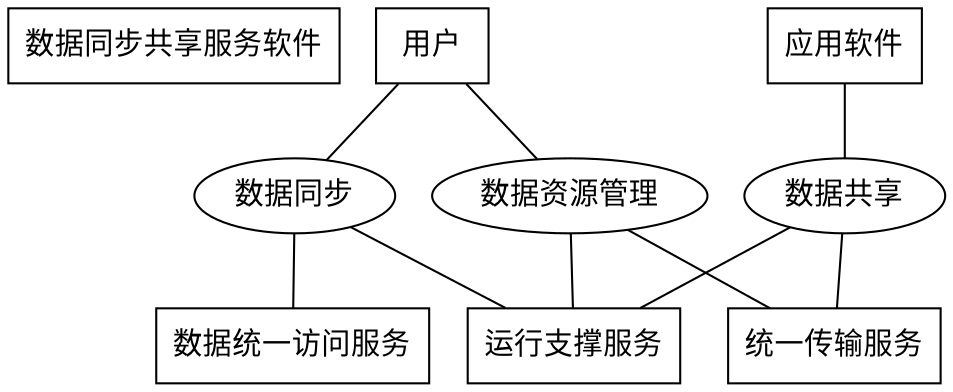

# 3_018 数据对档案

| 字段 | 值 |
|---|---|
| doc | 09数据同步共享服务软件需求规格说明-终稿 |
| section | 3.3.1 |
| image_caption | 图30 数据同步共享服务外部接口需求 |
| table_caption | 表41 数据同步共享服务外部接口需求 |

## 原始图片

*图30 数据同步共享服务外部接口需求*

## 结构图

*⚠ 结构经census重对齐: 旧锚点(oleObject8.bin:page1.xml)与图片不符, 已切换到与image.png内容一致的锚点(oleObject9.bin:page1.xml, align_score=0.556)*

*来源: born-digital导出(usecase, 9节点/9边)*
*类型经几何启发式精化(Master类型识别失败的图, 投影层推断, canonical锚点不变)*

*用例图以PlantUML渲染(UML母语): 小人=参与者 | 椭圆=用例 | 矩形框=系统边界 | 实线=关联 | 虚线=include/extend*

Mermaid兼容投影(通用md渲染器可显示)

DOT源码(完整语义, graphviz可渲染)

### 锚点节点结构

| # | 文本 | 类型 |
|---|---|---|
| 1 | 数据同步共享服务软件 | process |
| 2 | 数据同步 | usecase |
| 3 | 数据共享 | usecase |
| 4 | 数据资源管理 | usecase |
| 5 |   | other |
| 6 | 用户 | other |
| 7 |   | other |
| 8 | 数据统一访问服务 | other |
| 9 |   | other |
| 10 | 运行支撑服务 | other |
| 11 |   | other |
| 12 | 统一传输服务 | other |
| 13 |   | other |
| 14 | 应用软件 | other |

## 表格内容

| 序号 | 接口需求名称 | 接口需求标识 | 接口类型 | 发送方 | 接收方 | 接口内容 | 接口优先级 |
|---|---|---|---|---|---|---|---|
| 1 | 与应用软件接口 | PZXQ-WBJK-YYRJ | API接口 | 本软件 | 应用软件 | 提供数据发布 | 高 |
| 2 | 应用软件 | 本软件 | 订阅数据回调 | 高 |
| 3 | 与运行支撑服务接口 | PZXQW-WBJK-YXZCFW | API接口 | 运行支撑服务 | 本软件 | 向运行支撑服务获取数据库信息、主备服务器 | 低 |
| 4 | 人机交互接口 | PZXQ-WBJK-RJJH | 人机接口 | 界面集成框架 | 本软件 | 提供用户配置同步策略信息 | 低 |
| 5 | 与数据统一访问服务接口 | PZXQ-WBJK-SJTYFW | API接口 | 数据统一访问服务 | 本软件 | 向数据库中存储数据 | 高 |
| 6 | 本软件 | 数据统一访问服务 | 访问数据库中的数据 | 高 |
| 7 | 与统一传输服务接口 | PZXQ-WBJK-TYCSFW | API接口 | 本软件 | 统一传输服务 | 数据同步共享服务向统一传输服务中写入缓存 | 低 |

## 正文

数据同步共享服务接口包括与应用软件的发布订阅接口、人机交互接口、与数据统一访问服务访问接口和与运行支撑服务接口。数据同步共享服务外部接口需求表见表41所示。
