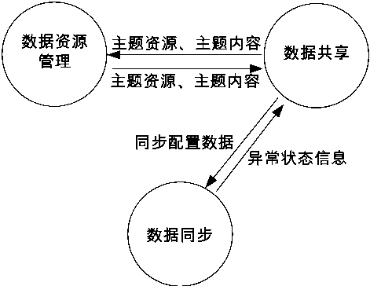
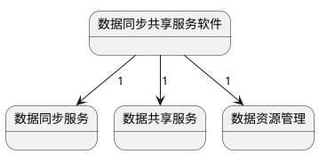
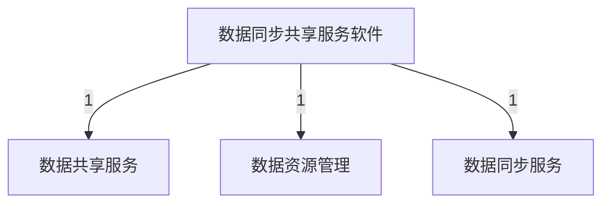

# 3_019 数据对档案

| 字段 | 值 |
|---|---|
| doc | 09数据同步共享服务软件需求规格说明-终稿 |
| section | 3.4.1 |
| image_caption | 图 31数据同步共享服务内部接口需求 |
| table_caption | 表49 数据同步共享服务内部接口需求 |

## 原始图片


*图 31数据同步共享服务内部接口需求*

## 结构图

*⚠ 结构经census重对齐: 旧锚点(oleObject31.bin:page1.xml)与图片不符, 已切换到与image.png内容一致的锚点(oleObject8.bin:page1.xml, align_score=0.75)*

*来源: born-digital导出(flowchart, 4节点/3边)*
*类型经几何启发式精化(Master类型识别失败的图, 投影层推断, canonical锚点不变)*

*状态图以PlantUML渲染(UML母语): [*]=起止 | 圆角框=状态 | 箭头标签=迁移事件*



<details><summary>Mermaid兼容投影(通用md渲染器可显示)</summary>



</details>

<details><summary>DOT源码(完整语义, graphviz可渲染)</summary>

```dot
digraph G {
  rankdir=TB;
  node [fontname="Microsoft YaHei"];
  N44 [shape=box, label="数据同步共享服务软件"];
  N47 [shape=box, label="数据同步服务"];
  N52 [shape=box, label="数据共享服务"];
  N67 [shape=box, label="数据资源管理"];
  N44 -> N52, label="1";
  N44 -> N67, label="1";
  N44 -> N47, label="1";
}
```

</details>

### 锚点节点结构

| # | 文本 | 类型 |
|---|---|---|
| 1 | 数据同步共享服务软件 | process |
| 2 | 数据同步服务 | process |
| 3 | 数据共享服务 | process |
| 4 | 数据资源管理 | process |

## 表格内容

| 序号 | 接口需求名称 | 接口需求标识 | 接口类型 | 发送方 | 接收方 | 接口内容 | 接口优先级 |
|---|---|---|---|---|---|---|---|
| 1 | 数据共享与数据资源管理接口 | PZXQ-NBJK-SJGX-SJZYG | API接口 | 数据共享 | 数据资源管理 | 主题资源及主题内容 | 低 |
| 2 | 数据资源管理 | 数据共享 | 主题资源及主题内容 |
| 3 | 数据同步与数据共享接口 | PZXQ-NBJK-SJTB-SJGX | API接口 | 数据同步 | 数据共享 | 异常状态信息 | 高 |
| 4 | 数据共享 | 数据同步 | 同步配置信息 |

## 正文

数据同步共享服务内部接口需求表见表49。
