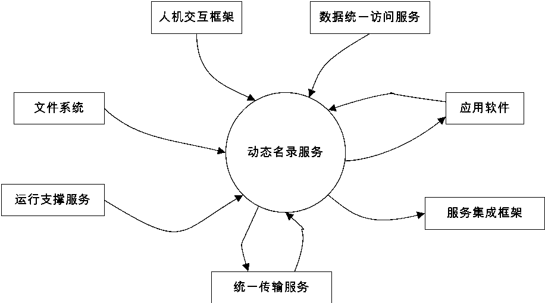
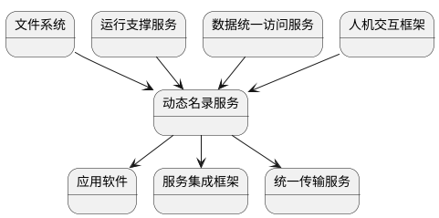
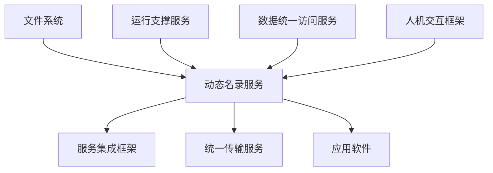
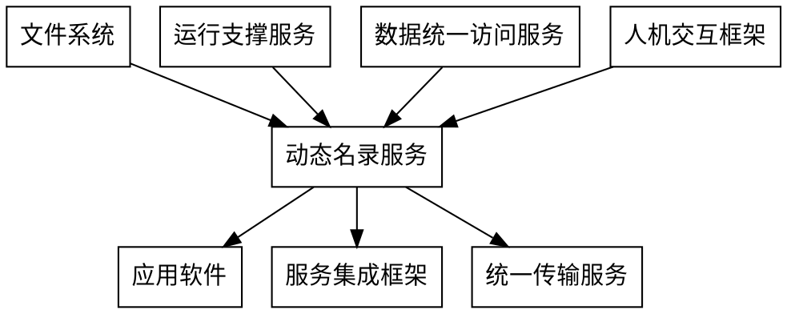

# 3_020 数据对档案

| 字段 | 值 |
|---|---|
| doc | 10动态名录软件需求规格说明-终稿 |
| section | 3.3.1 |
| image_caption | 图25 动态名录软件外部接口需求 |
| table_caption | 表69 动态名录软件外部接口需求 |

## 原始图片

*图25 动态名录软件外部接口需求*

## 结构图

*来源: born-digital导出(flowchart, 8节点/7边)*
*类型经几何启发式精化(Master类型识别失败的图, 投影层推断, canonical锚点不变)*

*状态图以PlantUML渲染(UML母语): [*]=起止 | 圆角框=状态 | 箭头标签=迁移事件*

Mermaid兼容投影(通用md渲染器可显示)

DOT源码(完整语义, graphviz可渲染)

*锚点Connect重建存在3个悬空连线端点, 已几何恢复1条边(连线自由端吸附最近语义节点, 每条带距离证据, via=dangling_snap; canonical锚点不变)*

### 锚点节点结构

| # | 文本 | 类型 |
|---|---|---|
| 1 | 动态名录服务 | process |
| 2 | 文件系统 | process |
| 3 | 运行支撑服务 | process |
| 4 | 应用软件 | process |
| 5 | 服务集成框架 | process |
| 6 | 数据统一访问服务 | process |
| 7 | 统一传输服务 | process |
| 8 | 人机交互框架 | process |

## 表格内容

| 序号 | 接口需求名称 | 接口需求标识 | 接口类型 | 发送方 | 接收方 | 接口内容 | 接口优先级 |
|---|---|---|---|---|---|---|---|
|   | 与运行支撑服务接口 | PZXQ-WBJK-YXZCFWJK | API接口 | 本系统 | 运行支撑服务 | 本机IP、服务器IP信息、日志信息 | 中 |
|   | 与文件系统接口 | PZXQ-WBJK-WJJK | 文件接口 | 文件系统 | 本系统 | 名录文件、编组文件、网络规划文件 | 中 |
|   | 与应用软件接口 | PZXQ-WBJK-YYCXJK | API接口/RestFul接口 | 应用软件 | 本系统 | 查询请求 | 中 |
| 本系统 | 应用软件 | 查询结果 | 中 |
|   | 与人机交互框架接口 | PZXQ-WBJK-RJJHJKJK | API接口 | 人机交互框架 | 本系统 | 节点信息、编组信息 | 中 |
|   | 与服务集成框架接口 | PZXQ-WBJK-FWJCKJJK | API接口 | 本系统 | 服务集成框架 | 动态名录软件运行状态 | 低 |
|   | 与统一传输服务接口 | PZXQ-WBJK-TYCSFWJK | API接口 | 本系统 | 统一传输服务 | 名录同步信息（用户状态信息、用户装备映射 | 低 |
|   | 与数据统一访问服务 | PZXQ-WBJK-SJTYFWJK | API接口 | 本系统 | 数据统一服访问服务 | 系统基础信息、名录结构信息 | 中 |

## 正文

动态名录软件外部接口包括：与文件系统接口、与应用软件接口、与运维管理框架接口、与服务集成框架接口。
