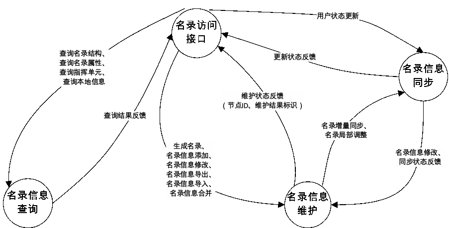
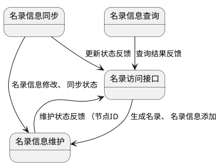
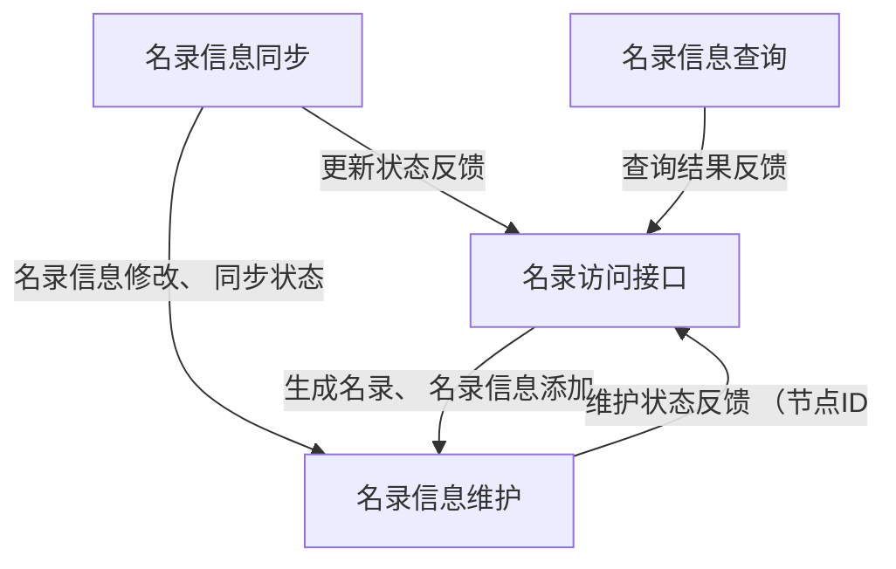

# 3_021 数据对档案

| 字段 | 值 |
|---|---|
| doc | 10动态名录软件需求规格说明-终稿 |
| section | 3.4.1 |
| image_caption | 图 26 动态名录内部接口图 |
| table_caption | 表 77 动态名录内部接口需求 |

## 原始图片


*图 26 动态名录内部接口图*

## 结构图

*⚠ 结构经census重对齐: 旧锚点(oleObject3.bin:page1.xml)与图片不符, 已切换到与image.png内容一致的锚点(oleObject26.bin:page1.xml, align_score=1.0)*

*来源: born-digital导出(flowchart, 4节点/5边)*
*类型经几何启发式精化(Master类型识别失败的图, 投影层推断, canonical锚点不变)*

*状态图以PlantUML渲染(UML母语): [*]=起止 | 圆角框=状态 | 箭头标签=迁移事件*



<details><summary>Mermaid兼容投影(通用md渲染器可显示)</summary>



</details>

<details><summary>DOT源码(完整语义, graphviz可渲染)</summary>

```dot
digraph G {
  rankdir=TB;
  node [fontname="Microsoft YaHei"];
  N28 [shape=box, label="名录访问接口"];
  N29 [shape=box, label="名录信息查询"];
  N30 [shape=box, label="名录信息维护"];
  N31 [shape=box, label="名录信息同步"];
  N31 -> N30, label="名录信息修改、 同步状态";
  N31 -> N28, label="更新状态反馈";
  N28 -> N30, label="生成名录、 名录信息添加";
  N29 -> N28, label="查询结果反馈";
  N30 -> N28, label="维护状态反馈 （节点ID";
}
```

</details>

*⚠ 锚点Connect重建存在1个悬空连线端点(线端粘在无文本形状上被语义过滤跳过), 图示边数可能少于原图——渲染只呈现锚点事实, 不编造边; 独立证据可对照VLM通道提取(scene_vlm_extractions.json)*

### 锚点节点结构

| # | 文本 | 类型 |
|---|---|---|
| 1 | 名录访问接口 | process |
| 2 | 名录信息查询 | process |
| 3 | 名录信息维护 | process |
| 4 | 名录信息同步 | process |

## 表格内容

| 序号 | 接口需求名称 | 接口需求标识 | 接口类型 | 发送方 | 接收方 | 接口内容 | 接口优先级 |
|---|---|---|---|---|---|---|---|
| 1 | 名录信息维护 | PZXQ-NBJK-MLXXWH | API接口 | 名录访问接口 | 名录信息维护 | 文件路径、属性标识、属性值、查询类型 | 中 |
| 名录信息同步 | 名录信息维护 | 节点ID、属性标识、属性值、用户ID、用 | 中 |
| 2 | 名录信息查询 | PZXQ-NBJK-MLXXCX | API接口 | 名录查询模块 | 名录访问接口 | 反馈查询结果（节点ID、属性标识、属性值 | 中 |
| 3 | 名录信息同步 | PZXQ-NBJK-MLXXTB | API接口 | 名录访问接口 | 名录信息同步 | 用户ID、用户在线状态 | 中 |
| 名录信息维护 | 名录信息同步 | 节点ID、节点属性、节点属性值 | 低 |
| 4 | 名录访问接口 | PZXQ-NBJK-MLFWJK | API接口/Restful接口 | 名录信息查询 | 名录访问接口 | 查询结果反馈（节点ID、属性标识、属性值 | 中 |
| 名录信息同步 | 名录访问接口 | 更新状态反馈（用户ID、状态更改结果标识 | 中 |
| 名录信息维护 | 名录访问接口 | 维护结果反馈（节点ID、维护标识、维护结 | 中 |

## 正文

动态名录软件内部接口图如图 26所示。
