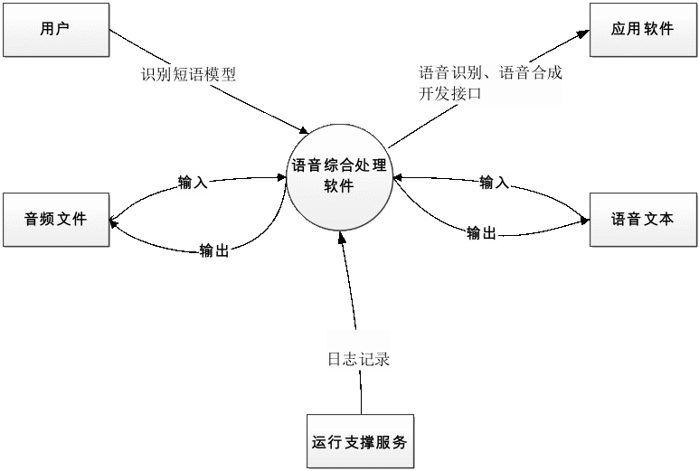
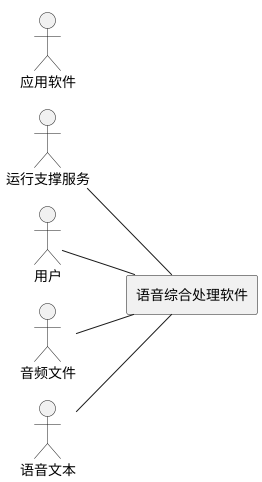
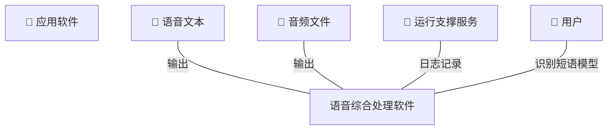

# 3_022 数据对档案

| 字段 | 值 |
|---|---|
| doc | 11语音综合处理软件需求规格说明-终稿 |
| section | 3.3 |
| image_caption | 图18 语音综合处理软件外部接口需求图 |
| table_caption | 表15 语音综合处理软件外部接口需求 |

## 原始图片

*图18 语音综合处理软件外部接口需求图*

## 结构图

*⚠ 结构经census重对齐: 旧锚点(oleObject3.bin:page1.xml)与图片不符, 已切换到与image.png内容一致的锚点(oleObject18.bin:page1.xml, align_score=0.857)*

*来源: born-digital导出(usecase, 6节点/4边)*
*类型经几何启发式精化(Master类型识别失败的图, 投影层推断, canonical锚点不变)*

*用例图以PlantUML渲染(UML母语): 小人=参与者 | 椭圆=用例 | 矩形框=系统边界 | 实线=关联 | 虚线=include/extend*

Mermaid兼容投影(通用md渲染器可显示)

DOT源码(完整语义, graphviz可渲染)

### 锚点节点结构

| # | 文本 | 类型 |
|---|---|---|
| 1 | 语音综合处理软件 | process |
| 2 | 应用软件 | actor |
| 3 | 运行支撑服务 | actor |
| 4 | 用户 | actor |
| 5 | 音频文件 | actor |
| 6 | 语音文本 | actor |

## 表格内容

| 序号 | 接口需求名称 | 接口需求标识 | 接口类型 | 发送方 | 接收方 | 接口内容 | 接口 优先级 |
|---|---|---|---|---|---|---|---|
| 1 | 与用户的接口 | PZXQ-WBJK-YYZHCL-RJJ | 人机接口 | 用户 | 本软件 | 语音录入、文本输入、语音播放 | 中 |
| 本软件 | 用户 |
| 2 | 与应用软件的接口 | PZXQ-WBJK-YYZHCL-YYR | API接口 | 本软件 | 语音应用软件 | 语音识别、语音合成二次开发接口 | 中 |
| 3 | 与运行支撑服务的接口 | PZXQ-WBJK-YYZHCL-YXZ | Restful接口 | 运行支撑服务 | 本软件 | 日志记录 | 中 |
| 4 | 与文件的接口 | PZXQ-WBJK-YYZHCL-WJJ | 文件接口 | 本软件 | 音频文件 | 音频文件 | 中 |
| 音频文件 | 本软件 |
| 5 | 与文本的接口 | PZXQ-WBJK-YYZHCL-WBJ | 文件接口 | 本软件 | 文本文件 | 文本 | 中 |
| 文本文件 | 本软件 |

## 正文

语音合成的主要功能包括：格式化文本语音合成、音频文件生成和存储、语音播报、语音设置，功能用例如图4所示。
