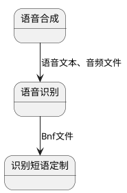
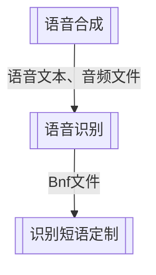

# 3_023 数据对档案

| 字段 | 值 |
|---|---|
| doc | 11语音综合处理软件需求规格说明-终稿 |
| section | 3.4.1 |
| image_caption | 图19 语音综合处理软件内部接口图 |
| table_caption | 表21 语音综合处理软件内部接口需求 |

## 原始图片


*图19 语音综合处理软件内部接口图*

## 结构图

*⚠ 结构经census重对齐: 旧锚点(oleObject15.bin:page1.xml)与图片不符, 已切换到与image.png内容一致的锚点(oleObject19.bin:page1.xml, align_score=1.0)*

*来源: born-digital导出(other, 3节点/2边)*
*类型经几何启发式精化(Master类型识别失败的图, 投影层推断, canonical锚点不变)*

*状态图以PlantUML渲染(UML母语): [*]=起止 | 圆角框=状态 | 箭头标签=迁移事件*



<details><summary>Mermaid兼容投影(通用md渲染器可显示)</summary>



</details>

<details><summary>DOT源码(完整语义, graphviz可渲染)</summary>

```dot
digraph G {
  rankdir=TB;
  node [fontname="Microsoft YaHei"];
  N44 [shape=box, label="语音识别"];
  N45 [shape=box, label="识别短语定制"];
  N47 [shape=box, label="语音合成"];
  N47 -> N44, label="语音文本、音频文件";
  N44 -> N45, label="Bnf文件";
}
```

</details>

*⚠ 锚点Connect重建存在1个悬空连线端点(线端粘在无文本形状上被语义过滤跳过), 图示边数可能少于原图——渲染只呈现锚点事实, 不编造边; 独立证据可对照VLM通道提取(scene_vlm_extractions.json)*

### 锚点节点结构

| # | 文本 | 类型 |
|---|---|---|
| 1 | 语音识别 | offpage |
| 2 | 识别短语定制 | offpage |
| 3 | 语音合成 | offpage |

## 表格内容

| 序号 | 接口需求名称 | 接口需求标识 | 接口类型 | 发送方 | 接收方 | 接口内容 | 接口优先级 |
|---|---|---|---|---|---|---|---|
| 1 | 语音识别与识别短语定制的接口 | PZXQ-YYSB-DYDZ | 文件 | 识别短语定制 | 语音识别 | 识别短语生成的Bnf文件 | 高 |
| 2 | 语音识别与语音合成的接口 | PZXQ-YYSB-YYHC | 文件 | 语音合成 | 语音识别 | 音频文件 | 中 |
| 语音识别 | 语音合成 | 语音文本 | 中 |

## 正文

语音综合处理软件的内部就接口主要应用于语音识别、识别短语定制等功能，语音综合处理软件的内部接口如图19所示：
