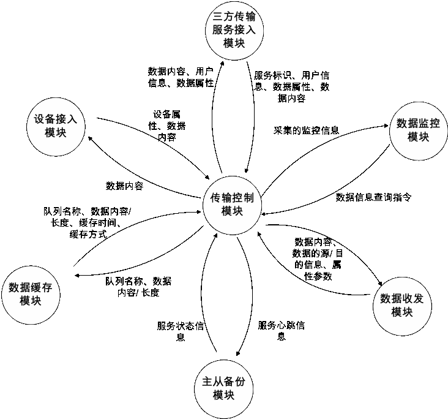
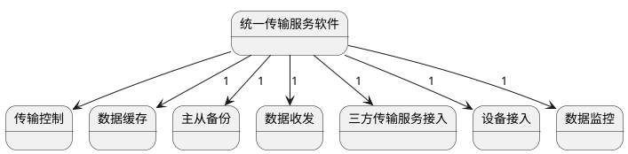
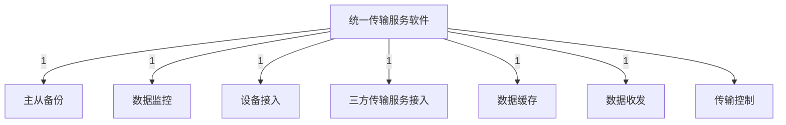

# 3_024 数据对档案

| 字段 | 值 |
|---|---|
| doc | 13统一传输服务软件需求规格说明-终端 |
| section | 3.4.1 |
| image_caption | 图11 统一传输服务软件内部接口需求 |
| table_caption | 表34 统一传输服务软件内部接口需求 |

## 原始图片


*图11 统一传输服务软件内部接口需求*

## 结构图

*来源: born-digital导出(flowchart, 8节点/7边)*
*类型经几何启发式精化(Master类型识别失败的图, 投影层推断, canonical锚点不变)*

*状态图以PlantUML渲染(UML母语): [*]=起止 | 圆角框=状态 | 箭头标签=迁移事件*



<details><summary>Mermaid兼容投影(通用md渲染器可显示)</summary>



</details>

<details><summary>DOT源码(完整语义, graphviz可渲染)</summary>

```dot
digraph G {
  rankdir=TB;
  node [fontname="Microsoft YaHei"];
  N1 [shape=box, label="统一传输服务软件"];
  N4 [shape=box, label="传输控制"];
  N9 [shape=box, label="数据缓存"];
  N14 [shape=box, label="主从备份"];
  N34 [shape=box, label="数据收发"];
  N39 [shape=box, label="三方传输服务接入"];
  N44 [shape=box, label="设备接入"];
  N49 [shape=box, label="数据监控"];
  N1 -> N14, label="1";
  N1 -> N49, label="1";
  N1 -> N44, label="1";
  N1 -> N39, label="1";
  N1 -> N9, label="1";
  N1 -> N34, label="1";
  N1 -> N4;
}
```

</details>

*锚点Connect重建存在1个悬空连线端点, 已几何恢复1条边(连线自由端吸附最近语义节点, 每条带距离证据, via=dangling_snap; canonical锚点不变)*

### 锚点节点结构

| # | 文本 | 类型 |
|---|---|---|
| 1 | 统一传输服务软件 | process |
| 2 | 传输控制 | process |
| 3 | 数据缓存 | process |
| 4 | 主从备份 | process |
| 5 | 数据收发 | process |
| 6 | 三方传输服务接入 | process |
| 7 | 设备接入 | process |
| 8 | 数据监控 | process |

## 表格内容

| 序号 | 接口需求名称 | 接口需求标识 | 接口类型 | 发送方 | 接收方 | 接口内容 | 接口优先级 |
|---|---|---|---|---|---|---|---|
|   | 传输控制模块与数据收发模块接口 | PZXQ-NBJK-TYCSFW-CKS | API接口 | 传输控制模块 | 数据收发模块 | 数据内容、数据的源/目的信息、属性参数 | 高 |
| 数据收发模块 | 传输控制模块 | 数据内容、数据的源/目的信息、属性参数 | 高 |
|   | 传输控制模块与数据缓存模块接口 | PZXQ-NBJK-TYCSFW-CKS | API接口 | 传输控制模块 | 数据缓存模块 | 数据内容、数据长度 | 中 |
| 数据缓存模块 | 传输控制模块 | 数据内容、数据长度、缓存时间、 缓存方式 | 中 |
|   | 传输控制模块与设备接入模块接口 | PZXQ-NBJK-TYCSFW-CKS | API接口 | 传输控制模块 | 设备接入模块 | 数据内容 | 低 |
| 设备接入模块 | 传输控制模块 | 设备属性、数据内容 | 低 |
|   | 传输控制模块与与主从备份模块接口 | PZXQ-NBJK-TYCSFW-CKZ | API接口 | 传输控制模块 | 主从备份模块 | 服务状态信息 | 中 |
| 主从备份模块 | 传输控制模块 | 服务心跳信息 | 中 |
|   | 传输控制模块与三方传输服务接入模块接口 | PZXQ-NBJK-TYCSFW-CKS | API接口 | 传输控制模块 | 三方传输服务接入模块 | 数据内容、用户信息、数据属性信息 | 中 |
| 三方传输服务接入模块 | 传输控制模块 | 服务标识、用户信息、数据属性信息、数据内 | 中 |
|   | 传输控制模块与数据监控模块接口 | PZXQ-NBJK-TYCSFW-CKS | API接口 | 传输控制模块 | 数据监控模块 | 采集的监控信息 | 低 |
| 数据监控模块 | 传输控制模块 | 数据信息查询指令 | 低 |

## 正文

统一传输服务软件内部接口需求表见表34。
