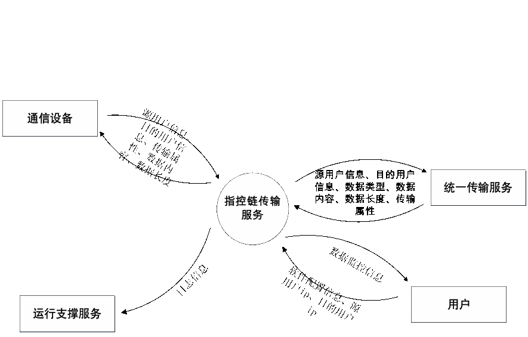
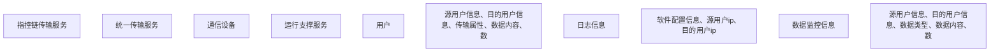

# 3_025 数据对档案

| 字段 | 值 |
|---|---|
| doc | 14传输服务软件需求规格说明-终稿 |
| section | 3.3.1 |
| image_caption | 图9 传输服务软件外部接口需求 |
| table_caption | 表27 传输服务软件外部接口需求 |

## 原始图片

*图9 传输服务软件外部接口需求*

## 结构图

*⚠ 结构经census重对齐: 旧锚点(oleObject8.bin:page1.xml)与图片不符, 已切换到与image.png内容一致的锚点(oleObject9.bin:page1.xml, align_score=0.5)*

*来源: born-digital导出(flowchart, 10节点/0边)*
*类型经几何启发式精化(Master类型识别失败的图, 投影层推断, canonical锚点不变)*

*状态图以PlantUML渲染(UML母语): [*]=起止 | 圆角框=状态 | 箭头标签=迁移事件*

Mermaid兼容投影(通用md渲染器可显示)

DOT源码(完整语义, graphviz可渲染)

```dot
digraph G {
  rankdir=TB;
  node [fontname="Microsoft YaHei"];
  N498 [shape=box, label="指控链传输服务"];
  N499 [shape=box, label="统一传输服务"];
  N501 [shape=box, label="通信设备"];
  N502 [shape=box, label="运行支撑服务"];
  N503 [shape=box, label="用户"];
  N512 [shape=box, label="源用户信息、目的用户信息、传输属性、数据内容、数"];
  N513 [shape=box, label="日志信息"];
  N514 [shape=box, label="软件配置信息、源用户ip、目的用户ip"];
  N515 [shape=box, label="数据监控信息"];
  N522 [shape=box, label="源用户信息、目的用户信息、数据类型、数据内容、数"];
}
```

### 锚点节点结构

| # | 文本 | 类型 |
|---|---|---|
| 1 | 指控链传输服务 | process |
| 2 | 统一传输服务 | process |
| 3 | 通信设备 | process |
| 4 | 运行支撑服务 | process |
| 5 | 用户 | process |
| 6 | 源用户信息、目的用户信息、传输属性、数据内容、数 | other |
| 7 | 日志信息 | other |
| 8 | 软件配置信息、源用户ip、目的用户ip | other |
| 9 | 数据监控信息 | other |
| 10 | 源用户信息、目的用户信息、数据类型、数据内容、数 | other |

## 表格内容

| 序号 | 接口需求名称 | 接口需求标识 | 接口类型 | 发送方 | 接收方 | 接口内容 | 接口优先级 |
|---|---|---|---|---|---|---|---|
| 1 | 传输服务软件与应用软件之间接口 | PZXQ-WBJK-ZKLCSFW-YY | API接口 | 本系统 | 应用软件 | 源端信息、目的信息、数据类型、数据内容、 | 高 |
| 应用软件 | 本系统 | 源端信息、目的信息、数据类型、数据内容、 | 高 |
| 2 | 传输服务软件与统一传输服务之间接口 | PZXQ-WBJK-ZKLCSFW-TY | API接口 | 本系统 | 统一传输服务 | 源端信息、目的信息、数据类型、数据内容、 | 高 |
| 统一传输服务 | 本系统 | 源端信息、目的信息、数据类型、数据内容、 | 高 |
| 3 | 传输服务软件与通信设备之间接口 | PZXQ-WBJK-ZKLCSFW-TX | 硬件接口 | 本系统 | 通信设备 | 数据内容、传输协议头信息 | 中 |
| 通信设备 | 本系统 | 数据内容、传输协议头信息 | 中 |
| 4 | 传输服务软件与运行支撑服务之间接口 | PZXQ-WBJK-ZKLCSFW-YX | API接口 | 本系统 | 运行支撑服务 | 日志信息 | 中 |
| 运行支撑服务 | 本系统 | 系统配置信息 | 中 |
| 5 | 人机交互接口 | PZXQ-WBJK-ZKLCSFW-RJ | 人机接口 | 本系统 | 用户 | 数据监控信息、服务状态信息 | 低 |
| 用户 | 本系统 | 参数设置操作、状态查询操作 | 低 |

## 正文

传输服务软件外部接口包括：与统一传输接口、与通信设备接口、与运行支撑服务接口、与应用软件接口、人机交互接口。
