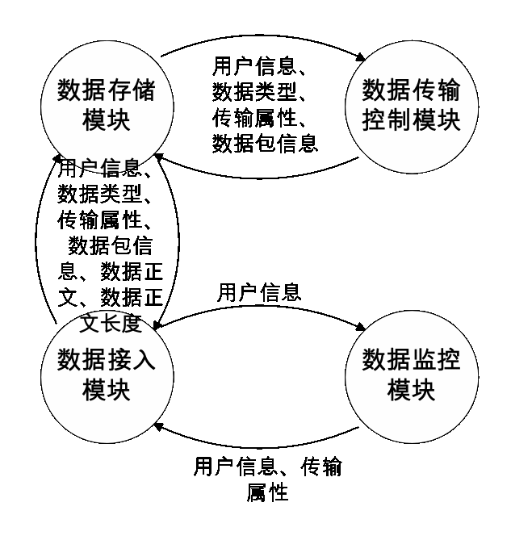

# 3_026 数据对档案

| 字段 | 值 |
|---|---|
| doc | 14传输服务软件需求规格说明-终稿 |
| section | 3.4.1 |
| image_caption | 图10 传输服务软件内部接口需求 |
| table_caption | 表32 传输服务软件内部接口需求 |

## 原始图片

*图10 传输服务软件内部接口需求*

## 结构图

*该对无Visio锚点(非Visio图, 无born-digital导出)*

## 表格内容

| 序号 | 接口需求名称 | 接口需求标识 | 接口类型 | 发送方 | 接收方 | 接口内容 | 接口优先级 |
|---|---|---|---|---|---|---|---|
| 1 | 编解码业务报头接口 | PZXQ-NBJK-ZKLCSFW-BJ | API接口 | 数据存储模块 | 数据接入模块 | 用户信息、数据类型、传输属性 | 高 |
| 2 | 监控接口 | PZXQ-NBJK-ZKLCSFW-JK | API接口 | 数据接入模块 | 数据监控模块 | 用户信息、传输属性 | 中 |
| 3 | 编解码协议头接口 | PZXQ-NBJK-ZKLCSFW-BJ | API接口 | 数据存储模块 | 与某平台互通模块 | 用户信息、传输属性 | 高 |
| 4 | 校验数据包接口 | PZXQ-NBJK-ZKLCSFW-JY | API接口 | 与某平台互通模块 | 数据存储模块 | 传输属性 | 高 |
| 5 | 判定长数据包接收完全接口 | PZXQ-NBJK-ZKLCSFW-PD | API接口 | 数据接入、与某平台互通 | 数据存储模块 | 数据包信息 | 中 |
| 6 | 重传检测接口 | PZXQ-NBJK-ZKLCSFW-CC | API接口 | 数据存储模块 | 数据接入、与某平台互通 | 数据包信息 | 中 |
| 7 | 数据放置发送队列接口 | PZXQ-NBJK-ZKLCSFW-FZ | API接口 | 数据传输控制、与某平台互通模块、数据接入 | 数据存储模块 | 用户信息、数据类型、传输属性、数据正文、 | 中 |
| 8 | 发送数据接口 | PZXQ-NBJK-ZKLCSFW-FS | API接口 | 数据存储模块 | 数据传输控制、与某平台互通模块、数据接入 | 用户信息、数据类型、传输属性、数据正文、 | 高 |

## 正文

传输服务软件内部接口包括：编解码业务报头接口、监控接口、编解码协议头接口、编解码传控协议头接口、校验数据包接口、判定长数据包接收完全接口、重传检测接口、数据放置发送队列接口、发送数据接口。
