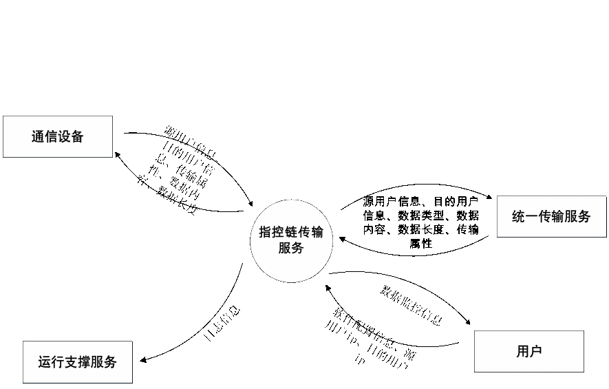
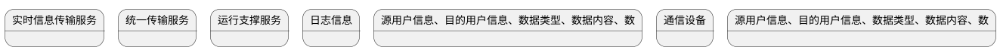
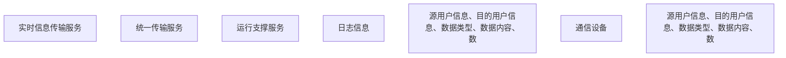

# 3_027 数据对档案

| 字段 | 值 |
|---|---|
| doc | 15实时信息传输服务软件需求规格说明-终稿 |
| section | 3.3.1 |
| image_caption | 图10实时信息传输服务软件接口需求 |
| table_caption | 表17实时信息传输服务软件外部接口需求 |

## 原始图片

*图10实时信息传输服务软件接口需求*

## 结构图

*来源: born-digital导出(flowchart, 7节点/0边)*
*类型经几何启发式精化(Master类型识别失败的图, 投影层推断, canonical锚点不变)*

*状态图以PlantUML渲染(UML母语): [*]=起止 | 圆角框=状态 | 箭头标签=迁移事件*

Mermaid兼容投影(通用md渲染器可显示)

DOT源码(完整语义, graphviz可渲染)

```dot
digraph G {
  rankdir=TB;
  node [fontname="Microsoft YaHei"];
  N4701 [shape=box, label="实时信息传输服务"];
  N4702 [shape=box, label="统一传输服务"];
  N4703 [shape=box, label="运行支撑服务"];
  N4707 [shape=box, label="日志信息"];
  N4708 [shape=box, label="源用户信息、目的用户信息、数据类型、数据内容、数"];
  N4709 [shape=box, label="通信设备"];
  N4712 [shape=box, label="源用户信息、目的用户信息、数据类型、数据内容、数"];
}
```

### 锚点节点结构

| # | 文本 | 类型 |
|---|---|---|
| 1 | 实时信息传输服务 | process |
| 2 | 统一传输服务 | process |
| 3 | 运行支撑服务 | process |
| 4 | 日志信息 | other |
| 5 | 源用户信息、目的用户信息、数据类型、数据内容、数 | other |
| 6 | 通信设备 | process |
| 7 | 源用户信息、目的用户信息、数据类型、数据内容、数 | other |

## 表格内容

| 序号 | 接口需求名称 | 接口需求标识 | 接口类型 | 发送方 | 接收方 | 接口内容 | 接口优先级 |
|---|---|---|---|---|---|---|---|
| 1 | 与统一传输服务之间接口 | PZXQ-WBJK-SSXXCSFW-T | API接口 | 本系统 | 统一传输服务 | 源端信息、目的信息、数据类型、数据内容、 | 高 |
| 统一传输服务 | 本系统 | 源端信息、目的信息、数据类型、数据内容、 | 高 |
| 2 | 与运行支撑服务之间接口 | PZXQ-WBJK-SSXXCSFW-Y | API接口 | 本系统 | 运行支撑服务 | 日志信息 | 中 |
| 3 | 与通信设备之间接口 | PZXQ-WBJK-SSXXCSFW-T | API接口 | 本系统 | 通信设备 | 源端信息、目的信息、数据类型、数据内容、 | 中 |
| 通信设备 | 本系统 | 源端信息、目的信息、数据类型、数据内容、 | 中 |

## 正文

实时信息传输服务软件外部接口包括：与统一传输接口、与运行支撑服务接口、与通信设备接口。
